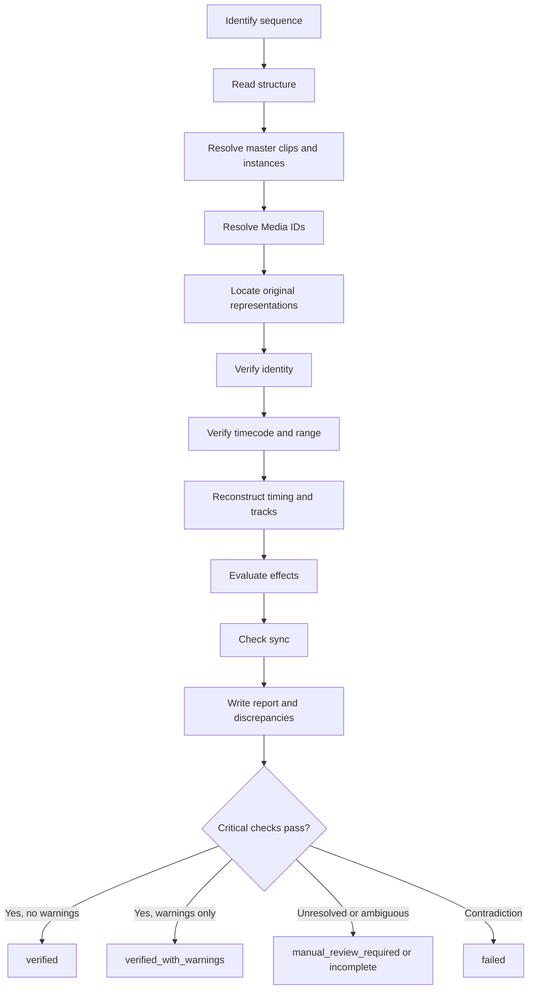

# AETHER online conform architecture

Status: proposal for review. Specification only. No conform was run. No sequence was exported. Illustrative timecodes are not measurements.

## Verified facts

- The editorial model stores sequence position and source position as separate integers in stated rational timebases (`docs/TIMELINE_ENGINE_ARCHITECTURE.md`).
- Exchange adapters return documents and loss reports. They do not become the live project (`docs/INTERCHANGE_ADAPTER_ARCHITECTURE.md`).
- A prior FFmpeg 9.0.2 study is a reconcile list for essence limits. It is not a conform result. Details are in `docs/NATIVE_MEDIA_ARCHITECTURE.md`.
- No online session against original camera media was executed for this document.

## Engineering recommendations

- Define conform as a read of the editorial model plus identity checks against original representations. Keep preview files out of the decision.
- Emit one report with an explicit state. A missing report is a failure to conform, not a silent success.
- Keep relink’s “file found” result as an input at most. Require the conform checks before a sequence state may be `verified`.

## Proposed behaviour

### Scope

Online conform proves that a sequence’s instances, source ranges, timing, tracks, speed maps, and supported effects still describe the original camera media identified at ingest. It is a project operation with a durable report. It is not an export preset and not a relink button.

In scope: sequence identification, object resolution, Media ID resolution, original location, identity, timecode and range, timing reconstruction, track reconstruction, effect support, sync, discrepancy list, and approval policy.

Out of scope: changing the cut to make a check pass; decoding pictures to invent a match; treating a proxy path as the camera original; claiming a foreign application agreed.

### Requirements

- Inputs available to the engine, per instance: sequence id, instance id, media id, timecode, source in, source out, duration, speed map, track, audio map, timebase, and effects.
- The engine reads those inputs from the editorial model and the registry. A caller may pass ids. A caller may not pass a substitute file path that bypasses the registry.
- Steps, in order: identify the sequence; read its structure; resolve editorial objects; resolve Media IDs; locate original representations; verify identity; verify timecode and source range; reconstruct timing and tracks; evaluate supported effects; check sync; write the report; list discrepancies; approve only when every critical check passes.
- Compared fields: sequence duration, rate, track count and order, clip count and identity, Media ID, source in and out, record positions, instance durations, speed maps, transitions, sync, source mapping, missing media, missing effects, unsupported effects, unintended gaps, and unintended overlaps.
- States are `verified`, `verified_with_warnings`, `incomplete`, `failed`, and `manual_review_required`. Definitions and the report schema are in `CONFORM_VALIDATION_AND_REPORTING.md`.
- Critical checks include identity of each instance’s Media ID, source range, record position, speed map, and the presence of a validated original when the conform target is camera original. Any unresolved critical item yields `incomplete`, `failed`, or `manual_review_required`. It never yields `verified`.
- Export success is recorded, when an export exists, as an export event. It is not one of the conform states.
- Relink success updates locations. It is not one of the conform states.
- Integrity rules 1–12 in `OFFLINE_EDITING_ARCHITECTURE.md` apply. Rules 1, 8, 9, and 11 are the ones this operation exists to enforce.

### Data model

Conform does not invent a second sequence. It reads:

| Record | Source |
| --- | --- |
| Sequence, tracks, instances, transitions, effects | Editorial model |
| Master clip and subclip | Bin / editorial object |
| `media_id` and original representation | Registry |
| Match class and validation | Registry decision rows |
| Speed map | Instance (`SEQUENCE_SOURCE_MAPPING.md`) |

The operation writes a conform run and a report. The run stores sequence id, revision, policy, state, and the report hash. It does not write instance in or out points.

### APIs

Conceptual operations. No library is implied.

| Operation | Input | Output |
| --- | --- | --- |
| `Conform.inspect(sequence_id)` | Sequence id | Revision, instance count, unresolved Media IDs, no mutation |
| `Conform.run(sequence_id, policy)` | Sequence id, policy id | Conform run id, state, report |
| `Conform.read(run_id)` | Run id | Report document |
| `Relink.commit` result | Decision rows | Usable only as location evidence. Ignored as a verdict. |
| `Export.write` result | Export event | Usable only as a packaging note. Ignored as a verdict. |

`policy` names the target representation role (`original` for online), the required match class (`exact`, or a list of decision ids a person has validated), and whether warnings may still yield `verified_with_warnings`.

The engine is callable without a widget, same as relink.

### Workflow

1. The user requests online conform of a named sequence and revision.
2. The application snapshots the editorial structure by revision so a later edit does not change the run underneath the report.
3. The engine performs the steps above.
4. The UI presents the state, the discrepancies, and the HTML report. The user approves a delivery only from a state the policy allows.
5. A subsequent edit creates a new revision. The old run stays attached to the old revision.

### Validation

Identity validation uses `MEDIA_FINGERPRINTING_AND_MATCHING.md`. Range validation uses `SOURCE_TIMECODE_AND_FRAME_ACCURACY.md`. Effect validation uses the preservation states already defined for AVX: native editable, mapped equivalent, metadata only, rendered fallback with the definition retained, and unsupported explicitly reported. Unsupported is a discrepancy. It is not a deletion.

Sync validation compares picture frame positions with integer audio samples through the rational map. A `sync_warning` already stored on the media, including a warning motivated by the unreconciled 29.97 sample-count note, blocks `verified`.

### Errors

| Error | State | Relationship |
| --- | --- | --- |
| Sequence id unknown | `failed` | Unchanged |
| Instance has no master clip | `failed` | Unchanged |
| Media ID missing | `incomplete` | Unchanged |
| Original offline | `incomplete` | Unchanged |
| Match ambiguous | `manual_review_required` | Unchanged |
| Checksum mismatch on the located file | `failed` | Previous location kept |
| Source range does not fit the original duration | `failed` | Instance unchanged |
| Speed map missing and duration alone was supplied by a caller | `failed` | The engine refuses the call |
| Effect unsupported | Not `verified` | Effect definition kept |
| Report write fails | `failed` | No approval bit set |

### Recovery

A crashed run leaves the sequence untouched. A partial report is stored as `failed` with reason `report_incomplete`, or is absent. Absence is not success. The user re-runs conform. Rollback of a conform run never rewrites timeline instances, because conform does not edit them.

### Performance

No measurement was taken. Conform walks instance records and registry rows. It does not decode a frame to decide identity. Optional fingerprint jobs are match operations, scheduled outside the interactive thread. A feature-length sequence is a sequential record walk with indexed Media ID lookup. Hashing originals, when checksums are still pending, is a background prerequisite, and the run stays `incomplete` until policy is satisfied.

### Tests

Test G in `OFFLINE_ONLINE_INTEROPERABILITY_TEST_PLAN.md`. Specified, not executed. Fixtures must include an export that completed and a relink that completed, each of which still produces a non-verified conform state when a critical check is open.

### Acceptance

- The thirteen steps and the comparison list are present.
- Export and relink are specified as non-verdicts.
- The engine’s inputs are editorial records, and a path cannot bypass the registry.
- Approval is defined as a state transition that critical failures cannot take.

## Unresolved questions

- Whether `verified_with_warnings` may include missing non-critical audio channels. Recommendation: only warnings listed in the policy’s allow-list, empty by default, so the first release treats channel-map disagreement as `manual_review_required`.
- Whether conform of a nested sequence is one run or a tree of runs. Recommendation: one parent run with child run ids, and the parent is `verified` only when every child is `verified` or `verified_with_warnings` under the same policy.
- Locking the revision for the duration of a long hash. Recommendation: pin the revision id at start; if the user edits, the run remains valid for the pinned revision and the UI says the current cut is newer.
