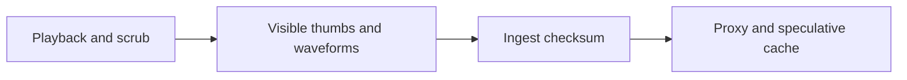

# AETHER performance requirements

Status: proposal for review. No timing measurement was taken. Numbers below are requirements to test later, not results.

The reference workload is a two-hour feature timeline with picture, several audio tracks, and linked camera media or proxies.

## Verified facts

- The brief requires, for that workload: virtualised timeline drawing, asynchronous waveforms and thumbnails, a clip index, cache, and background jobs.
- The UI must not block on the audio callback, and the audio callback must not block on the UI.
- A two-hour sequence at 24 fps contains 172800 frames. That figure is arithmetic, not a benchmark.
- This environment did not run FFmpeg, a timeline, or a disk array.

## Engineering recommendations

- Specify interactive budgets separately from throughput budgets.
- Virtualise every long list: bins with tens of thousands of clips, and the timeline.
- Prioritise the job queue: playback and audible scrub first, then the visible thumbnail and waveform window, then ingest checksum, then full-file proxies, then speculative cache.
- Measure on Linux first, on a machine profile SISE names later. Do not publish a number from a laptop that was not used.

## Proposed AETHER behaviour

### Interactive budgets

These are acceptance targets for a later build. They are not met by this document.

| Action | Target | Notes |
| --- | --- | --- |
| Playhead redraw after a local trim | Within one frame of the display refresh, on the reference machine | Model update is synchronous and small. Tiles may lag. |
| Timeline scroll of a two-hour sequence | Continuous pan without instantiating every clip widget | Virtualised. |
| Keyboard insert or overwrite | Command returns on the UI thread without waiting for a proxy job | |
| Meter paint | Follows the lock-free snapshot. A dropped meter frame is acceptable. A stalled UI thread is not. | |
| Open project | Database open and first sequence snapshot without hashing all media | Checksums stay background. |

If a target is missed, the failure is a bug against this table once a reference machine exists. Until then the table is a specification.

### Drawing

The timeline view requests clips intersecting the visible range plus a prefetch margin. It draws clips as a bounded set of shapes. It does not create one widget per clip. Thumbnails are tiles from cache. A missing tile is a solid placeholder with the clip name.

The bin virtualises rows the same way.

### Audio and picture

Picture decode is ahead of the playhead on a worker, bounded by a memory cap (the cap is unresolved). Audio rings are filled by a worker. The callback does not read the disk. If either starves, the playhead does not freeze the interface. Picture may repeat or drop a frame and count it. Audio underruns to silence for that clip or the device, and counts it. Counts are visible in diagnostics.

Scrub uses the same path at lower priority than play. It does not launch a transcode.

### Background work

A user cancel is recognised at the next job boundary. A codec that cannot cancel quickly is documented in the capability list. The UI remains usable.

### Cache

Thumbnail and waveform cache may be deleted. Regeneration is a background job. The timeline must be editable while it runs. Cache size is capped by a preference. When over cap, evict tiles not in the open sequence first. Never evict originals, managed media, or proxies under this policy.

### Index

The editorial interval index answers “clips on these tracks between frames A and B” without a full table scan as the common case. The database may use an index on `(track_id, record_in)`. Query plans were not examined. The requirement is the complexity goal: the visible window’s cost grows with the window, not with the two-hour duration, except for operations that are defined to touch the whole timeline (extract that ripples to the end).

A ripple that shifts every later clip on a track may touch many rows. That cost is acceptable if it stays off the audio thread and does not rebuild thumbnails.

### Ingest

Inspect of a file should return enough to show a bin row without waiting for a full checksum. The checksum continues in the background. Copy throughput is a disk limit. AETHER should not add a second full-file read on the UI thread.

### Non-targets

- Real-time optical-flow retimes of 4K as a default. Speed ramps may play as nearest-frame holds until a processing budget exists. The model still stores the ramp.
- Unlimited tracks. The requirement is a feature dialogue predub shape: dozens of audio tracks, not hundreds of plug-in channels. An upper test fixture of 32 audio tracks and 8 picture tracks is recommended for the first performance fixture. It is a fixture definition, not a result.
- Network collaborative editing latency. Out of scope.

### Specified tests, not executed

- Build a 172800-frame sequence with 2000 picture cuts and scroll from start to end. UI creates only visible rows.
- Start playback and a proxy job together. Playback priority is higher. Measure underruns.
- Delete the waveform cache during playback. Playback continues. Waveforms fill in afterwards.
- Ripple the first clip of a 2000-cut timeline and undo it. Audio callback allocation count is zero if instrumentation exists.

## Rationale

| Decision | Rationale |
| --- | --- |
| Virtualised drawing | A widget per clip will not carry a feature. The brief names virtualisation because of that. |
| Separate budgets from results | Publishing imagined milliseconds as measurements would mislead SISE. |
| Job priority | Assistants can wait for a proxy. They cannot wait for the playhead to unlock the mouse. |
| Window-scoped index | The two-hour requirement is about what is on screen, not about copying the whole movie to the GPU every frame. |
| Fixture of 32 audio tracks | Gives QA a number without pretending a dub stage has no limit. |

## Unresolved questions

- Reference CPU, RAM, GPU, disk, and display. SISE has not named the machine in this document. Linux is the first platform to measure.
- Memory cap for decoded picture. Open.
- Whether the timeline is drawn on the GPU. Recommendation: a retained scene of simple shapes, GPU only if the UI toolkit makes that the normal path. Do not build a custom renderer in the prototype.
- 4K versus HD proxy as the playback test. Recommendation: measure both, require the interactive budgets on the proxy profile the project claims to support, and publish a separate master-quality result. No profile is claimed yet.
- Maximum bin size. Recommendation: test 50,000 media rows as a virtualised list. Not a product limit until measured.
