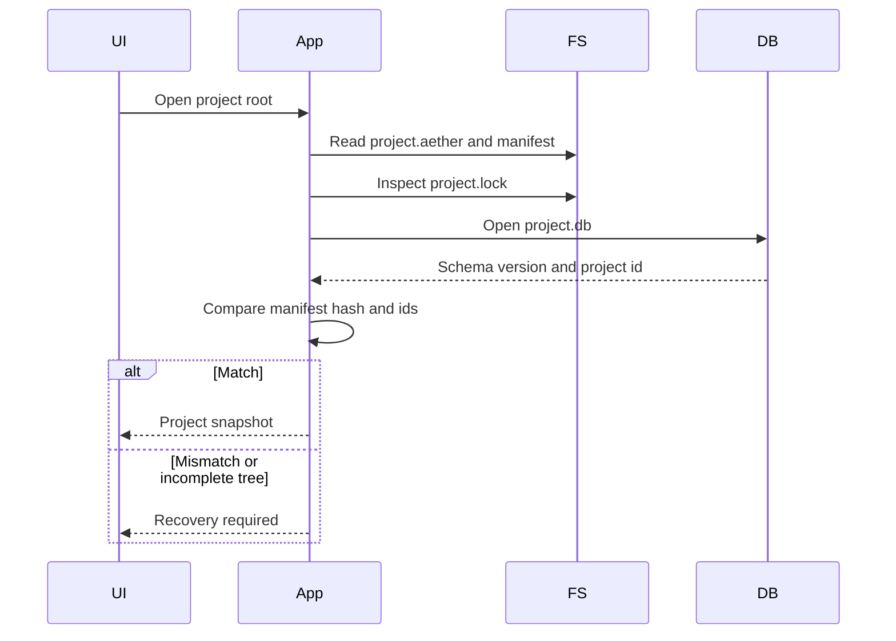

# AETHER project architecture

Status: proposal for review. Creating a project is specified. It is not implemented by this document.

A project is a directory the editor can copy, archive, and open offline. The native model is the authority. Exchange files are exports.

## Verified facts

- No existing AETHER project file was available to inspect.
- SQLite is a candidate for the local database, not a linked library in this workspace.
- PostgreSQL is not required by any workflow in the brief. It is reserved for a shared service that has not been requested.

## Engineering recommendations

- Write the smallest durable project in one transaction sequence: tree, database, manifest, settings, lock, initial sequence, then validate. If validation fails, the directory is not reported as a project.
- Keep high-volume media and cache on configurable volumes. Keep identity, settings, and the cut in the project directory unless the user explicitly relocates a role.
- Use a lock file to signal a live writer. Do not use the lock as a licence check.
- Store schema version in the database from the first migration.

## Proposed AETHER behaviour

### Identity

| Field | Rule |
| --- | --- |
| Project ID | Permanent, generated at creation, independent of folder name |
| Name | Display name, editable, not a key |
| Root | Directory that contains `project.aether` |
| Schema version | Integer, migrated, never guessed |
| Creation time | UTC timestamp recorded at creation |

Renaming the folder does not change the project ID. Relinking media does not change the project ID.

### Creation wizard

The wizard asks, in order:

1. Project name.
2. Project root directory.
3. Preset (feature, television, documentary, streaming, commercial, or custom). A preset fills defaults. It does not hide the values.
4. Frame rate as a rational (`24/1`, `25/1`, `30000/1001`, `24000/1001`, `30/1`, `60000/1001`, and other explicit rationals).
5. Raster (width, height) and pixel aspect rational.
6. Audio sample rate and the intended channel layout of the sequence.
7. Colour tagging (working space name and a transfer label). Colour management depth is limited until OpenColorIO is accepted.
8. Media volume and role paths.
9. Proxy preference: off, or a named proxy profile, still subject to the processing capability query.
10. Optional additional volumes (originals, cache, backup).

AETHER then creates the full folder tree in `PROJECT_FOLDER_SPECIFICATION.md`, the database, `project_settings.json`, `project_manifest.json`, `project.lock`, and one empty sequence that uses the wizard timebase. It validates that every required path exists, the database opens at the expected schema, and the manifest hash matches the database identity block. Only then does the UI call the project open.

The wizard does not copy media. Ingest is a later, explicit action.

### Settings and manifest

`project_settings.json` holds human-editable defaults: timebase, raster, audio rate, colour tags, proxy preference, last workspace name. It is not the timeline.

`project_manifest.json` holds project ID, schema version, database file hash, and a list of storage roles with volume identifiers. It is the cross-check document. Editorial events are not duplicated into it.

`project.aether` is the marker file a file browser can associate with the application. It stores the project ID and a format version so a future reader can refuse an unknown version.

`project.lock` records holder, process start, and a timestamp. A stale lock is reported. It is not deleted without the user confirming that no other writer is open. The lock is not a copy-protection device.

### Sequences

A project owns one or more sequences. The wizard creates one. Each sequence has its own rational timebase, raster, pixel aspect, and audio rate. Mixed timebases in one project are allowed. Mixed timebases inside one sequence are an editorial question (`TIMELINE_ENGINE_ARCHITECTURE.md`) and are represented as clip rates plus a sequence rate, not as a second clock inside the file format.

### What is not inside the project authority

- Decoder state, thumbnail caches, waveform caches.
- Foreign AAF, AVX, XML, OTIO, or EDL files. Those live under `EXCHANGE/` as documents.
- Avid MediaFiles directories. Those are an export target on a volume root, never a child that defines the project (`AVID_MEDIA_COMPATIBILITY.md`).

### Open sequence



Offline media does not fail this open. A missing database or a hash mismatch does.

### Sample `project.aether`

```json
{
  "format": "aether-project",
  "format_version": 1,
  "project_id": "prj_01HZX",
  "name": "Monsoon Cut",
  "schema_version": 1
}
```

### Sample settings

```json
{
  "project_id": "prj_01HZX",
  "sequence_defaults": {
    "timebase": "24/1",
    "raster": { "width": 1920, "height": 1080 },
    "pixel_aspect": "1/1",
    "audio_sample_rate": 48000,
    "audio_layout": "stereo"
  },
  "colour": { "tag": "unspecified", "display": "unset" },
  "proxy_preference": "off"
}
```

## Rationale

| Decision | Rationale |
| --- | --- |
| Directory, not a single opaque bundle | Assistants already copy folders, and a corrupt blob must not hide the media tree. SQLite still provides transactions. |
| Wizard writes no media | Copying camera originals as a side effect of “new project” violates the explicit-choice rule and can fill a disk. |
| Manifest separate from settings | Settings are preferences. The manifest is an integrity record. Mixing them makes a hand edit look like corruption, or the reverse. |
| One initial sequence | A project with no timeline forces the editor through extra setup before the first cut. Extra sequences are cheap later. |
| Lock is advisory and visible | Hard locks break on network filesystems and crashed processes. Silent lock breaking is also unsafe. Ask. |

## Unresolved questions

- Exact hash algorithm for the manifest (recommendation: SHA-256 of the database file after a checkpoint).
- Whether `project_settings.json` may be edited by hand while the project is closed. Recommendation: yes, with validation on open, and with timebase changes refused if a sequence already contains clips.
- Maximum project name and path length on Windows. Specified as “stay inside platform limits”, not measured.
- Whether a project may be created on a network share in the prototype. Recommendation: local disk only until lock behaviour is tested.
