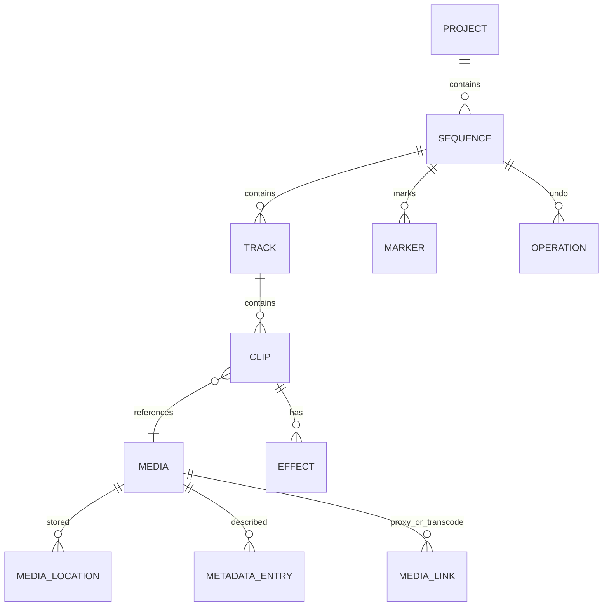

# AETHER project database schema

Status: proposal for review. This is a logical schema. It is not a migration file and it was not executed. SQLite is the candidate engine. PostgreSQL is not the default.

## Verified facts

- Required entities: project, sequences, tracks, clips, media registry, metadata, locations, proxies, effects, markers, operations, storage, ingest history.
- Schema versioning and migrations are required from the start.
- The database and `project_manifest.json` validate each other.
- Cache is not stored as authoritative media.

## Engineering recommendations

- Use integer primary keys internally and stable text ids externally (`prj_`, `seq_`, `med_`, `clp_`).
- Keep undo operations in the database so crash recovery can see them, and checkpoint the manifest after commits that change identity or schema.
- Foreign keys on. Transactions around every editorial gesture and every ingest registration.
- Store rationals as two integers, not as IEEE floats.

## Proposed AETHER behaviour

### Engine

`project.db` at the project root. SQLite in WAL mode is the recommended operating mode when implementation exists, because readers (UI queries) can run beside a writer. That recommendation is untested here. The schema does not use PostgreSQL types.

### Versioning

Table `schema_migrations(version INTEGER PRIMARY KEY, applied_at TEXT, checksum TEXT)`.

The application refuses to open a newer version. It migrates an older version forward in a transaction and writes a backup of the pre-migration file into `BACKUP/` first. If migration fails, it restores that backup and does not leave a half-migrated file as the current `project.db`.

Manifest fields checked on open: `project_id`, `schema_version`, database file hash. Mismatch stops open and offers recovery.

### Logical tables

```text
project
  project_id PK
  name
  schema_version
  created_utc
  sequence_rate_n, sequence_rate_d          -- defaults only
  raster_w, raster_h
  pixel_aspect_n, pixel_aspect_d
  audio_rate
  colour_tag

storage_volume
  volume_id PK
  role              -- project, originals, managed, proxy, cache, render, backup
  path
  last_seen_utc
  online            -- boolean last known

sequence
  sequence_id PK
  project_id FK
  name
  rate_n, rate_d
  raster_w, raster_h
  pixel_aspect_n, pixel_aspect_d
  audio_rate
  nest_depth_limit

track
  track_id PK
  sequence_id FK
  kind              -- picture, audio
  ordinal
  name
  role              -- dialogue, music, picture, ...
  enabled, locked, targeted

media
  media_id PK
  original_name
  original_path
  checksum
  checksum_state
  size_bytes
  source_mtime_utc
  ingested_utc
  timecode
  drop_frame
  duration_frames
  duration_samples
  rate_n, rate_d
  raster_w, raster_h
  pixel_aspect_n, pixel_aspect_d
  container
  codec
  colour_tag
  sample_rate
  bit_depth
  channels
  channel_layout    -- text or unknown
  camera, reel
  status
  alpha_state
  sync_warning
  retired

media_location
  location_id PK
  media_id FK
  volume_id FK
  role              -- link, original_copy, managed, proxy, transcode, consolidated
  path
  online

media_link
  parent_media_id FK
  child_media_id FK
  relation          -- proxy, transcode, consolidate

metadata_entry
  media_id FK
  key
  value
  source            -- probe, user

clip
  clip_id PK
  track_id FK
  media_id FK NULL
  child_sequence_id FK NULL
  record_in, record_out
  source_in
  source_rate_n, source_rate_d
  speed_n, speed_d
  rounding
  link_id NULL

transition
  transition_id PK
  sequence_id FK
  left_clip_id FK
  right_clip_id FK
  duration_frames
  alignment
  state
  definition_json

effect
  effect_id PK
  owner_kind        -- clip, track, transition
  owner_id
  type
  state
  definition_json
  ordinal

keyframe
  keyframe_id PK
  effect_id FK
  position          -- integer in declared domain
  domain            -- sequence_frame, source_frame, sample
  value_json

marker
  marker_id PK
  owner_kind        -- sequence, clip
  owner_id
  position
  colour
  name
  comment

operation
  operation_id PK
  sequence_id FK
  undo_group
  payload_json
  created_utc

ingest_event
  event_id PK
  job_id
  media_id NULL
  state
  mode
  source_path
  dest_path
  message
  created_utc

storage_role_path
  role PK
  volume_id FK
  path
```

`definition_json` holds effect parameters that the relational columns do not normalise yet. It is still inside the database transaction. It is not a second project file.

Timeline usage is a query: clips whose `media_id` matches and whose sequence is not retired. It is not a stored counter that can drift. A cache of the count may exist and must be rebuildable.

Proxies are `media` rows plus `media_link`. They are not a column of pixels.

### Sample row relationship



### Integrity

- A clip has either `media_id` or `child_sequence_id`, not both, not neither.
- `record_out` is greater than `record_in`.
- A proxy link cannot point at the same id as the parent.
- Deleting a media row is a retired flag, not a physical delete, until a validated purge command runs. The purge refuses if a clip still references the id.
- Cache files are absent from `media`.

### Manifest cross-check

After a commit that changes `project`, `media` identity, or schema version, infrastructure updates the manifest hash. Editorial keystrokes may batch the hash (recommendation: at most every few seconds, and always on idle and on clean shutdown) so the manifest is not rewritten per trim. A crash may leave the hash one batch behind. Recovery compares the operation log to the hash time and reports “consistent” or “replay”. It does not ignore a schema mismatch.

## Rationale

| Decision | Rationale |
| --- | --- |
| External text ids | Exchange and logs need stable ids that survive a table rebuild. |
| Two integers for rates | Matches the rational-time rule. |
| Retire instead of delete | Unvalidated record deletion is forbidden. A flag is reversible. |
| Effects as JSON inside the database | An open-ended effect graph normalised too early will not match AVX. JSON in a column is still transactional. |
| Usage is a query | Stored usage counts go stale when undo restores a clip. |
| Pre-migration backup | Schema changes are the easiest way to destroy a project. One copy is cheap relative to a feature. |

## Unresolved questions

- SQLite page size, cache size, and WAL checkpoint interval. Unmeasured.
- Whether `operation.payload_json` stores inverse deltas or full clip copies. Open, matching the timeline document.
- Full-text search on metadata. Later. Not required to cut.
- Encryption at rest. Not in the default schema. A facility option is a security question, unresolved.
- Sharing one `project.db` from two machines. Recommendation: do not. The lock file is advisory. The schema is not a multi-writer server.
