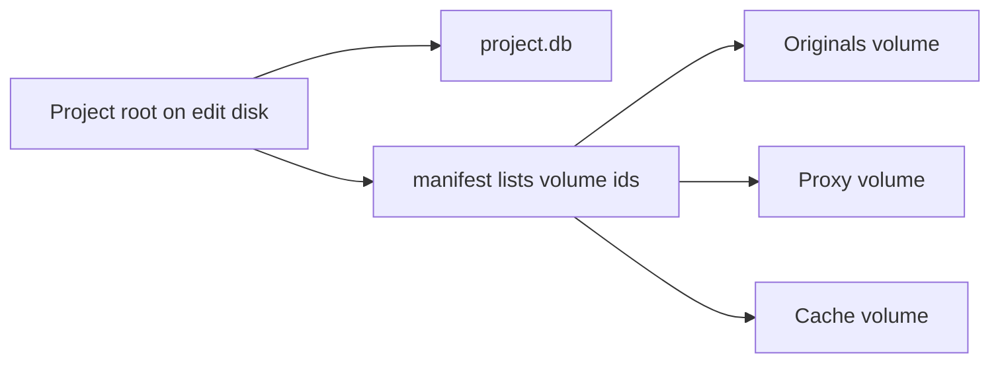

# AETHER project folder specification

Status: proposal for review. This tree is the initial on-disk specification. It is not created by this document.

## Verified facts

- The tree below is the tree required by the product brief. It was not compared with a live SISE project because that folder was offline.
- Avid’s on-disk media layout is a different specification. It is not a subtree that may be improvised inside this tree. See `AVID_MEDIA_COMPATIBILITY.md`.

## Engineering recommendations

- Create every directory at project creation, including empty ones, so later jobs have a known destination.
- Allow originals, managed media, proxies, cache, renders, and backups to be retargeted to other volumes. Store the retarget in the manifest, not by silently moving files.
- Do not create a forced folder per scene, camera, or department. Those are metadata.
- Keep exchange and exports as generated documents. They are not inputs the editor must protect as camera originals, but they are also not cache: the user asked for them.

## Proposed AETHER behaviour

### Tree

```text
ProjectRoot/
  project.aether
  project.db
  project_settings.json
  project_manifest.json
  project.lock
  MEDIA/
    ORIGINALS/
    MANAGED/
    PROXIES/
    TRANSCODES/
    CONSOLIDATED/
  EDITORIAL/
  AUDIO/
    dialogue/
    ADR/
    Foley/
    effects/
    ambience/
    music/
    mixes/
    exports/
  GRAPHICS/
  CACHE/
    thumbnails/
    waveforms/
    indexes/
  METADATA/
  EXCHANGE/
    AVX/
    AAF/
    XML/
    OTIO/
    EDL/
  EXPORTS/
  BACKUP/
  LOGS/
    ingest/
    jobs/
    recovery/
```

`EDITORIAL/` holds notes, locator lists, and assistant paperwork the user chooses to store. The timeline itself is in `project.db`, not in a pile of JSON clips.

### Roles and relocatability

| Path | Role | May live on another volume | Deleting it |
| --- | --- | --- | --- |
| `project.db`, manifest, settings, `project.aether` | Project identity | No, except a whole-project move | Recovery action only |
| `MEDIA/ORIGINALS` | User-approved copies of source media | Yes | Never silent |
| `MEDIA/MANAGED` | Media AETHER generated as editorial mezzanine under an explicit transcode or consolidate | Yes | Confirmation, never if it is the only online master |
| `MEDIA/PROXIES` | Proxies | Yes | Regenerable only when a master or managed file remains |
| `MEDIA/TRANSCODES` | Explicit transcodes that are not the proxy set | Yes | Confirmation |
| `MEDIA/CONSOLIDATED` | Handles-only or used-media consolidations | Yes | Confirmation |
| `AUDIO/**` | User or imported audio organised for people, not for the database | Yes, as a storage role | Confirmation |
| `GRAPHICS/` | Titles and stills the user placed | Yes | Confirmation |
| `CACHE/**` | Thumbnails, waveforms, indexes | Yes | Safe to delete; regenerated |
| `METADATA/` | Sidecars and extracted reports | Prefer beside the project | Confirmation if user-authored |
| `EXCHANGE/**` | AVX, AAF, XML, OTIO, EDL documents | Prefer beside the project | Confirmation |
| `EXPORTS/` | Mastered outputs | Yes | Confirmation |
| `BACKUP/` | Snapshots | Yes, and recommended | Confirmation |
| `LOGS/**` | Ingest and job logs | Prefer beside the project | Retention policy, not silent at the moment of ingest |

Cache may be deleted and regenerated. Originals are never cache. A proxy is never written over an original path.

### Virtual organisation

Bins are views. A bin named “A cam” or “Scene 12” does not move bytes. Organisation by camera, reel, card, date, scene, source type, audio category, or department is a metadata query. The physical tree stays stable so paths in the registry remain meaningful.

Audio category folders exist so people can find dialogue and music. Placing a file in `AUDIO/music/` does not by itself set metadata. Ingest records the category if the user, or a rule they confirmed, chose it. The database remains the index.

### Other volumes



If a volume is absent, media whose role points at it is offline. The folder inside the project may be a placeholder or an absent redirect. The project still opens.

### Names that must not appear as working files

- `Avid MediaFiles/` inside the project tree as a place AETHER writes daily media.
- Database files belonging to another application.
- A proxy whose filename is the original filename in the original folder.

### Sample manifest roles

```json
{
  "project_id": "prj_01HZX",
  "roles": {
    "project": { "path": "/edit/Monsoon", "volume_id": "vol_edit" },
    "originals": { "path": "/media/camera", "volume_id": "vol_cam" },
    "managed": { "path": "/edit/Monsoon/MEDIA/MANAGED", "volume_id": "vol_edit" },
    "proxy": { "path": "/fast/proxies/Monsoon", "volume_id": "vol_fast" },
    "cache": { "path": "/fast/cache/Monsoon", "volume_id": "vol_fast" },
    "backup": { "path": "/backup/Monsoon", "volume_id": "vol_bak" }
  }
}
```

## Rationale

| Decision | Rationale |
| --- | --- |
| Full tree at creation | Jobs and assistants need stable destinations. Creating folders lazily hides misconfiguration until a deadline. |
| Separate ORIGINALS, MANAGED, PROXIES, TRANSCODES, CONSOLIDATED | Each has a different deletion rule. One “Media” folder makes those rules unenforceable. |
| AUDIO categories as places, not as the data model | Sound departments think in dialogue, Foley, and music. Forcing that tree to be the only index breaks cross-category sync groups. |
| CACHE isolated | Users and support must be able to delete cache without a speech about originals. |
| EXCHANGE split by format | AVX and AAF have different specifications. Mixing them in one folder invites the Avid mistake of dropping the wrong file into a managed media directory. |

## Unresolved questions

- Whether `EDITORIAL/` should be omitted from the required tree and left as a user folder. The brief includes it, so it stays required until review removes it.
- Case of directory names on case-insensitive volumes. The specification uses the capitals shown. A later platform note must define a comparison rule.
- Symlinks across volumes. Recommendation: store the resolved volume id at creation and treat a changed target as a relink, not as a silent follow.
- Maximum number of files per directory before the managed tree shards by media-id prefix. Open. Recommendation: shard `MANAGED/` and `PROXIES/` by the first two characters of the media id if a directory exceeds a platform-tested limit. That limit is not yet measured.
