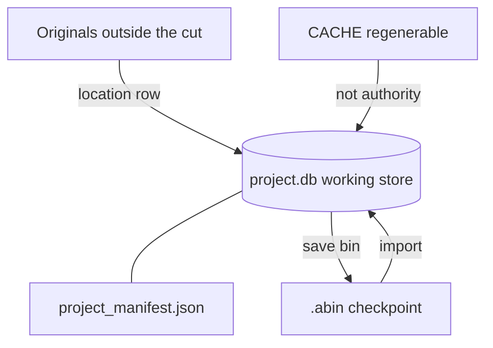

# Project storage and database

Status: storage authority for the decision in ADR-003 (**ACCEPTED**). This document authorises no database file and no migration. It does not keep a second package shape open.

One `project.db` is the only editorial authority. The Project manifest describes the package and is not a second editorial authority. `.abin` is interchange. Operational rules (transactions, locking, atomic writes, migrations, backup, corruption, crash recovery, relocation, bin validation, referential integrity) are the decision text in ADR-003. Schema column lists stay in the schema documents named below. This file does not copy those tables.

| Topic | Document |
| --- | --- |
| Earlier logical schema | `docs/PROJECT_DATABASE_SCHEMA.md` |
| Later bin and editorial tables | `docs/BIN_DATABASE_SCHEMA.md` |
| Media rows | `docs/MEDIA_REGISTRY_SCHEMA.md` |
| Directory tree | `docs/PROJECT_FOLDER_SPECIFICATION.md` |
| Bin checkpoints and the `BINS/` hint | `docs/BIN_ARCHITECTURE.md` |
| Portable package | `docs/BIN_FILE_FORMAT_SPECIFICATION.md` |
| Decisions | `architecture/decisions/ADR-003-project-database.md`, `architecture/decisions/ADR-004-abin-package.md` |

## 1. Contract

**ACCEPTED.** While a project is open, `project.db` is the authority for project id, bins, objects, media registry, sequences, relationships, settings, and revision. A `.abin` file is an interchange package for one bin. It is not queried on each keystroke. It is not a dump of the project tables and it is not a second authority. Import resolves existing Media IDs and does not duplicate a Media Asset.

**ACCEPTED.** The database file name is `project.db`. The early name `project.sqlite` inside `Title.sise/` is not the canonical file. Audit conflict C2 is closed for that choice. The early text remains in `ARCHITECTURE.md` as history and is marked superseded there.

**PROPOSED.** `project_manifest.json` repeats `project_id`, `schema_version`, and a hash of the database. On open they validate each other. Disagreement starts recovery. It does not pick a winner silently.

**PROPOSED.** Rationals are two integer columns. IEEE float columns are not the authority for time, speed, or gain that the editorial model stores as a rational.

**PROPOSED.** `PRAGMA foreign_keys = ON` on every connection. WAL is recommended for a local disk. `project.db` is not placed on a camera card. Those engine settings were not measured. **CONFIRMED.**

**PROPOSED.** Cache under `CACHE/` is regenerable. Exchange files under `EXCHANGE/` and exports under `EXPORTS/` are generated documents the person asked for. They are not cache, and they are not camera originals. Originals are never classified as cache.

The folder specification does not list `BINS/` or `LOGS/BIN_OPERATIONS/`. The bin architecture calls those an amendment and does not edit the folder specification. **OPEN** until the folder document is revised by a review. The bin id is still not read from the path.

## 2. What is stored where

| Data | Working store | Portable bin | Must not be the only copy of the cut |
| --- | --- | --- | --- |
| Membership, objects, instances, markers | Yes | Yes, as JSON members | An EDL, a cache, a proxy |
| Media locations | Yes | Hints in `media_refs.json` | The `.abin` path hint alone |
| Undo session stack | **OPEN** | No | — |
| Thumbnails | Derived | Optional refs | Must not be required to reopen the cut |
| Project settings | Yes | No. They are project-scoped | — |

## 3. Schema overlap

The package decision is closed: one `project.db`. `docs/PROJECT_DATABASE_SCHEMA.md` and `docs/BIN_DATABASE_SCHEMA.md` still overlap on columns (sequence rate, media checksum, tracks, markers). The later bin and registry tables are the working set, with proxies as representation rows of one Media ID, not as separate media ids. The earlier schema is history for those overlapping columns. It is not a second authority.

One migration series still has to be written. Until then:

- Do not generate SQL from both documents into the same database.
- Do not treat either document as a file that was executed. **CONFIRMED** neither was.
- Identity rules in `docs/04_CORE_DATA_MODEL.md` win over a column that would store a path as a primary key. Neither schema does that. A future edit that did would contradict the model.

## 4. Workflows

### 4.1 Create

1. Create the project directory and the roles the folder specification requires, or record that a role lives on another volume.
2. Create the database and the manifest in one successful step. If either fails, do not publish a project id that claims success.
3. Take the lock. A second writer is refused.

### 4.2 Save a bin checkpoint

1. Serialise the bin from the working store into the public member list.
2. Write `name.abin.partial`, verify, rename.
3. Store the package hash on the revision row.

Failure: the database remains the authority if the package write fails. The UI says the portable copy is missing. It does not roll back the edit solely because the checkpoint failed, unless the person asked for a single transaction that includes both. Which of those two commit scopes is used is **OPEN** and must be fixed before the milestone test for checkpoints. The milestone’s acceptance for `.abin` is a direct serializer round-trip, which can run without that project-commit question (`docs/FIRST_IMPLEMENTATION_MILESTONE.md`).

### 4.3 Import a bin into another project

The source project may be absent. Import validates members, mints no Media ID for an instance that already carries one, and matches or creates media rows through media management. Unknown types follow the retain-or-roll-back rule. Name-matched replacement of objects is forbidden (`docs/BIN_ARCHITECTURE.md`).

## 5. Failure cases

| Case | Result |
| --- | --- |
| Hash mismatch between manifest and database | Recovery path. No silent continue |
| Newer `schema_version` than this build | Refuse to open |
| Migration fails | Restore the pre-migration backup. Do not leave a half-migrated file as current |
| Delete cache | Composition hash unchanged |
| Delete a `.abin` | Project still opens. Portable copy reported missing |
| Two workstations write one `project.db` | Not supported. One writer. Multi-writer shared service is **OPEN** and not proposed |

## 6. Acceptance criteria

- Create, write a sequence, close, reopen. Composition hash matches.
- Manifest tamper in a test forces the recovery branch and does not auto-pick a file.
- `.abin` round-trip preserves object ids, Media IDs, and rational ranges. An unknown extra member survives a second write.
- A test that stores a frame index reads back the same integer.
- **CONFIRMED.** No database was created by this preparation.
