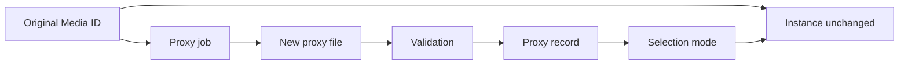

# AETHER proxy and original media relationship

Status: proposal for review. Specification only. No proxy was generated. No preset is claimed validated. The prior FFmpeg 9.0.2 mux notes are not a proxy pass.

## Verified facts

- The master proxy note separates proxy, transcode, and consolidate, and requires the timeline to store the master media id (`docs/PROXY_AND_TRANSCODE_SYSTEM.md`).
- ADR-005 accepts one Media ID. A `proxy_id` in this document is a Representation ID that references that Media ID. The editorial source id does not change. The earlier sentence that gave a proxy its own media id is not the rule.
- Prior study, not repeated: OP1a ProRes and DNxHR muxed in that study; PCM only at 48 kHz 24-bit; channel layout not in MXF; ProRes 4444 alpha incomplete; a 29.97 sample-count mismatch. Any proxy profile that depends on those muxers stays `not_validated` until reconciliation (`docs/NATIVE_MEDIA_ARCHITECTURE.md`).

## Engineering recommendations

- Generate a proxy only after the original Media ID exists, and only when a person or a project policy requested it.
- Validate the proxy as a derivative. A path that exists is not a pass.
- Switch representation without writing the editorial object.
- Keep failed outputs out of the `passed` validation state so conform cannot select them.

## Proposed behaviour

### Scope

This document defines how original camera media, editorial transcodes, and proxies share one Media ID, how a proxy record is shaped, how generation jobs behave, and how representation switching works. Conform’s use of originals is in `ONLINE_CONFORM_ARCHITECTURE.md`. Job binaries are not chosen.

### Requirements

- Originals remain unmodified. Proxy bytes are new files in the proxy storage role.
- Every proxy row stores `proxy_id` and `media_id` (the original).
- Editorial transcodes (ProRes Proxy, ProRes LT, DNxHR LB, DNxHR SQ) are a different role from proxies, even when the codec name overlaps a proxy preset. They also store the original `media_id`.
- Proxy presets: `prores_proxy`, `dnxhr_lb`, `h264`, and `custom`. Custom names its codec, container, raster rule, and audio rule. Presets are specifications. Their `validation_status` is `not_validated` until a future suite passes on a named backend version.
- Generation controls: batch, background, pause, resume, retry, cancel.
- A switch among original, proxy, editorial, automatic, per clip, or batch changes only the playback selection.
- Unchanged by a switch: `master_clip_id`, source in, source out, timeline position, sequence duration, metadata, `instance_id`.
- A failed or unvalidated proxy cannot be the source a conform trusts.
- Frame rate of a proxy equals the original picture rate. A profile that cannot keep that rate is refused before the job starts.
- Whole-file proxies are the rule. Used-range extracts are consolidation (`MEDIA_CONSOLIDATION_SPECIFICATION.md`).

### Data model

Proxy record fields:

| Field | Content |
| --- | --- |
| `proxy_id` | UUID |
| `media_id` | Original UUID |
| `path` | Current proxy path |
| `checksum` | Algorithm, value, state |
| `codec` | Codec and container actually written |
| `raster` | Width and height |
| `rate` | Rational |
| `duration` | Frame count and the rational duration it implies |
| `timecode` | Start timecode and drop-frame flag |
| `audio` | Sample rate, sample count, channels, layout availability, channel map |
| `generation_settings` | Preset id, raster rule, audio policy, handles none |
| `software_version` | Application version and processing backend version string |
| `timestamp` | Generation time, UTC |
| `validation` | The checks below and their results |

Playback selection, stored separately from the instance:

```text
representation_selection
  scope          global | batch | instance
  instance_id    NULL when global
  mode           offline_proxy | original | editorial | automatic
```

The selection is a preference. The resolver skips a representation whose `validation_state` is not `passed`.



### APIs

| Operation | Contract |
| --- | --- |
| `Proxy.request(media_id, preset, dest)` | Refuses unknown media id, retired id, or a preset that cannot hold the source rate. Reserves `proxy_id`. |
| `Proxy.pause(job_id)` / `resume` / `cancel` / `retry` | Retry reuses `proxy_id` when no passed file exists. |
| `Proxy.complete(job_id, file)` | Runs validation. Commits the proxy relationship only on pass. |
| `Playback.select(scope, mode)` | Writes selection. Does not call `Registry.commitRelationship` on the master clip. |
| `Playback.resolve(instance_id)` | Returns a readable path or an offline state. The path is not written onto the instance. |

Processing may encode. The registry commit stays in the proxy boundary after validation, matching the master rule that processing does not insert the registry row.

### Workflow

1. Original is registered.
2. User or policy requests a preset. The UI names the preset as not validated until a suite exists. The specification still defines the preset so the suite has a target.
3. The job runs in the background, yielding to playback as the master proxy note requires.
4. On completion, validation runs. Pass commits the proxy record in one transaction. Fail quarantines the new file and leaves the original relationship as it was. There is no passed proxy row.
5. The editor continues. Mode switches resolve a different path.

Pause finishes or checkpoints the in-flight write when the encoder can. When it cannot, pause stops new work and the UI is told that the in-flight item can only be cancelled. That limit is a property of the backend, reported as data.

### Validation

A proxy is `passed` only when all of the following hold against the original record:

| Check | Pass condition |
| --- | --- |
| Duration | Frame count matches the original frame count |
| Frame count | Integer equality |
| Rate | Rational equality with the original picture rate |
| Timecode | Start timecode and drop-frame flag match when the original availability is `present`. When the original timecode is `absent`, the proxy also records `absent`. |
| Audio duration | Integer sample count matches the policy. A 29.97-style mismatch sets `sync_warning` and the proxy is not `passed`. |
| Channel map | Declared map matches, or both sides are `unknown` and the channel count matches. A guessed layout fails the check. |
| Sync | No `sync_warning` |
| Start timestamp | First-frame timestamp matches when both are `present` |
| Source relationship | `media_id` on the proxy record is the original, and the proxy file name is not stored as the original filename |

Existence of the file is a precondition for reading it, not a check that passes.

Until MXF layout and 4444 alpha are reconciled, a proxy in those envelopes records layout `container_stored: false` and alpha `unverified`, and it does not pass a check that requires container layout or verified alpha.

### Errors

| Error | Registry |
| --- | --- |
| Encoder crash | No passed row. Partial file quarantined. |
| Validation failed | No passed row. `validation_state = failed`. |
| Cancel | No passed row. Reserved `proxy_id` may be reused by retry. |
| Switch while proxy failed | Resolver returns the next passed representation or an offline state. It does not substitute the failed file. |
| Destination inside an original camera folder | Refused before write. |

### Recovery

A retry after failure reuses the reserved id and does not mint a Media ID. Quarantine never deletes originals. Deleting a proxy file later sets that representation offline and leaves the master clip in place. Cache thumbnails and proxy files are different roles; deleting one does not delete the other.

### Performance

Proxy jobs are background and cancellable. They yield to playback and to an explicit user transcode. The interactive thread does not encode. No encode speed was measured. Validation that needs a full checksum runs as a job, and the proxy stays `not_run` or `incomplete` until it finishes. Playback of an unvalidated proxy is refused by `Playback.resolve`.

### Tests

Test C in the test plan. Specified, not executed. Includes each preset as a contract, a file that exists and fails duration, a switch that preserves the six identity fields, and a failed proxy excluded from conform inputs.

### Acceptance

- The proxy record field list matches the brief.
- Validation failure cannot be mistaken for “file present”.
- Switching representation is specified as a non-edit of the cut.
- Codec presets are named and marked unvalidated, with the FFmpeg study cited as reconcile-only.

## Unresolved questions

- Default preset after a suite exists. Open in the architecture decisions. No default is offered as available now.
- Burn-in of timecode on proxies. Recommendation: off. A dailies preset may burn in a copy. That copy is still a proxy of the same Media ID, and conform ignores it as an original.
- Many-track production sound. Recommendation: preserve channel count when the preset can. A downmix is a different proxy record, labelled `downmix`, and is not the AAF source.
- Hardware encode. Out of scope.
