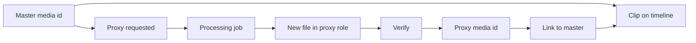

# AETHER proxy and transcode system

Status: proposal for review. No transcoder was run.

## Verified facts

- Proxies and transcodes are required capabilities of media management and of media processing. They are not the same files.
- The brief forbids replacing originals with proxies.
- A prior FFmpeg 9.0.2 study reported that certain OP1a ProRes and DNxHR profiles muxed, with the limits recorded in `NATIVE_MEDIA_ARCHITECTURE.md`. That study is not a proxy-profile pass and was not repeated here.
- No default proxy codec is justified by a measurement in this workspace.

## Engineering recommendations

- Represent a proxy as a representation of the master Media ID, role `PROXY`, with its own Representation ID (ADR-005). Do not mint a second media id.
- Generate proxies only after the master is registered and only when the user or the project preference requested them.
- Keep proxy frame rate identical to the master picture rate so editorial frame numbers match. If a profile cannot do that, refuse the profile rather than silently drop frames.
- Store handles implicitly by proxying the whole master file in the first design. Partial proxies of used ranges are a later consolidate feature and are easy to get wrong relative to trim handles.

## Proposed AETHER behaviour

### Definitions

| Term | Meaning |
| --- | --- |
| Proxy | A smaller, whole-file stand-in used for playback. Disposable if the master exists. |
| Transcode | A new essence the user requested, which may become managed editorial media. Not disposable unless the user says so. |
| Consolidate | A new file of used ranges plus handles. Specified in media management. Not a proxy. |

### Job contract

Processing accepts a transcode request: source media id, destination role, profile id, and a destination path the media layer reserved. Processing returns progress, cancel, and a result file. Media management registers the result only after size and checksum verification. Processing does not insert the registry row.

If the job fails, any partial output is quarantined. The master remains. There is no media record with status `online` for the failed output.

### Playback policy

The application asks media management for a location given a quality policy:

- `proxy_if_available` for the timeline while editing
- `master` for export and for a “toggle to full” command
- `offline` if none are readable

The timeline stores the master media id on the clip. It may store a hint of the last viewed quality. The hint is not the identity of the cut. Switching quality does not rewrite source in and out.

### Profiles

A profile is a named capability: container, video codec, raster rule, audio codec, sample rate, bit depth. The processing layer publishes profiles it has validated in AETHER’s suite. Unvalidated profiles are hidden.

Until that suite exists, the application ships with the preference set to off. It does not advertise ProRes or DNxHR proxies as available on the strength of the prior study.

Audio on a proxy follows the project sample rate when the backend can resample. The editorial model still stores the source rate. A proxy that changes 29.97 picture duration relative to audio must set `sync_warning` and must not be marked ready.

### Background behaviour

Proxy jobs yield to playback and to explicit user transcodes. They support cancel. Pause is required if the backend can flush a partial file safely. Otherwise cancel-only, stated in the UI. Retry reuses the reserved media id if one was allocated and no successful file exists.

Thumbnails may be taken from the proxy after it is ready, or from the master. The picture cache is still cache.

### Specified tests, not executed

- Proxy failure does not change master checksum or path.
- Toggle quality does not change clip in and out points.
- Deleting cache thumbnails does not delete proxy files. Deleting proxies does not delete masters.
- A profile that cannot hold the source frame rate is refused before the job starts.
- Cancel leaves no online proxy row.

## Rationale

| Decision | Rationale |
| --- | --- |
| Whole-file proxies first | Used-range proxies break when the editor extends a handle past the proxied region. |
| Same frame rate | The timeline is in frames. A proxy at a different rate creates a second editorial geometry. |
| Registration outside processing | A crashed encoder must not have marked itself online inside the catalogue. |
| Proxies off until validated | The prior mux notes are not a playback, sync, or licence pass. Shipping a default codec now would over-claim. |

## Unresolved questions

- Default proxy codec after validation (intra-frame mezzanine versus a long-GOP preview). Open. Recommendation: intra-frame or all-I for frame-accurate scrubbing once a licence-clean encoder is confirmed.
- Burn-in of timecode and clip name on proxies. Useful for dailies, harmful if used as the only full-quality path. Recommendation: off by default, optional for a dailies preset, never for the master.
- Proxy audio channel count when the source is production sound with many tracks. Recommendation: full channel count if the profile allows, else a documented downmix that is labelled as a downmix and is not the AAF source.
- Hardware encode. Out of scope for the prototype.
