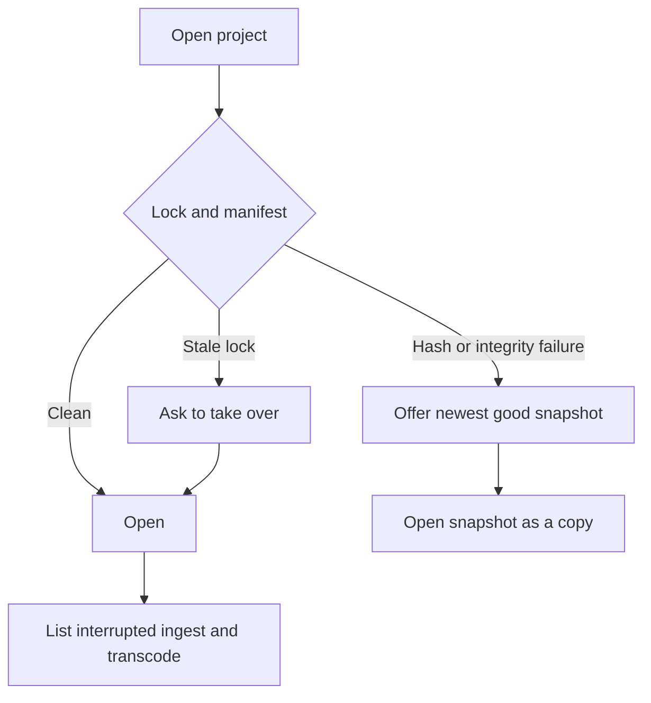

# AETHER recovery and backup

Status: proposal for review. No crash was induced and no restore was run.

## Verified facts

- The brief requires autosave, snapshots, crash recovery, integrity checks, backup, version history, and recovery of interrupted ingest and transcode.
- The database and the manifest validate each other.
- Cache may be deleted. Originals may not.
- No backup tool was executed.

## Engineering recommendations

- Autosave the database on a short interval and on idle, using the engine’s transactional write, not a second hand-built copy of every clip in the UI process.
- Snapshot on a longer interval into `BACKUP/`, and before any migration or mass media operation.
- Keep ingest and transcode jobs durable so restart can resume or quarantine.
- Make restore an explicit command that writes into a new folder or replaces the database only after a confirmed swap. Never restore by deleting originals.

## Proposed AETHER behaviour

### Autosave

Every committed edit is already a transaction. Autosave means those transactions are flushed, the manifest hash is refreshed, and a small autosave journal notes the time. Interval recommendation: 60 seconds and on idle after a change, whichever comes first. Unmeasured. The UI shows “saved” or “saving”. It does not show a cloud icon.

Autosave does not copy media.

### Snapshots

A snapshot is a copy of `project.db`, the manifest, and settings, named with UTC time, under `BACKUP/`. It does not include `MEDIA/ORIGINALS` unless the user ran a separate “archive project with media” command. That archive command is explicit, shows the size, and writes to the backup role. It is not autosave.

Recommendation: keep the last 20 snapshots or 14 days, whichever is smaller, and never auto-delete the snapshot taken before a migration. The numbers are open.

### Crash recovery

On open, if the lock is stale or the manifest hash disagrees with the database:

1. Do not start playback.
2. Validate SQLite integrity if the engine is SQLite. The check is specified. It was not run.
3. If the database opens and the hash is merely one autosave behind, offer “continue and rewrite manifest”.
4. If the database does not open, offer the newest snapshot that passes integrity.
5. If both fail, stop. Do not create an empty project in the same folder.

A stale lock asks whether to take over. Taking over does not discard the database.

Interrupted ingest: jobs in `copying` or `verifying` do not become `online`. The UI lists them under recovery: resume, retry, or discard the partial new file. Discard never deletes the source path if the mode was copy and the source is outside the partial destination. Interrupted transcode follows the same rule for the new file only.

### Version history

Undo is short-term history. Snapshots are the version history an assistant can open. Opening a snapshot opens it as a recovered project copy so the live database stays put until the user promotes the copy. Promotion swaps files using a temporary name and keeps the previous database as a snapshot.

### Integrity

| Check | When |
| --- | --- |
| Manifest id and schema match the database | Every open |
| Database integrity | Every open after a crash flag, and on demand |
| Media checksum spot check | On demand, and a background sample. Not a silent rewrite. |
| Folder tree contains required directories | Every open. Missing cache directories are recreated. Missing originals are offline, not recreated as empty masters. |

### What recovery will not do

- Delete cache as part of crash recovery unless the user asks. Cache is safe to delete, and recovery should not surprise a render farm of thumbnails without a reason.
- Rebuild originals from proxies.
- Edit Avid databases as a repair.

### Specified tests, not executed

- Kill the process after a commit and before manifest update: open offers continue or snapshot, and no clip is half-inserted.
- Fail a copy at 50 percent, restart: no online media row, source file unchanged.
- Restore a snapshot: current database remains until promotion.
- Delete `CACHE/` and open: project opens, thumbnails regenerate as jobs.

## Rationale

| Decision | Rationale |
| --- | --- |
| Snapshots exclude media by default | A feature’s originals dwarf the database. Mixing them into autosave fills the backup disk and tempts the app to “tidy” media. |
| Open snapshot as a copy | Replacing the live project immediately makes recovery itself dangerous. |
| Interrupted copy is not online | Matches the ingest rule that a failed copy leaves no valid record. |
| Recreate cache directories only | Those folders are not user essence. Recreating `MEDIA/ORIGINALS` as an empty stand-in would look like the media exists. |

## Unresolved questions

- Snapshot interval and retention counts. Recommendations above are not measured against a two-hour show’s database size.
- Whether autosave uses SQLite backup API or file copy. Decide when the engine is real.
- Off-machine backup (a second disk the user named). The backup role supports it. Scheduling is open. There is still no cloud account.
- How to present a manifest/database split if the operation log itself is damaged. Stopped state is specified. The forensic tool is not.
