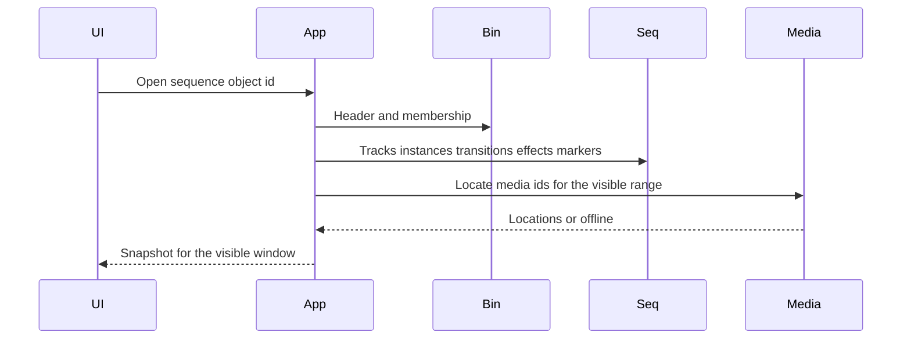
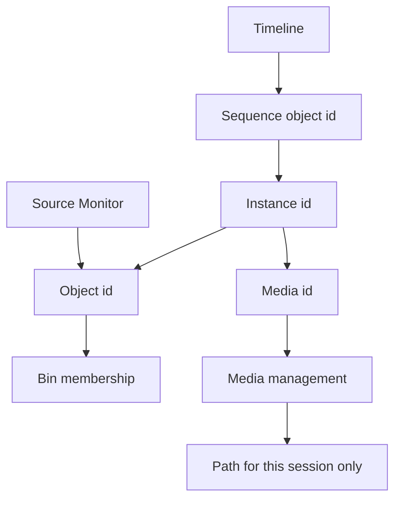

# AETHER sequence and bin integration

Status: proposal for review. The join between the timeline model and the bin model is specified. No timeline was saved.

## Purpose

Specify the sequence as a bin object and the timeline instance as the only placement identity, so Source Monitor, Timeline, and Sequence Manager use the bin registry.

## Scope

In scope: identity, load, edit, save, nests, and what the timeline is allowed to know about media.

Out of scope: trim mathematics, track targeting rules, and rational mapping. Those remain in `docs/TIMELINE_ENGINE_ARCHITECTURE.md` and `docs/EDITORIAL_PHILOSOPHY.md`. This document binds them to bin ids. Where the timeline document says `clip_id`, this document means `instance_id` for the same value. Where it says `sequence_id`, this document means the sequence’s `object_id`.

## Requirements

- A sequence is an editorial object with a bin membership or an unassigned state. Sequence Manager lists object ids of type `sequence`. It does not keep a private list.
- Creating the project creates one empty sequence object, as the project architecture requires, and places it in a bin named `SEQUENCES` unless the person renames that bin. The bin’s directory hint may be `BINS/SEQUENCES/`. The directory is not the sequence.
- A timeline instance stores `instance_id`, `sequence_object_id`, `source_object_id`, and `media_id` when the source is essence-backed. It stores no filesystem path.
- Source Monitor opens an object id. Timeline opens a sequence object id. Both resolve pictures through media management.
- Saving a sequence writes the sequence’s typed rows, increments its revision, rebuilds its dependency edges, appends undo at the timeline’s own stack, and participates in bin revision and crash recovery.
- Duplicating a sequence creates a new object id and new instance ids, with the same source object ids and media ids, under the lifecycle rules.
- A nest cites a child sequence’s object id.
- The timeline core does not call the filesystem and does not link Qt, FFmpeg, or GStreamer.

## Verified facts

- The timeline model already stores rational time, half-open ranges, `media_id` on the clip, and nest references as child sequence ids. It already says persistence must work without the audio engine.
- The editorial philosophy already says a nest is an editable sequence and that zoom and view state are not the cut.
- The project wizard already creates one sequence. This document gives that sequence a bin object id.
- No integrated save was executed.

## Engineering recommendations

- Keep trim and the interval index inside `aether_editorial`. Keep membership and package publication inside `aether_bin`. Share `aether_model` structs. The application loads a sequence by asking the bin core for the object and the sequence core for the body. They meet in the database rows, not by calling each other’s services.
- On sequence save, use one database transaction for the body, the object revision, and the dependency projection, then publish the package using the revision document’s steps.
- Store view state (zoom, scroll, playhead) as workstation UI state. The playhead may also be stored on the sequence as a convenience field `last_playhead_frame`. Recommendation: store it, and treat it as non-editorial. It is not a dependency and it is not part of equality checks for import conflicts. Unresolved if reviewers would rather omit it. The recommendation is to store it so a cutting room returns to the same frame, and to exclude it from payload-equality.

## Proposed behaviour

### Identity

| Timeline concept | Bin model |
| --- | --- |
| Sequence | `EditorialObjects` row, `object_type` `sequence`, plus a `Sequences` row |
| Clip on a track | `TimelineInstances` row. `instance_id` is the clip id |
| Media on that clip | `media_id` |
| Editorial source | `source_object_id` pointing at a master, subclip, sequence, title, multicam, group, sync clip, or generated-media ref |
| Nest | Instance whose `source_object_id` is a sequence and whose `media_id` is null |
| Path | Absent. Resolved outside the timeline |

There is no second table of clips that the timeline owns apart from `TimelineInstances`.

### Load



The UI snapshot for a visible window includes instance ids, source object ids, media ids, ranges, and offline flags. It includes paths only inside the application’s playback request, which is not written back into the sequence.

Source Monitor load is the same resolve with a single object id and that object’s source range. A subclip opens on its in and out. The monitor does not create an instance. An edit from the monitor into the timeline creates instances.

### Edit

Edit commands are the timeline commands: insert, overwrite, replace, lift, extract, and the rest of the editorial list. Each command names instance ids or ranges and source object ids. The sequence core checks the source object exists and, for essence, that the media id matches the object. It refuses a command that supplies a path.

Inserting from a bin selection creates one instance per targeted track mapping the application computes. The instance `source_object_id` is the selected object. The instance `media_id` is the object’s media id, or null for a sequence. The application does not allocate a parallel “timeline clip guid” besides `instance_id`.

### Save

1. Sequence core validates the body: ranges, nest depth, cycles, media-id agreement.
2. Database transaction: write tracks, instances, transitions, effects, markers, automation; increment the sequence object revision; rebuild dependency edges for that sequence and its sources.
3. Timeline undo stack records the inverse for unsaved steps, as the timeline specification requires. A save does not clear the undo stack. It marks a revision boundary the recovery document can name.
4. Package publication for every bin that has a resident or reference membership of this sequence. An unassigned sequence still updates the database and writes a package when it has a checkpoint hint; if it has never been saved to a package, the project database holds it and the recovery report notes the missing portable copy.
5. A failed validation or a failed transaction writes nothing. A failed package publication follows the revision document and leaves the database commit in place with a mismatch report.

Sequence Manager refreshes from the registry after the commit. Its row is the same object id.

### Nests and multicam

A nest instance points at the child sequence object. Saving the parent does not embed a copy of the child. Saving the child updates the child object and the parent’s dependency edge remains the child id. Playback walks the child.

Duplicating the parent shallow keeps citing the same child. The report in the UI says the nest is shared. Deep duplicate allocates new child object ids and rewrites the new parent’s nest instances.

A multicam instance cites the multicam object id and the active angle’s object id, and stores the active angle’s media id. Changing the active angle updates those two fields on that instance. Other instances of the same multicam object are unchanged. The angle table on the multicam object is the list of possible media ids. The instance’s media id must be one of them.

### What the timeline must not do

- Open, rename, move, or delete media files.
- Store a path on an instance to “make playback easier”.
- Allocate an identity for a clip that is not `instance_id`.
- Save a sequence into a private document that Sequence Manager does not list.
- Treat a reference video from a share as the sequence’s picture.
- Drop an unsupported effect on save. The effect row remains and the dependency report classifies it.

### Diagram



### Interfaces

| Call | Owner |
| --- | --- |
| `sequence.load(object_id)` | Sequence core, after the bin core confirms the object type |
| `sequence.apply(command)` | Sequence core |
| `sequence.save(object_id)` | Application, calling sequence core then revision save |
| `monitor.open(object_id)` | Application |
| `media.locate(media_id, policy)` | Media registry, called by the application |

The sequence command structure remains `EditCommand` from the system architecture: operation, targets, rationals, selection. The selection carries object ids and instance ids. It does not carry paths.

### Operations

Create empty sequence, open, edit, save, duplicate shallow, duplicate deep, nest, unnest by the timeline’s nest commands, restore with the bin revision. Unnest and trim behaviour stay in the timeline specification. This integration requires only that those commands read and write instance rows.

### Failure scenarios

| Failure | Sequence |
| --- | --- |
| Source object deleted from the registry while an instance cites it | Save and load report a missing source. The instance row remains so the cut can be repaired. Delete-unassigned is already blocked while the instance exists |
| Media offline | Edit and save succeed. Playback shows offline |
| File moved | Edit and save succeed. Playback returns after relink. Instance bytes in the database are unchanged |
| Nest cycle | The command that would close the cycle is refused. No partial link is written |
| Save crash | Recovery rules. The last committed body remains readable |
| Two windows edit one sequence | One write lock on the bins that contain it, and the sequence object revision check. The second save with a stale revision is refused |

A sequence that is a member of two bins is still one object. Saving it publishes both packages, or publishes them in a defined order and reports if the second publish fails. Recommendation: publish the resident bin first, then reference bins, and a failure of a reference publish is a mismatch on that bin only. The sequence body is already committed.

### Recovery

The sequence body is in the database transaction and in the bin package of each membership. Undo before save uses the timeline stack. Undo across a save uses restore of a bin revision, which restores the sequence body because the body is part of the package. Restoring one bin that holds a shared sequence restores that sequence object, and the other bin sees the restored body because there is one object. The restore report names every bin that lists the sequence.

Cache of waveforms and thumbnails is irrelevant to restore. A missing cache does not change an instance.

### Performance

The timeline already requires an interval index and a windowed query for a two-hour feature. The bin integration does not add a second scan. Save writes the dirty instance set when the sequence core can name it, and still validates the whole sequence’s dependency walk. The walk is the cost specified in the dependency document. Package publication streams the sequence members. Playback location lookups are by media id for the visible window, not for every instance on each save.

### Compatibility

An older package with timeline clips that have `media_id` and no `source_object_id` is not a legal format version 1 package. Format version 1 requires both for essence-backed instances. A migration from a hypothetical earlier draft synthesises a master object per distinct media id and fills `source_object_id`. That migration is specified so a partial export from an experiment cannot become a second identity model. If the media id is missing as well, the instance is retained as unsupported and reported. It is not given a path.

Display names of sequences may collide. Sequence Manager shows the object id in the chooser and the bin name of the resident membership. Import uses object id, as the import specification requires.

### Sample structure

A sequence header and the instance that places the select. The instance matches the data-model sample.

```json
{
  "object_id": "obj_4c2e8a10-22b1-4f03-9d55-18e0a77c0901",
  "object_type": "sequence",
  "display_name": "Reel 1 Assembly",
  "timebase": "24/1",
  "raster_width": 1920,
  "raster_height": 1080,
  "pixel_aspect": "1/1",
  "audio_sample_rate": 48000,
  "audio_layout": "stereo",
  "resident_bin_id": "bin_3b1c0d01-7a10-4e21-9c01-d0a100000099",
  "revision": 12
}
```

```json
{
  "instance_id": "inst_77c0aa01-88d2-4c19-b001-09aa77110001",
  "sequence_object_id": "obj_4c2e8a10-22b1-4f03-9d55-18e0a77c0901",
  "source_object_id": "obj_4c2e8a10-22b1-4f03-9d55-18e0a77c0102",
  "media_id": "med_6f0e2c44-91ab-4d10-8e77-2a9c0b11d001",
  "record_in": 86400,
  "record_out": 86640,
  "source_in": 120,
  "speed": "1/1"
}
```

No path key is present. Adding one fails format validation.

## Rationale

| Decision | Rationale |
| --- | --- |
| One instance table | A second clip identity would drift from the bin the moment a relink or a rename happened on only one side |
| Sequence id is the object id | Sequence Manager, bins, nests, and packages then share a key |
| Save publishes every membership | A shared sequence that updates only one package leaves the other workstation with a stale cut and the same id |
| Playhead excluded from equality | Two imports of the same cut taken at different times of day would otherwise look like conflicts |
| Timeline stays free of paths | The media move test is unwinnable if any cached path inside the sequence is allowed to count as success |

## Acceptance criteria

Specified, not executed.

- Sequence Manager lists the object id created with the project. The row is the bin object.
- An instance produced by a drag from a bin stores that object id and that media id and has no path.
- Source Monitor opens a subclip by object id and uses the subclip range. It does not create a second clip record.
- After save, the sequence revision increments, the dependency report includes the source objects and media ids, and undo can still reverse the last unsaved edit after a reload of the saved body.
- Moving the media file and relinking leaves the stored instance unchanged and playback working.
- Shallow duplicate produces a new sequence object id and new instance ids, and the nest child id is unchanged.
- A cycle nest is refused with the sequence body unchanged.
- A sequence save test runs without Qt and without a codec library.
- Unsupported effect parameters present before save are present after save.

## Unresolved questions

- Whether `last_playhead_frame` is stored. Recommendation above: store it and exclude it from conflict equality.
- Order of package publication when a sequence sits in several bins and the disk fills on the second package. Recommendation: resident first, then references, mismatch reported per bin.
- How Sequence Manager groups sequences. Recommendation: by resident bin, with a flat list as a view mode. Grouping is not a new identity.
- The timeline document’s sample prefix `clp_` and `seq_`. Decision 10 in `BIN_ARCHITECTURE.md` keeps one value under `instance_id` and `object_id` until that document is revised.
