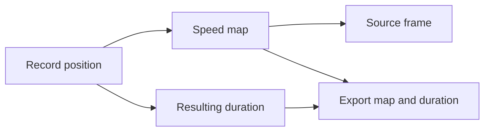

# AETHER sequence source mapping

Status: proposal for review. Specification only. No speed effect was rendered. Curves in examples are illustrative.

## Verified facts

- The timeline documents store a record range and a source range. Picture selection is ADR-002, accepted 2026-11-21, not a per-clip rounding policy. Speed maps in this file stay a proposal. They are not started.
- The brief for this set requires normal, constant slow and fast, reverse, freeze, variable, ramps, remap, and interpolation where the engine supports it.
- Export of duration alone is insufficient when the source map is more than a single constant.

## Engineering recommendations

- Store the source map on the instance. Derive duration from it for constant maps, and store duration as well so a disagreement can be detected.
- When a receiver cannot represent a ramp, report that limit. Leave the AETHER map intact.
- Keep interpolation policy explicit. An unsupported interpolation is a reported limit, not a silent change of frames.

## Proposed behaviour

### Scope

A sequence-source map binds one timeline instance to a source range on a master clip or subclip, including speed. It is the structure conform reconstructs and the structure interchange must try to carry. Pixel interpolation during playback is a processing concern. The map still names the interpolation the editor asked for, so a conform can say whether a receiver can honour it.

### Requirements

- The instance stores sequence position, source range, and the speed map as separate fields.
- Duration in sequence frames is `record_out - record_in` in the half-open model. It is a consequence of the placement. It is not a substitute for the map.
- Kinds:

| Kind | Stored map | Source advance |
| --- | --- | --- |
| `normal` | Speed `1/1` | Equal to the converted record duration at 100 percent |
| `constant` | One rational `speed_n/speed_d` other than `1/1` or negative | Linear |
| `reverse` | Negative rational | Backward through the source |
| `freeze` | Speed `0/1` plus a single source frame | Record duration may be long. Source frame stays. |
| `variable` | Piecewise rationals over record intervals | Sum of the pieces |
| `ramp` | Segments with start speed, end speed, and a named curve | Evaluated by the curve |
| `remap` | Explicit keyframes of record frame to source frame | Keyframes are authoritative |
| `interpolation` | A named mode on the instance: `nearest`, `frame_blend`, or `optical` when processing later supports it | Does not change the map’s source frames. It changes presentation only. |

- `optical` and `frame_blend` are requests. Until processing validates them, availability is `unsupported` and playback uses `nearest`, and the instance still stores the request. The report says playback simplified the presentation. The stored map is not simplified.
- Export writes the map. A constant export also writes the resulting duration. A ramp export writes the segments. If the chosen receiver format cannot hold the segments, the compatibility report lists those instances. The exporter does not replace the ramp with a single average speed in the AETHER project or in the AETHER manifest.
- A rendered fallback, if a person later asks for one, is a new representation. The instance’s map remains. This is architecture decision 11.

### Data model

```text
speed_map
  map_id
  kind
  constant        rational NULL
  segments        list
  keyframes       list
  interpolation   nearest | frame_blend | optical

segment
  record_in, record_out     sequence frames, half-open
  speed_start, speed_end    rationals
  curve                     linear | hold | bezier
  bezier                    control rationals when curve is bezier

keyframe
  record_frame
  source_frame
```

Illustrative constant case, same integers as `SOURCE_TIMECODE_AND_FRAME_ACCURACY.md`: kind `normal`, speed `1/1`, source `[296, 453)`, record in `3216`, record duration `157` sequence frames at 24/1. The source timecode label of frame 296 is `01:00:12:08`. The record label of frame 3216 may be `00:02:14:00`. Both are stored.

An illustrative ramp, not a rendered result: two linear segments, `1/1` to `1/2` over 48 sequence frames, then hold `1/2`. A CMX 3600 adapter that cannot carry that curve reports the instance. It does not write a single M2 speed and call the map preserved.



### APIs

| Operation | Contract |
| --- | --- |
| `Map.evaluate(map, record_frame)` | Returns the source frame by ADR-002 picture selection. Pure function. No stored rounding menu. |
| `Map.durationSource(map, record_range)` | Returns the source frames touched, as a range or as a list when a remap folds. |
| `Map.validate(map, source_duration)` | Checks every evaluated frame lies inside the master clip, unless the project explicitly allows black frames past the end. Default: refuse frames outside the source. |
| `Map.projectToReceiver(map, receiver_caps)` | Returns `preserved` or a loss entry. Does not modify `map`. |

`receiver_caps` is data the interchange adapter supplies, such as “constant speed only” or “no bezier”.

### Workflow

1. An editorial command writes a map when the user sets speed.
2. Playback asks `Map.evaluate` per frame and then asks processing for that source frame from the selected representation.
3. Export calls `Map.projectToReceiver`. Losses go to the compatibility report and to the conform report if the run includes exchange.
4. Conform recomputes source frames for the record range and compares them with the stored source in and out. For a ramp, the comparison is the segment list, not the record duration alone.

### Validation

- `normal` implies speed `1/1` and a source duration consistent with the rate conversion.
- `reverse` implies a negative speed and a source range that still sits inside the master.
- `freeze` implies one source frame and `record_out > record_in`.
- Segments abut and cover the record range exactly once.
- Keyframes in a remap are ordered by record frame.
- Bezier controls are rationals.
- A map that evaluates outside the source fails `Map.validate` and the instance is not silently trimmed.

### Errors

| Error | Outcome |
| --- | --- |
| Only a duration was provided for a ramp | `Map.validate` fails. Conform state `failed` for that instance. |
| Curve name unknown | Instance kept. Exchange reports unsupported. |
| Interpolation `optical` with no processing support | Presentation uses `nearest`. Map unchanged. Report lists the substitution of presentation only. |
| Receiver capability missing | Loss entry. Project unchanged. |

### Recovery

Undo of a speed command restores the previous map through the editorial operation log. Relink does not push an undo step, because relink does not change the map. A corrupt map marks that instance `failed` in conform and leaves neighbouring instances alone.

### Performance

Evaluation is per frame and must be a closed-form or a short segment walk. It does not read media. Remap keyframe counts for a feature shot are expected to be small; if a map ever holds a keyframe per frame for a whole reel, the implementation should index keyframes. No timing was measured. The specification forbids evaluating a ramp by sampling a float timebase and then rounding back as the stored definition.

### Tests

Test F includes map cases: normal at the illustrative numbers, constant `1/2`, reverse, freeze, a two-segment ramp, a remap with three keyframes, and a receiver capability that rejects the ramp. Expected export content is the segment list plus a loss entry. Specified, not executed.

### Acceptance

- Every required speed kind has a stored form.
- Duration-only export is specified as insufficient for non-constant maps.
- Silent simplification of a stored ramp is forbidden, and the report path is named.
- Interpolation is separated from the source map.

## Unresolved questions

- Bezier evaluation in rational arithmetic versus a declared high-precision decimal. Recommendation: store controls as rationals; define evaluation in a later math note before phase 2 implements it. Until that note exists, bezier ramps are stored and reported, and playback may refuse them with an explicit error rather than approximate in float and hide it.
- Whether freeze-frame extraction at a non-integer source position can occur. Recommendation: source frames are integers. A freeze names one integer source frame.
- Timewarp interpolation across a mixed-rate boundary. Recommendation: evaluate in source frames after the rate conversion, and report if the receiver’s timewarp is defined only in the sequence rate.
