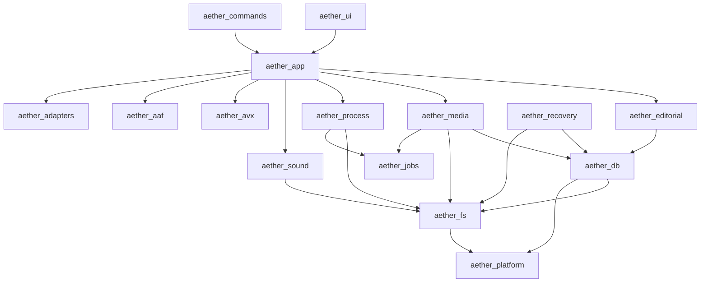

# AETHER software modules

Status: proposal for review. No module is to be coded from this document until the roadmap review says so.

Modules are the build-time expression of the seven layers in `SYSTEM_ARCHITECTURE.md`. Names here are architectural. They are not a source tree.

## Verified facts

- No source tree was available. Module boundaries are specified, not observed in a repository.
- Third-party libraries named below are candidates. A module “may encapsulate” a candidate. It does not require that candidate to be linked.
- Teams requested by the brief are UI, editorial, media management, processing, audio, interchange, QA, and build. Module ownership follows that split. Build produces packages. It is not a domain module.

## Engineering recommendations

- One public header surface per module, exchanging plain structures and integer identifiers.
- Third-party types never appear in a public header. Qt types stay in UI. FFmpeg and GStreamer types stay in processing. SQLite types stay in infrastructure.
- Cycles are forbidden. The application module is the only module that depends on more than one domain module.
- QA owns validation suites and fixtures, not product behaviour. A codec profile is “available” only when QA records a pass. Specified tests are not passes.

## Proposed AETHER behaviour

### Module catalogue

| Module | Layer | Responsibility |
| --- | --- | --- |
| `aether_ui` | Application and UI | Shell, docking, monitors, timeline widget, bins, inspectors, dialogs, shortcut capture |
| `aether_commands` | Application and UI | Command catalogue, context, shortcut map, focus routing |
| `aether_app` | Application and UI | Use cases: new project, open, ingest, edit, playback session, export |
| `aether_editorial` | Editorial | Sequences, tracks, clips, operations, undo, markers, nests, rational time |
| `aether_media` | Media management | Ingest state machine, media id, registry, relink, verification, folder policy |
| `aether_process` | Media processing | Backend interface, decode, playback clock glue, thumbnails, waveforms, transcode jobs |
| `aether_sound` | Audio | Graph, clip/track/bus, automation, meters, monitoring, sample clock |
| `aether_avx` | Interchange | AVX read/write and loss report |
| `aether_aaf` | Interchange | AAF audio profile read/write and loss report |
| `aether_adapters` | Interchange | FCP XML, FCPXML, OTIO, CMX 3600 EDL |
| `aether_db` | Infrastructure | Schema, migrations, transactions, manifest cross-check |
| `aether_fs` | Infrastructure | Path roles, atomic replace, locks, volume identity, quarantine |
| `aether_jobs` | Infrastructure | Background scheduler, pause, resume, cancel, retry |
| `aether_recovery` | Infrastructure | Autosave, snapshots, crash recovery, backup, restore |
| `aether_platform` | Infrastructure | Threads, high-resolution clock, filesystem differences |

### Dependency matrix

Rows depend on columns. `Y` is allowed. Empty is forbidden.

|  | ui | commands | app | editorial | media | process | sound | avx | aaf | adapters | db | fs | jobs | recovery | platform |
| --- | --- | --- | --- | --- | --- | --- | --- | --- | --- | --- | --- | --- | --- | --- | --- |
| ui |  | Y | Y |  |  |  |  |  |  |  |  |  |  |  |  |
| commands |  |  |  |  |  |  |  |  |  |  |  |  |  |  | Y |
| app |  | Y |  | Y | Y | Y | Y | Y | Y | Y | Y | Y | Y | Y | Y |
| editorial |  |  |  |  |  |  |  |  |  |  | Y |  |  |  | Y |
| media |  |  |  |  |  |  |  |  |  |  | Y | Y | Y |  | Y |
| process |  |  |  |  |  |  |  |  |  |  |  | Y | Y |  | Y |
| sound |  |  |  |  |  |  |  |  |  |  |  | Y |  |  | Y |
| avx |  |  |  |  |  |  |  |  |  |  |  | Y |  |  | Y |
| aaf |  |  |  |  |  |  |  |  |  |  |  | Y |  |  | Y |
| adapters |  |  |  |  |  |  |  |  |  |  |  | Y |  |  | Y |
| db |  |  |  |  |  |  |  |  |  |  |  | Y |  |  | Y |
| fs |  |  |  |  |  |  |  |  |  |  |  |  |  |  | Y |
| jobs |  |  |  |  |  |  |  |  |  |  |  |  |  |  | Y |
| recovery |  |  |  |  |  |  |  |  |  |  | Y | Y |  |  | Y |
| platform |  |  |  |  |  |  |  |  |  |  |  |  |  |  |  |

Editorial persists through `aether_db` only. It does not open files in `MEDIA/`. Media management does not include the editorial undo stack. Processing and sound receive already-resolved paths from the application.



### Team interfaces

| Team | Modules they change | Interface they must preserve |
| --- | --- | --- |
| UI | `aether_ui`, `aether_commands` | Command names and the snapshot shape they render |
| Editorial | `aether_editorial` | `EditCommand` results, rational time, undo records |
| Media management | `aether_media` | Media ID lifecycle, ingest states, relink order |
| Processing | `aether_process` | `PictureRequest`, capability query, job progress |
| Audio | `aether_sound` | Graph request, sample clock, meter snapshot |
| Interchange | `aether_avx`, `aether_aaf`, `aether_adapters` | Document version and loss report |
| QA | fixtures and suites across modules | Pass/fail records for profiles; no production shortcuts |
| Build | packaging, later | Reproducible dependency pins; no domain logic |

A change that requires two teams is a change to a contract and needs an explicit version bump of that contract.

### Process model

Recommended operating shape, when a later implementation exists:

- UI process: widgets and command dispatch.
- Disk and database work: worker threads or a worker process owned by infrastructure, never by the audio callback.
- Audio callback: in-process only if the engine meets the non-blocking contract. A separate process is allowed if the sample clock stays synchronous with picture. That split is unresolved.
- Background jobs: pool with priorities. Interactive playback outranks thumbnails. Ingest checksum outranks proxy generation. Nothing outranks a user cancel except a flush that protects originals.

### Sample command snapshot

The UI renders this. It does not compute trim.

```json
{
  "sequence_id": "seq_01H",
  "playhead": { "timebase": "24/1", "frame": 172800 },
  "tracks": [
    { "id": "V1", "kind": "picture", "target": true, "clips": 412 },
    { "id": "A1", "kind": "audio", "target": true, "arm": "read" }
  ],
  "selection": { "clips": ["clp_88"], "range": null },
  "undo_depth": 36
}
```

## Rationale

| Decision | Rationale |
| --- | --- |
| Split `aether_avx` from `aether_aaf` | Picture exchange and audio exchange have different loss rules. One module would blur the “never silently drop” reports. |
| Adapters in one module | FCP XML, FCPXML, OTIO, and EDL are secondary. They share a translation-report type. They must not pull OTIO types into editorial. |
| Editorial may use the database | The cut is persisted data. Forbidding the database would force the application to serialize every keystroke and would invite a second model. |
| Processing may not use the database | A decoder that writes registry rows can mark a failed transcode as online. Registration stays in media management. |
| Commands separated from widgets | Keyboard-first editing needs a command catalogue that tests can drive with no window. |

## Unresolved questions

- Whether `aether_sound` and picture playback share one clock service inside `aether_app` or a small `aether_sync` module. Recommendation: keep sync in the application until the clock contract stabilises, then extract it.
- Process isolation for codecs. A crash in a demuxer should not take the project file. Isolation has a latency cost. Open.
- Whether OTIO lives only inside `aether_adapters`. Recommendation: yes. OTIO is not a public type of any other module.
- Binary packaging boundaries (shared libraries versus one executable). Open, and irrelevant until a build exists.
- Plugin module. Not in the prototype. A later `aether_plugins` module may sit beside the application, not beside editorial.
