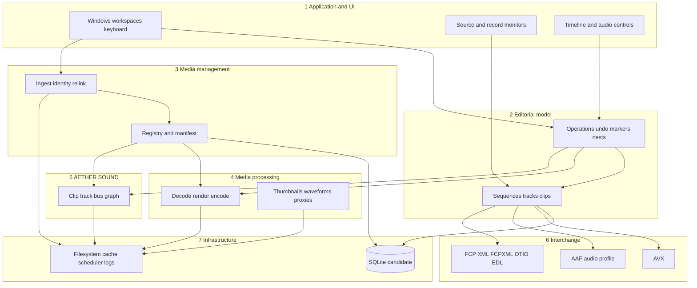
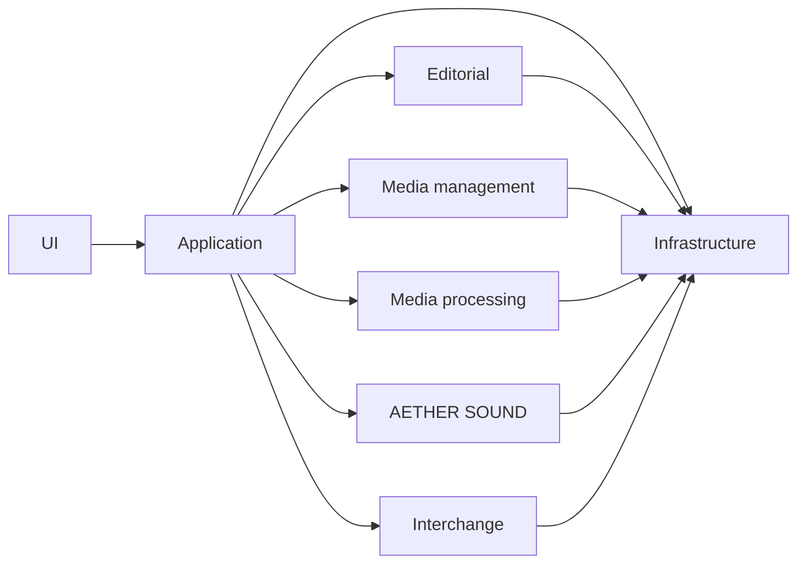

# AETHER system architecture

Status: proposal for review. This document authorises no implementation, no CMake, and no engine code.

AETHER is specified as seven independent layers with stable interfaces. The native project model is the source of truth. Playback, codecs, AVX, AAF, and other adapters are not the internal architecture.

## Verified facts

- The Fedora tree `/home/editry/development/sise-editor` was offline and was not read.
- No codec binary was executed for this document. Prior FFmpeg 9.0.2 observations are cited only as a local study to reconcile (`NATIVE_MEDIA_ARCHITECTURE.md`).
- No test against Resolve, Media Composer, Premiere Pro, or Pro Tools was executed. Names of those applications appear only as exchange targets whose behaviour must be proven later, against published specifications where those exist.
- As of 2026-11-20 the owner has accepted a direction (ADR-001, **ACCEPTED WITH CONDITIONS**): C++, Qt 6, CMake, SQLite, and FFmpeg as the mandatory core media framework. GStreamer is not a mandatory dependency. OpenColorIO, OpenTimelineIO, and DeckLink are not adopted by that decision. This document’s earlier “all of these are candidates” sentence is superseded for FFmpeg, Qt, CMake, SQLite, and GStreamer. The stack is not fully production-validated. Licensing stays open (ADR-008).

## Engineering recommendations

- Keep every layer replaceable behind a narrow interface of plain data and explicit operations.
- Put orchestration in the application layer. Domain layers do not call each other to “help”. The application joins an editorial decision to a media location and then to a processing or audio request.
- Store time as rationals and integer positions. Do not let a processing graph define the cut.
- Version every persisted contract: database schema, manifest, AVX, and the AAF profile.
- Fail closed on media safety: if a copy, checksum, or record write fails, do not publish a media record that claims success.

## Proposed AETHER behaviour

### Layers

| # | Layer | Owns | Must not own |
| --- | --- | --- | --- |
| 1 | Application and UI | Windows, workspaces, project browser, media UI, source monitor, record/program monitor, timeline view, audio timeline controls, effects UI, metadata UI, project settings, preferences, keyboard commands | Timeline mathematics, codec calls, file deletion policy |
| 2 | Editorial and project model | Project and sequence identity, timeline data, tracks, clip relationships, editorial operations, rational timebase, undo/redo, markers, nesting, persistence of the cut | Decode, device I/O, pixel rendering |
| 3 | Media management | Ingest, identity, folders, metadata extraction records, index, database records, proxies, consolidation, relink, storage roles, verification | How a frame is decoded |
| 4 | Media processing | Decode, playback pictures, render, encode, thumbnails, waveforms, proxy jobs, background jobs | The meaning of a cut; which file is the original |
| 5 | Audio engine (AETHER SOUND) | Real-time playback, clip processing, automation, mix and routing, channel map, effects, meters, monitoring, sample-accurate sync | UI threads; destructive source edits |
| 6 | Interchange | AVX, AAF profile, and adapters for FCP XML, FCPXML, OTIO, CMX 3600 EDL | Being the live project model |
| 7 | Infrastructure | Local database candidate, filesystem abstraction, storage roles, cache, scheduler, logging, diagnostics, autosave, crash recovery, backup, schema migrations | Editorial policy |

Layers 2, 3, 4, and 5 remain independently testable. A timeline can be edited with every file offline. A media record can exist with no sequence. A processing job can render a request built by a test. The audio engine can mix a buffer graph with no widgets loaded.

### System diagram



Allowed dependency direction is downward toward infrastructure and sideways only through documents passed by the application. Interchange reads and writes documents. It does not update the database except by handing a document back to editorial and media management.

### Module dependencies

Hard rule: an arrow means “may call or include the interface of”. Absence of an arrow means forbidden, including convenience calls.



Forbidden edges:

- UI to database, codecs, or the audio callback.
- Editorial to FFmpeg, GStreamer, PortAudio-class devices, or Qt widgets.
- Media management to the timeline command API.
- Media processing to undo history.
- Audio engine to widgets or to moving files.
- Interchange adapters to “fixing up” the live model in place. They return a translation report.
- Any layer to silent deletion of original media.

### Contracts that cross layers

These are conceptual types, not source code.

| Contract | Producer | Consumer | Carries | Does not carry |
| --- | --- | --- | --- | --- |
| `EditCommand` | UI | Editorial | Operation name, track targets, rational in/out, selection | Paths, pixels |
| `CompositionSlice` | Editorial | Application | Sequence position, layers, source positions, transition weights, effect parameters, media ids | Filesystem paths |
| `MediaRecord` | Media management | Application, interchange | Media ID, checksum, technical metadata, status, role | Decode context |
| `MediaLocation` | Media management | Application | Media ID, quality policy, path or offline | Permission to delete |
| `PictureRequest` | Application | Media processing | Locations plus the slice | Undo |
| `AudioGraphRequest` | Application | AETHER SOUND | Clip gains, automation, routing, media ids resolved to readable paths or silence | Widget state |
| `ExchangeDocument` | Interchange | Application | AVX, AAF, or adapter payload plus a loss report | A promise of silent fidelity |

Rational time is a pair of integers (`numerator`, `denominator`) plus an integer position in a declared timebase. Display seconds are formatted at the edge. They are never accumulated to store the cut.

### Persistence

Infrastructure stores the editorial model and the media registry in the project database and repeats a content hash and identity summary in `project_manifest.json`. On open, the database and the manifest validate each other. Disagreement opens a recovery path (`RECOVERY_AND_BACKUP.md`). It does not pick a winner silently.

Cache files are regenerable. Originals are never classified as cache.

### Processing independence

Media processing exposes a capability query: containers, codecs, sample rates, and alpha that the linked backend has demonstrated in AETHER’s own validation suite. The prior FFmpeg 9.0.2 study is a warning list, not that suite. Until a backend passes the suite, the application must not offer the corresponding mezzanine or Avid OP-Atom write as available.

The processing interface stays free of editorial types, and editorial code does not mention FFmpeg types. The core framework bound to that interface is FFmpeg (ADR-001). GStreamer is not a mandatory dependency. The editorial model still does not include either library.

### Audio independence

AETHER SOUND consumes an audio graph and returns meters, peak flags, and a running sample clock related to the picture frame by a rational mapping. The UI paints meters from a lock-free snapshot. The callback does not take the database lock and does not allocate as part of the steady-state contract. Clip, track, and bus processing remain separate non-destructive stages (`AUDIO_ENGINE_ARCHITECTURE.md`).

### Interchange independence

AVX is the open versioned picture exchange. AAF, under the AETHER Audio Exchange Profile, is the primary audio composition exchange. FCP XML, FCPXML, OTIO, and CMX 3600 EDL are additional adapters. Import constructs a native document or refuses with a report. Export reads the native document. Round-trip equality is defined as equality of preserved native fields, not as byte equality of the foreign file.

### Extensibility

Extension points, when implementation is approved, are versioned and explicit:

- processing backend
- interchange adapter
- optional monitoring device (DeckLink is a candidate, not a default)
- panel contributed through the application, not through a domain module

Plugins do not receive a writable path to the SQLite file. They receive documents and return documents.

### Failure domains

| Failure | Visible result | Preserved |
| --- | --- | --- |
| Missing volume | Media status offline | Sequence, media ids, checksums |
| Cancelled ingest | No successful media record for the failed item | Originals, partial files quarantined |
| Processing crash | Job marked failed, UI remains | Project database |
| Audio device lost | Silence on that output, picture may continue | Automation data |
| Adapter cannot map an effect | Item listed as unsupported or rendered-fallback, never dropped silently | Native project |

## Rationale

| Decision | Rationale |
| --- | --- |
| Seven layers matching the brief | Fewer layers hide audio and interchange inside “processing” and make replacement expensive. More layers split the cut from its undo stack. |
| Application is the only joiner | If editorial calls codecs, a codec change changes trim code. The seam is the point of the architecture. |
| Manifest plus database | A single SQLite file is easy to corrupt mid-write. A second identity summary detects that. Cache is not that second copy. |
| Capability query instead of compile-time codec claims | The prior FFmpeg study already shows that “MXF exists” is not “this profile is valid”. |
| Adapters outside the model | FCP XML and AAF omit or reinterpret data. Using them as storage would make their limits into AETHER’s limits. |

## Sample structure

A picture request after the application has joined a slice to locations:

```json
{
  "sequence_id": "seq_01H",
  "position": { "timebase": "30000/1001", "frame": 86400 },
  "layers": [
    {
      "track": "V1",
      "media_id": "med_01J",
      "source_frame": 12012,
      "location": {
        "role": "proxy",
        "path": "/volumes/proxy/show/MED/med_01J_proxy.mov",
        "status": "online"
      },
      "opacity": "1/1"
    }
  ]
}
```

## Unresolved decisions

Implementation waits for review. The following are open. None is settled by naming a candidate.

1. Programming language. C++ is the accepted primary language (ADR-001), with build and feasibility conditions still open. It is not production-validated.
2. UI toolkit. Qt 6 is the accepted desktop framework. Distribution obligations are unaudited (`DEPENDENCY_AND_LICENCE_AUDIT.md`, ADR-008).
3. Media framework. FFmpeg is the mandatory core. GStreamer is not a mandatory dependency. The 9.0.2 CLI has been run (`docs/validation/FFMPEG_MXF_ROUNDTRIP_TEST.md`). Library integration is **BLOCKED**. The 30000/1001 audio contract is **Failed**.
4. Real-time audio implementation inside AETHER SOUND: a dedicated engine is required by the brief; the library or the amount of custom code is open.
5. AVX canonical encoding. JSON is the recommendation in `AVX_FORMAT_SPECIFICATION.md`. Review can still choose XML. Binary is not recommended as the canonical form.
6. AAF implementation route: an existing SDK versus a profile-limited writer. Unaudited.
7. Local database: SQLite `project.db` plus a manifest is accepted (ADR-003). Feasibility is not yet measured. PostgreSQL stays out of scope.
8. Project licence (copyleft or permissive) and patent policy for ProRes and VC-3 / DNxHR.
9. Whether OP1a ProRes or DNxHR is an internal mezzanine. Blocked on validation. Prior study is not a pass.
10. Avid OP-Atom writer. Specified as a separate export. Not available until a validated writer exists. Prior study: OP-Atom optional only.
11. Persistence of channel layout, ProRes 4444 alpha, and 29.97 audio sample alignment. Prior study recorded gaps. Policy is specified so those gaps are not hidden. Re-test is open.
12. OpenColorIO adoption and how much of colour is in the first prototype (recommendation: tags and a display transform hook only).
13. Optional DeckLink monitoring. Proprietary SDK. Default off.
14. Plugin ABI and process isolation. Not in the prototype.
15. Default proxy codec and container.
16. House keyboard preset. No commercial editor’s map is copied as a claim of compatibility.
17. Multi-writer shared storage. File lock plus one editor is the recommendation. Shared database service is not.
18. Conflict rule details when database and manifest disagree beyond “do not continue silently”.
19. Nesting depth, mixed-rate conformance, and speed-ramp resampling policy.
20. How far autosave history retains media-ingest transactions versus editorial transactions.
21. Windows and macOS path, lock, and case-folding behaviour. Designed for, not exercised.
22. Governance body that can mark an unresolved item resolved after SISE review.
