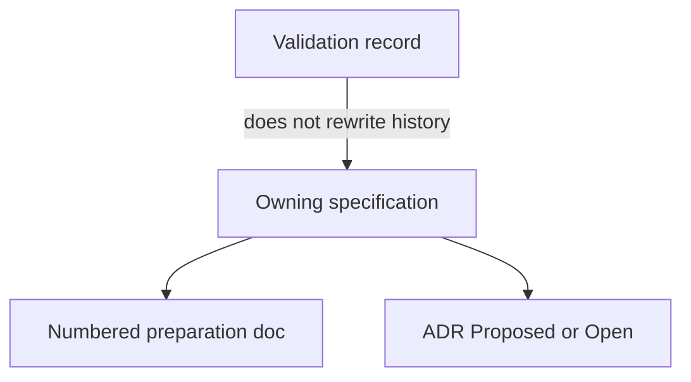

# System integration and consistency

Status: architecture preparation. This document authorises no integration code.

The product is one cutting room. The specifications were written in more than one pass. Integration means a later change keeps the invariants, and means a reader can find the document that owns a subject. The inventory of conflicts is `docs/ARCHITECTURE_AUDIT.md`. This file is the rule for staying consistent. It does not resolve the open conflicts by itself.

## 1. Ownership

| Subject | Owning documents | Do not also specify in |
| --- | --- | --- |
| Bins, membership, `.abin` | `docs/BIN_*.md` | A new clip-folder design |
| Media ID, registry, fingerprint, relink | `docs/MEDIA_IDENTITY_SPECIFICATION.md`, `docs/MEDIA_REGISTRY_SCHEMA.md`, `docs/MEDIA_RELINK_ENGINE.md`, `docs/MEDIA_FINGERPRINTING_AND_MATCHING.md` | Timeline code comments that mint ids |
| Sequences, trims, operations | `docs/TIMELINE_ENGINE_ARCHITECTURE.md`, `docs/EDITORIAL_OPERATIONS.md`, `docs/TRIM_ENGINE_SPECIFICATION.md` | The widget |
| Time | `docs/TIMEBASE_AND_FRAME_ACCURACY.md`, `docs/AUDIO_TIMEBASE_AND_SYNC.md` | A decoder timestamp |
| Audio graph | `docs/AUDIO_ENGINE_ARCHITECTURE.md` and its companions | A second gain stored only in the UI |
| MXF, ProRes, DNx profiles | `docs/NATIVE_MEDIA_ARCHITECTURE.md` and the profile specs | A claim of validation |
| Conform | `docs/ONLINE_CONFORM_ARCHITECTURE.md`, `docs/CONFORM_ENGINE_SPECIFICATION.md`, `docs/CONFORM_VALIDATION_AND_REPORTING.md` | Relink or export |
| Exchange | `docs/INTERCHANGE_ADAPTER_ARCHITECTURE.md`, AVX and AAF documents, `docs/EXCHANGE_COMPATIBILITY_MATRIX.md` | The project schema |
| UI layout | `docs/UI_ARCHITECTURE.md`, `docs/UI_UX_DESIGN_SYSTEM.md`, `docs/TIMELINE_UI_SPECIFICATION.md`, `docs/BIN_UI_SPECIFICATION.md` | Domain libraries |

Numbered preparation documents (`docs/01_…`, `docs/03_…`, and the rest of this set) point at those owners. If a numbered document and an owner disagree, the owner is the detailed contract and the disagreement is filed as **OPEN** in the audit. The numbered document is not silently “fixed” by deleting the owner.

## 2. Invariants every path keeps

**PROPOSED**, and required of any phase that starts, except item 3, which the owner accepted on 2026-11-21:

1. A bin is an object. A directory is a storage folder.
2. Media ID is stable. Timeline instances cite it.
3. Stored time is rational. Float seconds are display text. **ACCEPTED — INITIAL EDITORIAL TIME AUTHORITY** (`architecture/decisions/ADR-002-rational-time.md`). Ceiling is not the general boundary policy. There is no project-wide sample-rounding menu, no phase reset, and no stored sample clock. The displayed out-point stays **DEFERRED**. This item does not authorise a timeline.
4. Originals are not silently modified.
5. Relink updates locations. Conform writes a report. Export writes a file and a report.
6. The application joins documents. Domain modules do not call each other to help.
7. Cache is not the cut.
8. Untested vendor behaviour stays untested on the page that talks about it.

## 3. Workflow: changing a contract

1. Edit the owning document.
2. If a numbered document would become false, update the pointer or the one paragraph that restates the rule.
3. If two owners disagree, add a row to the audit’s contradiction table and an ADR with status **OPEN** or **PROPOSED**. Do not mark the ADR accepted in the same change.
4. Leave historical “no test was run” sentences in place, or add a dated note that names the log. Do not rewrite them into a pass.

## 4. Known seams that are still open

| Seam | Label | Where it is tracked |
| --- | --- | --- |
| `project.sqlite` blob package versus `project.db` tables | **OPEN** | ADR-003, audit C2 |
| Asset id versus Media ID, proxy id shape | **OPEN** | ADR-005, audit C3–C4 |
| Undo durability | **OPEN** | ADR-009 |
| Sound inside Processing versus `aether_sound` | **OPEN** | ADR-006 |
| Stack “approved” versus candidates | **OPEN** | ADR-001 |
| `BINS/` directory versus the folder spec | **OPEN** | `docs/PROJECT_STORAGE_AND_DATABASE.md` |
| Empty `docs/ARCHITECTURE.md` and the root `ARCHITECTURE.md` | **CONFIRMED** both exist. The stub stays empty | Audit §2.5 |

## 5. Failure cases

| Case | Result |
| --- | --- |
| A playback change stores a path on the instance | Rejected in review. Breaks invariant 2 |
| An export dialog sets conform status to verified | Rejected. Breaks invariant 5 |
| A new markdown file duplicates the bin member list with different required members | Rejected. Edit `docs/BIN_FILE_FORMAT_SPECIFICATION.md` |
| A README sentence says the stack is approved | Rejected while ADR-001 is Proposed |

## 6. Acceptance criteria

- A reader can start at `README.md`, reach this file, and reach the owner for each subject without finding two required member lists for `.abin`.
- Every **OPEN** item in §4 has an ADR or an audit row. Adding a new conflict without a row is a documentation defect.
- Implementation reviews include the forbidden-edge list in `docs/ENGINEERING_INTERFACES.md`.
- **CONFIRMED.** No integration test joins the modules, because the modules are not built.
