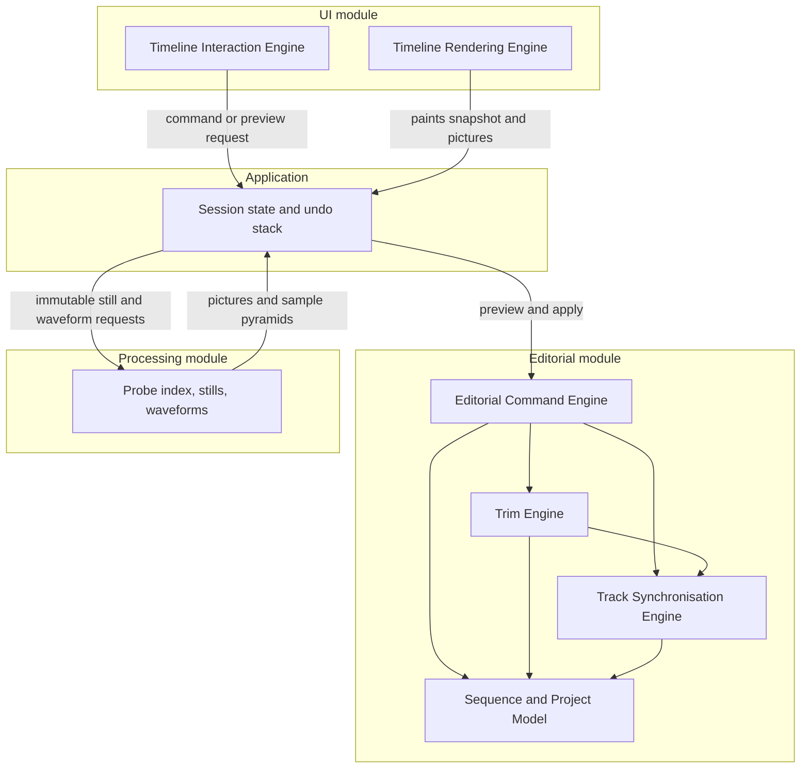
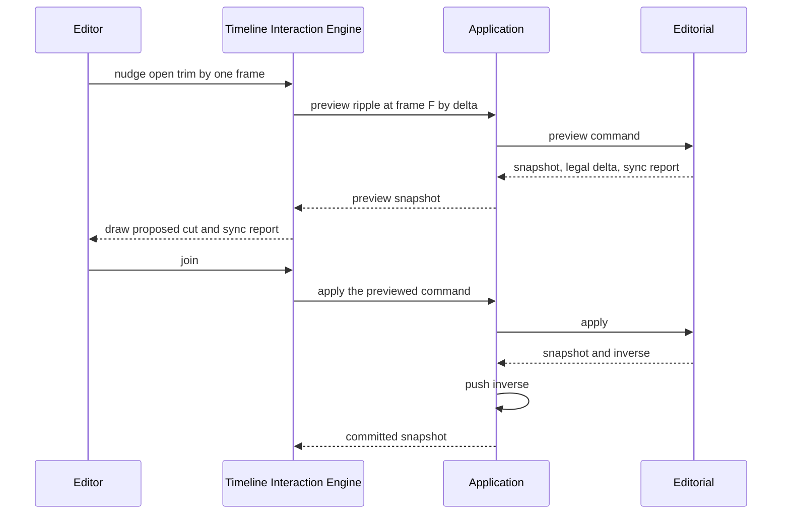
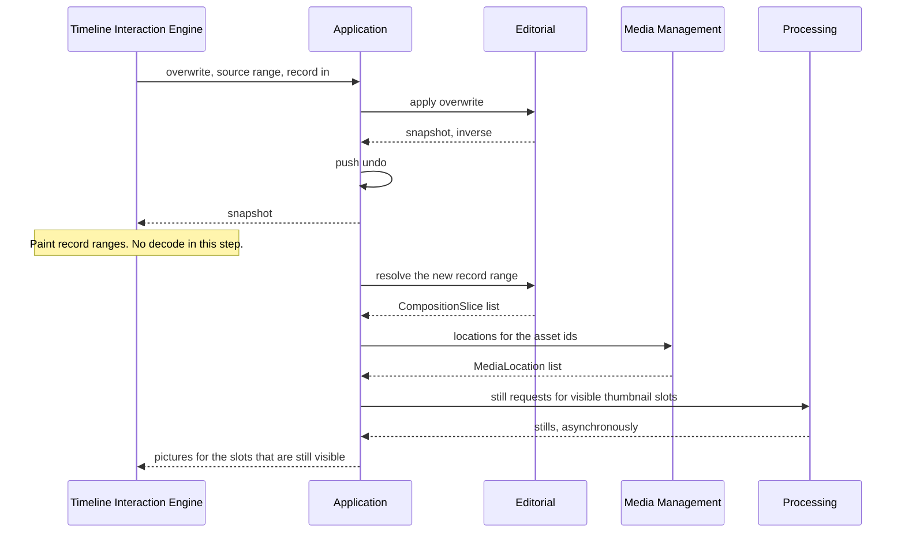

# AETHER Timeline Engine Architecture

Status: proposal, awaiting review. No implementation is authorized by this document.

This document places the timeline's engines inside the modules of [MODULES.md](../MODULES.md). It adds no row to the dependency matrix and no edge between domain modules. The Application remains the only joiner of an editorial snapshot and a media location. The UI remains the only Qt user. Processing remains the only decoder.

Read [EDITORIAL_PHILOSOPHY.md](EDITORIAL_PHILOSOPHY.md) for the cutting model these engines serve, and [TIMEBASE_AND_FRAME_ACCURACY.md](TIMEBASE_AND_FRAME_ACCURACY.md) for the integers they exchange.

## 1. The six engines

The names below are responsibilities inside modules that already exist. They are not new link targets. A later split of Editorial, if one is ever justified, follows section 16 of [MODULES.md](../MODULES.md) and revises that document first.

| Engine | Lives in | Responsibility |
| --- | --- | --- |
| Sequence and Project Model | Editorial, with the passive `TimelineDocument` in Contracts | Sequences, tracks, items, gaps, transitions, nests, markers, links, sync anchors, source ranges, record ranges. The in-memory indexes. Load and save of the timeline document. |
| Editorial Command Engine | Editorial | Atomic structural commands: insert, replace, remove, delete, split, marks, links, track flags. Asks the trim engine to perform trim-class commands. Asks the sync engine for a plan whenever duration can change. |
| Trim Engine | Editorial | Pure trim math: trim, ripple trim, roll, slip, slide, and a multi-track trim of one kind. Legal deltas. Handle limits. |
| Track Synchronisation Engine | Editorial | Sync plans, link groups, drift anchors. Consulted by the command engine and the trim engine. |
| Timeline Interaction Engine | UI, with session fields in the Application | Hit-testing, keyboard and pointer gestures, targets, patch, zoom, scroll, open-trim session, snapping. Turns a gesture into a command that carries frame numbers. |
| Timeline Rendering Engine | UI | Paints the visible window from a snapshot. Draws ruler, lanes, clips, waveforms, and thumbnails it has been given. |

Forbidden calls, restated so the diagram cannot be read loosely:

- The interaction engine and the rendering engine do not call Editorial, Processing, or Project Storage.
- The trim engine and the sync engine do not paint, do not open files, and do not decode.
- Processing does not move a cut, does not relink, and does not write the timeline document.
- The sequence model does not store pixel scales, playheads, or undo stacks.

## 2. Sequence and Project Model

**Owns.** The in-memory sequence set and the mapping to and from `TimelineDocument`. Item ids are opaque 128-bit kernel ids. Ids are stable across a trim. Split allocates a new id for the piece after the cut. Undo of that split removes the new id and restores the original range.

**Proposed document fields.** These elaborate the timeline document [MODULES.md](../MODULES.md) already names. They are part of this proposal and are frozen only when Contracts are reviewed.

| Object | Fields |
| --- | --- |
| Sequence | id, name, rate, start frame, tracks, sequence markers, sequence In, sequence Out |
| Track | id, kind (`video` or `audio`), order, name, enable, lock, sync lock, sync anchors |
| Item | id, kind (`clip`, `gap`, `transition`, `nest`), record range, source range, asset id or nested sequence id, link group id, effect parameters, colour-decision id. Picture selection is ADR-002, not a per-clip rounding menu. |
| Link group | id, members, expected difference of each member's record start from the group's primary |
| Sequence marker | id, range, text, optional clip reference (asset id and source frame) |
| Sync anchor | sequence frame, delta in frames, meaning "from this frame forward, this track differs from the sync reference by this many frames" |

A gap is an item with a record range and no asset. The recommended storage rule is that the items and gaps on a track partition that track from the sequence start frame through the track's end: half-open, no holes, no overlaps except a transition sitting on a cut. Past the track end there is no implicit gap item. The sequence duration is the maximum track end.

**Does not own.** Paths, pixels, the playhead, zoom, track targets, or the undo stack.

**Queries the other engines use.**

| Query | Result |
| --- | --- |
| `overlap(track, range)` | Items whose record ranges meet that half-open range, including items that start before it. |
| `editPoints(track, frame)` | The head, tail, or cut at that frame, if any. |
| `nextCut` / `previousCut` | The next or previous edit point at or beside a frame, on one track or across a set of tracks. |
| `usages(asset id)` | Every item in the project that references the asset, with sequence id, record range, and source range. |
| `resolve(sequence, range)` | `CompositionSlice` values, as the architecture already requires. Runs with offline assets. |
| `compositionHash(sequence, range)` | The hash playback already uses to detect a stale plan. |

`overlap` and the cut queries are the indexes the performance document bounds. The concrete index structure is an Editorial implementation choice if those bounds hold.

## 3. Editorial Command Engine

**Owns.** `apply(command)` for the structural commands, and the dispatch of trim-class commands to the trim engine. Validation. The inverse description returned to the Application.

**A command is one transaction.** The engines build the next model in private and publish it only if every invariant holds. A failure returns a structured error and the previous model. Invariants include the ones [MODULES.md](../MODULES.md) already lists, plus the sync plan's limits and the integer checks in the timebase document.

**Command identifiers.**

| Spoken name | Id | Engine that computes the result |
| --- | --- | --- |
| INSERT | `insert` | Command engine, then sync plan |
| REPLACE | `overwrite` | Command engine |
| REMOVE | `lift` | Command engine |
| DELETE | `extract` | Command engine, then sync plan |
| SPLIT | `razor` | Command engine |
| TRIM | `trim` | Trim engine |
| RIPPLE TRIM | `ripple` | Trim engine, then sync plan |
| ROLL | `roll` | Trim engine |
| SLIP | `slip` | Trim engine |
| SLIDE | `slide` | Trim engine |
| MULTI-TRACK TRIM | `trim`, `ripple`, `roll`, `slip`, or `slide`, with more than one edit point | Trim engine |
| Marker edit | `marker` | Command engine |
| Track enable, lock, sync lock | `trackEnable`, `setTrackLock`, `setSyncLock` | Command engine |
| Link, unlink | `link`, `unlink` | Command engine, via the sync engine's link rules |

`overwrite`, `insert`, `lift`, `extract`, `razor`, `trim`, `ripple`, `roll`, `slip`, `slide`, `marker`, and `trackEnable` are the identifiers [MODULES.md](../MODULES.md) already lists. `setTrackLock`, `setSyncLock`, `link`, `unlink`, and `preview` are added by this proposal.

**Apply result.**

| Field | Meaning |
| --- | --- |
| Snapshot | Sequences, tracks, and items in frame numbers, for the view. |
| Inverse | A command that restores the previous document, including item ids. |
| Playhead hint | The sequence frame where assembly conventionally parks. The Application decides whether to use it. |
| Sync report | Per-track effect: edited, padded, closed, held, drifted. The signed delta. |
| Error | Stable code, the item or track that limited the command, and a human-readable message. Empty on success. |

The Application pushes the inverse onto the session undo stack after a successful apply. Redo stores the forward command. Undo and redo go through `apply`. The stack is session state and is not required to survive a restart. That limit is accepted for the Foundation Prototype (ADR-009). Autosave, crash recovery, snapshots, and journals are separate, and a committed edit still persists in `project.db`.

## 4. Trim Engine

**Owns.** The meaning of an edit point and the legal delta for trim, ripple, roll, slip, slide, and multi-track trim. The specification is [TRIM_ENGINE_SPECIFICATION.md](TRIM_ENGINE_SPECIFICATION.md).

**An edit point** is one of:

- the head of an item on a track
- the tail of an item on a track
- a cut, which is the tail of the left item and the head of the right item, used by roll

A multi-track trim is a set of edit points of one kind, one delta in sequence frames, and one sync plan. Mixed kinds in one command are rejected.

**Preview.** `preview(command)` returns a snapshot of the model the command would produce, the greatest legal delta in the requested direction, the item or track that imposes that limit, and the sync report. It does not mutate the model and it does not return an inverse. The interaction engine uses it on every nudge and every drag sample. Join calls `apply` once.

## 5. Track Synchronisation Engine

**Owns.** The sync plan for a duration-changing command, the link-group rules, and the sync anchors on tracks.

**Recommended plan.** This is the behaviour the operations document specifies. It is open for review in section 10.

For a duration change of `D` frames at sequence frame `F` (`D > 0` lengthens, `D < 0` shortens):

| Track | Plan |
| --- | --- |
| Locked | Hold. Record a sync anchor at `F` whose delta changes by `-D` relative to tracks that moved. |
| Sync lock off | Hold. Same anchor. Drift is visible. |
| Targeted, receiving media | Edit. The command's own media lands here. The tail after the new material shifts by `D`. |
| Sync lock on, not receiving the new media, lengthen | Pad. Insert a gap of `D` at `F` and shift the tail later. |
| Sync lock on, shorten or delete | Close. Remove `|D|` frames at `F` from whatever occupies that frame, splitting an item if the frame falls inside it, and shift the tail earlier. |

Slip, slide, and roll ask for no pad and no close. Their sync report is unchanged on tracks that are not part of the edit. Link members on other tracks are part of the edit when the gesture is not isolated.

Legal `D` for a trim is the minimum the trim engine allows on every track whose source range must grow or whose transition handles must hold. Padding a gap needs no source handle. Closing by cutting existing frames needs the occupied item to be at least `|D|` frames long. A command that cannot honour the full `D` on every track in the plan fails unchanged and names the limiting track. The preview's greatest legal delta is the value the gesture can still reach.

**Links.** A link group stores the expected difference between record starts. Operations that move a group together preserve the difference. An operation that moves one member, because the editor isolated it, updates the stored difference and marks that member drifted. Split keeps the group on the left piece. The right piece is unlinked. An item is in at most one group. A group that would overlap another group is rejected.

**Derived drift.** `syncDelta(track, frame)` is the anchor in force at that frame. Zero means the track still matches the sync reference from that frame forward. The header and the lane read this query. They do not keep a second copy.

## 6. Timeline Interaction Engine

**Owns.** Translation of input into requests. Hit-testing by the pixel rule in the timebase document. The open-trim session: which edit points are open, the proposed delta, the last preview. Snapping as a session toggle. Track targets and patches as session state. Focused track.

**Session fields that already belong to the Application.** Playhead, selection, zoom, undo, source marks, quality policy. The interaction engine asks the Application to change these. It does not store a second playhead.

**Gesture path.**

The interaction engine sends the frame the editor aimed at. Editorial returns the frame the model stored. If the aimed delta is past the legal delta, preview says so, and the gesture stops on the legal frame. A typed delta past the limit is an apply that fails, and the document stays.

Snapping moves the aimed frame to a nearby event frame: a cut, a mark, a marker, or the playhead. The snapped value is still an integer frame. The toggle is session state. A modifier inverts the toggle for the duration of one gesture. Bindings for that modifier are part of the later key map.

Isolate is a modifier on a gesture. It asks the command to ignore the link group and aim at one item. The command records drift if the group required it.

## 7. Timeline Rendering Engine

**Owns.** Painting the visible window. The ruler, lane backgrounds, item rectangles, labels, thumbnail slots, waveform slots, the playhead line, mark highlights, trim terminals, snap guides, sync marks, and the sequence overview.

**Reads.** The presentation snapshot: the last editorial snapshot, the session playhead, zoom, scroll, targets, and the open preview if one exists. Pictures for thumbnail slots and waveform pyramids, already produced by Processing and handed over by the Application. Asset names, already joined onto the snapshot by the Application.

**Visible window.** The renderer asks for items that overlap the visible frame range on the visible tracks, plus items that intersect that range by starting earlier. It paints those. A feature-length sequence does not allocate an element per clip. The timeline surface is one custom-painted widget in the Qt Widgets shell. Clips are drawings in that widget.

**Pictures.** When a thumbnail slot or a waveform span enters the prefetch window, the renderer names the slot to the Application. The Application requests an immutable still or waveform from Processing. When the slot leaves, the request is cancelled if it has not finished. A missing picture paints the label and the offline or pending state. The cut remains editable.

The performance bounds are in [TIMELINE_PERFORMANCE.md](TIMELINE_PERFORMANCE.md). The visual rules are in [TIMELINE_UI_SPECIFICATION.md](TIMELINE_UI_SPECIFICATION.md).

## 8. How a replace crosses the seam

Replace is the shortest path that still uses every layer.

The gesture's success does not wait for the still. Playback, if it is running, is invalidated because the composition hash changed. The same seam builds a `RenderRequest` when the record viewer shows the frame. The timeline engines do not build that request.

## 9. Undo, identity, and failure

One successful join or one successful structural command is one undo step. Nudges inside an open preview are not steps. Abandoning the preview is not a step. Undo during an open preview cancels the preview and then, if the editor undoes again, undoes the last committed command.

Item ids survive trim, ripple, roll, slip, and slide. Insert allocates ids for the new items. Split allocates an id for the right piece. Remove and delete retire ids. The inverse recreates those ids with the same values, so a later undo step that names an id still names the same item.

A command that fails leaves ids, ranges, anchors, and marks as they were. The error names the limiting track or item. The view shows that message in the status line. It does not apply a partial plan.

Autosave writes the last committed document. It does not write the open preview and it does not write the undo stack.

## 10. Unresolved technical decisions for review

The documents in this set specify a single recommended behaviour for each item below, so a reviewer can see the consequence. Acceptance of this proposal accepts the recommendations, or sends back the items that should change. Implementation stays stopped either way.

1. **Sync-close rule.** Recommended: a lengthening duration change pads a gap on every sync-locked, unlocked track that is not receiving the new media, and a shortening change cuts the same number of frames out of whatever occupies that frame on those tracks. Locked tracks and tracks with sync lock off hold still, and a sync anchor records the drift. The published alternative is to close only as far as every such track already has a gap, and to refuse a larger close. These documents specify the recommended rule. Confirm or replace it before the trim fixtures are written.

2. **A track the plan assigned `close` or `edit` that cannot take the full delta.** Recommended: the command fails, the model is unchanged, and the error names the track. Preview exposes the greatest delta that would succeed. A track assigned `hold` — locked, or sync lock off — records drift and does not by itself fail the command. Confirm this against a partial close that leaves a shorter gap.

3. **Open-trim commit model.** Recommended: `preview` is a new Editorial operation that returns a snapshot and a legal delta without mutating; `apply` on join pushes one undo step. [MODULES.md](../MODULES.md) currently lists `apply` and `query`. Confirm the addition of `preview`.

4. **Gap storage.** Recommended: explicit gap items partition each track from the sequence start through that track's end. Confirm before the timeline document is frozen. The alternative is implicit holes, with gaps materialised only when an operation must name them.

5. **Persistence of lock, sync lock, and sync anchors.** Recommended: they are document fields. They survive save. Interchange carries them only in the SISE metadata namespace and lists them in the round-trip report. Track targets, patches, zoom, and the open preview stay session state. Confirm the document side, in particular that a reopened film still has dialogue locked and music sync-unlocked.

6. **Command identifiers added by this proposal.** `preview`, `setTrackLock`, `setSyncLock`, `link`, and `unlink`. The spoken names REPLACE, REMOVE, DELETE, and SPLIT keep the existing ids `overwrite`, `lift`, `extract`, and `razor`. Confirm the additions. No existing id is reused for a different effect.

7. **No-target default.** Recommended: with no track targets lit, insert and replace aim at every unlocked track the current patch maps a source track onto. Remove and delete aim at every unlocked track that holds media in the marked span. A trim with no target opens the item under the playhead on the focused track and its link group. Confirm.

8. **Four marks present, durations unequal.** Recommended: refuse the command. The first command set has no fit-to-fill. Confirm.

9. **Sample-boundary function.** Accepted on 2026-11-21 as part of ADR-002, not as acceptance of this whole review list. `sampleIndex(F)` in [TIMEBASE_AND_FRAME_ACCURACY.md](TIMEBASE_AND_FRAME_ACCURACY.md) is a property of the sequence rate and the output sample rate, identical for every clip. It is integer floor of the exact product from sequence frame 0. Per-clip audio rounding is rejected. A subframe position is refused or reported unsupported in the initial model. That limit is not a permanent ban. The other items in this list stay open. ADR-002 does not authorise a timeline.

10. **Zoom hit rule.** Recommended: scale is a rational pixels-per-frame; the pixel span of a frame is integer; when several frames share a pixel, the hit is the first of them. Keyboard and typed timecode name a frame directly. Confirm.

11. **Markers.** Recommended: sequence markers are Editorial document state and move with the tail; a marker on an edit point stays with the cut; a marker may store an asset id and a source frame. Source cues are catalog metadata on the asset, displayed by a join, and are not sequence structure. Confirm that split of ownership.

12. **Link groups, split, and offset links.** Recommended: a link group is a flat set of items plus expected record-start differences; groups do not overlap and do not nest; split keeps the link on the left piece and leaves the right piece unlinked. Members may have different record ranges, which is how a split edit is stored. Opening one side opens the same side of the other members unless isolate is set, and the command fails on overlap. The sync plan then runs once for the net duration change. Confirm.

13. **Transitions.** Recommended: a command that would move a transition off its cut, or leave it without the handles it needs, fails unchanged. Confirm against dropping the transition and applying the edit.

14. **Playhead hints.** Recommended: insert and replace hint the end boundary of the new material; remove hints the start of the gap; delete hints the join; split hints the new cut; a joined trim hints the edit point. The Application applies the hint. Confirm that these are session policy and not fields of the inverse command.

15. **One kind per trim command.** Recommended: a multi-track trim is several edit points of one kind, one delta, one sync plan, and one undo step. A gesture that mixes a roll on one track with a ripple on another is rejected. Confirm.

16. **Derived media geometry.** Recommended: Processing stores a regenerable pyramid of per-channel min/max waveform bins, and stills at a fixed set of source-frame strides. The renderer requests visible slots plus a short prefetch and cancels the rest. The stride set and the prefetch length are numbers still to choose. Confirm that both artifacts live in `cache/` and that deleting them changes no composition hash.

17. **Trim pictures in the record viewer.** Recommended: an open trim shows the frames on either side of each opened cut by resolving those frames through the existing still path. There is no second compositor and no decode inside Editorial. Confirm.

18. **Clipboard.** Recommended: the Application holds a session clipboard of item descriptors. Paste is an insert or a replace. The clipboard is not a timeline-document field and does not survive process exit. Copy of a partial item splits in the command that fills the clipboard. Confirm that this facility waits until the ten operations exist, and that it is not required to specify them.
