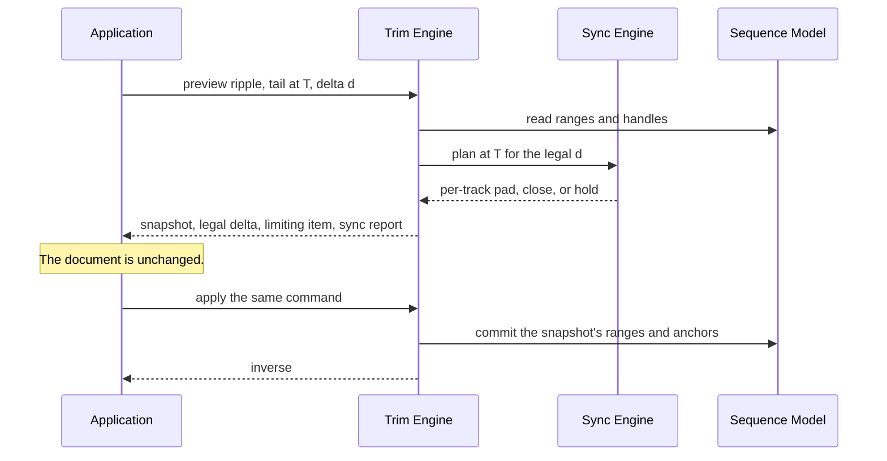

# AETHER Trim Engine Specification

Status: proposal, awaiting review. No implementation is authorized by this document.

The trim engine is part of Editorial. It computes trim, ripple trim, roll, slip, slide, and multi-track trim. It does not paint, decode, or own the undo stack. A trim’s undo step is a session command (ADR-009), not an autosave and not a journal row. Placement and the sync plan are in [TIMELINE_ENGINE_ARCHITECTURE.md](TIMELINE_ENGINE_ARCHITECTURE.md). The integers are in [TIMEBASE_AND_FRAME_ACCURACY.md](TIMEBASE_AND_FRAME_ACCURACY.md). Each operation's full effect on the sequence is in [EDITORIAL_OPERATIONS.md](EDITORIAL_OPERATIONS.md).

## 1. Inputs and outputs

A trim command carries:

| Field | Meaning |
| --- | --- |
| Kind | `trim`, `ripple`, `roll`, `slip`, or `slide` |
| Edit points | One or more heads, tails, or cuts, each naming a track and an item |
| Delta | An `int64` count of sequence frames. Positive moves the opened boundary toward later frames. |
| Isolate | When set, link members are not opened automatically. |

`preview` returns the model that `apply` would commit, the greatest delta in the requested direction that still satisfies every limit, the track or item that sets that limit, and the sync report. `preview` does not mutate. `apply` commits that result or leaves the model unchanged.

At matching source and sequence rates the source delta equals the sequence delta. At mixed rates the source delta is the integer mapping in the timebase document, using the clip's stored conform policy. A `hold` clip has no source handle to reveal. Its record range may still change when the operation only moves sequence time, and it fails when the operation would require a second source frame.

## 2. Edit points

| Point | Opened by | Positive delta |
| --- | --- | --- |
| Tail | The end boundary of one item | That boundary moves later. |
| Head | The start boundary of one item | That boundary moves later. |
| Cut | The shared boundary of a left item and a right item | The cut moves later. Used by roll. |

A head or a tail is the point a single-sided trim or ripple moves. A cut is the point a roll moves. Slip and slide name the item, and the engine opens both of that item's source edges or both neighbouring boundaries as the tables below require.

The limit span is the half-open sequence range the preview says the boundary may still travel. The interaction engine draws it. The renderer does not compute it.

## 3. Single-sided trim

Command id `trim`. Sequence duration is unchanged. The sync plan is empty. Other tracks stay still, including sync-locked tracks, because the sequence does not change length.

### 3.1 Tail

Positive `d` lengthens the item into the following gap.

| | |
| --- | --- |
| Record end | `+= d` |
| Source end | `+= sourceDelta(d)` |
| Following gap | Shrinks by `d` |
| Later items | Stay |
| Limit | Source handle beyond the current source end, and the following gap's duration. A following clip that starts at this boundary is a gap of zero, so a positive `d` fails. A negative `d` shortens the item and grows the following gap. The item's duration must remain at least one frame, unless `d` removes it entirely, in which case the item becomes a gap that fills its old record range. |

### 3.2 Head

Positive `d` moves the head later. The item shortens. A gap opens, or the preceding gap grows.

| | |
| --- | --- |
| Record start | `+= d` |
| Source start | `+= sourceDelta(d)` |
| Preceding gap | Grows by `d` |
| Later items | Stay |
| Limit | For a negative `d` (head moves earlier, item lengthens), the preceding gap and the source handle before the current source start. |

A trim never overlaps the neighbour. Consuming the neighbour's media is a roll or a slide.

## 4. Ripple trim

Command id `ripple`. The boundary's content change is the same as a trim. The tail of the sequence moves so that no gap is created by the ripple itself. Sync-locked tracks take the plan in the engine architecture.

Let `T` be the sequence frame of the opened boundary before the command.

### 4.1 Tail ripple

| Delta | This item | Items that start at or after the old record end | Sequence duration | Other sync-locked tracks |
| --- | --- | --- | --- | --- |
| `+d` | Record end and source end grow by `d` | Shift later by `d` | `+= d` | Pad a gap of `d` at `T` |
| `-d` | Record end and source end shrink by `d` | Shift earlier by `d` | `-= d` | Close `d` frames at `T` |

### 4.2 Head ripple

The cut stays at `T`. The previous item stays. The clip's length changes, and everything that began at the clip's old record end moves.

| Delta | Source start | Record start | Record end | Tail from the old record end | Other sync-locked tracks |
| --- | --- | --- | --- | --- | --- |
| `+d` (shorten) | `+= sourceDelta(d)` | Unchanged | `-= d` | Shift earlier by `d` | Close `d` frames at `T` |
| `-d` (lengthen) | `-= sourceDelta(d)` | Unchanged | `+= d` | Shift later by `d` | Pad a gap of `d` at `T` |

Lengthening a head needs source media before the current source start. Shortening needs the item to contain `d` frames. The previous item is not overwritten: the extra or missing frames are accounted inside this item's record range, and the later sequence moves.

### 4.3 What close and pad do on a track that was not opened

**Pad.** Split the occupying item at `T` if `T` is interior. Insert a gap of `d`. Shift the right piece and every later item by `+d`. Source ranges of the pieces stay contiguous with the media they already used.

**Close.** Remove the half-open record range `[T, T+d)`. Split occupants at the ends of that range. Retire or shorten them. Shift every item that started at or after `T+d` earlier by `d`. A track that does not contain `d` frames from `T` onward cannot close. The command fails and names that track.

**Hold.** Locked tracks, and tracks with sync lock off, do not pad or close. A sync anchor is written at `T`. A positive anchor delta means that track's material lies later than the tracks that moved, by that many sequence frames. Lock wins over sync lock: a locked track holds even when its sync-lock flag is set.

Slip, slide, and roll do not pad or close.

## 5. Roll

Command id `roll`. One cut, one delta. Sequence duration is unchanged. Items beyond the right item stay. Sync anchors stay.

Positive `d` moves the cut later.

| Side | Record | Source |
| --- | --- | --- |
| Left item | End `+= d` | End `+= sourceDelta(d)` |
| Right item | Start `+= d` | Start `+= sourceDelta(d)` |

The left item's start and the right item's end stay. The left side must have source handle for a positive `d`. The right side must have source media to give up for a positive `d`, and source handle before its start for a negative `d`. Either item's duration after the roll is at least one frame, or the command fails at the last legal frame where both sides still exist. A cut with no left item or no right item is not a roll. A cut against a gap is a roll: the gap changes duration and has no source handle to run out of, and the clip on the other side still has to have source.

## 6. Slip

Command id `slip`. The record range is unchanged. Both source edges move by the same source delta. Sequence duration is unchanged. Neighbours are unchanged. The sync plan is empty.

Positive `d` moves the source window later:

```
sourceStart += sourceDelta(d)
sourceEnd   += sourceDelta(d)
```

The limit is the source media before `sourceStart` for a negative `d`, and the source media after `sourceEnd` for a positive `d`. A `hold` item cannot slip. A gap cannot slip.

The picture at each sequence frame inside the record range changes. The frames where the clip begins and ends on the timeline do not.

## 7. Slide

Command id `slide`. The item's source range is unchanged. Its record range moves by `d`. The previous item and the next item on that track absorb the move. Sequence duration is unchanged.

Positive `d` moves the item later.

| Item | Change |
| --- | --- |
| Sliding item | Record start and record end `+= d`. Source range unchanged. |
| Previous item | Record end `+= d`. Source end grows by `sourceDelta(d)`. |
| Next item | Record start `+= d`. Source start grows by `sourceDelta(d)`. |

A positive slide needs source handle on the previous item's tail, and needs the next item to contain `d` frames to give up. A negative slide needs the previous item to contain `|d|` frames, and needs source handle on the next item's head. A gap absorbs either side without a source handle. A slide with no previous item or no next item fails. The sliding item may not cross the far side of a neighbour: the greatest legal `|d|` is the neighbour's available handle or duration.

## 8. Multi-track trim

A multi-track trim is one kind, one delta, and several edit points, committed as one apply and one undo step.

Rules:

1. Kind is one of trim, ripple, roll, slip, or slide. A command that mixes kinds is rejected.
2. For trim, ripple, and roll, every opened edit point lies on the same sequence frame. The sync plan runs once, at that frame.
3. Link members that share the frame are opened with the gesture, unless isolate is set.
4. The legal delta is the minimum legal delta of the members. Preview names the member that limits it.
5. Slip of a link group slips each member's own source by the same sequence delta. Record ranges stay. If a member is `hold` or would leave its source, that member limits the delta.
6. Slide of a link group moves each member's record range by the same delta and adjusts each track's own neighbours. One member that lacks a neighbour or a handle limits the whole command.

### 8.1 Offset links

A link group may contain items whose record ranges differ. That is a split edit: picture and sound change at different frames.

Opening one side of any member opens the same side of the other members, unless isolate is set. Each member's own boundary moves by the same delta. The command fails if any track would overlap. The sequence duration changes by the change in the maximum track end, and the sync plan uses that net delta once, at the earliest opened boundary. Isolate moves one member and records drift on the group when the stored record-start difference no longer holds.

This is the rule the operations use for an L-cut and a J-cut. It is covered by review item 12 in the engine architecture.

## 9. Handles, transitions, and nests

A handle is the source media inside the known source duration and outside the current source range. The side a lengthening operation needs:

| Operation | Handle required |
| --- | --- |
| Tail lengthen, roll cut later, slide later | Media at and after the current source end, on the item that grows its tail |
| Head lengthen, roll cut earlier, slide earlier | Media before the current source start, on the item that grows its head |
| Slip later | Media at and after the current source end |
| Slip earlier | Media before the current source start |

When the document carries no source duration, the handle is treated as available and the resolver still emits the source frame. Playback shows offline or a slate if the media cannot provide it. The editorial command does not invent a duration.

A transition is an item whose record range lies on the cut it names. A roll moves that record range by the same delta as the cut. A ripple that moves the cut's tail moves the transition with the cut. If the transition would no longer lie on the cut, or if either neighbouring source range cannot cover the transition after the trim, the command fails unchanged and names the transition.

A nest is a clip whose source is an inner sequence. Trim math uses the inner rate as the source rate and the outer clip's conform policy. The inner sequence is not modified.

Effect keyframes are integer sequence frames on the item. Keyframes strictly after a boundary that moves with the tail shift by the tail's delta. Keyframes inside a range that close or remove retires are removed. Keyframes are not resampled.

## 10. Preview and join



Playing across an open trim, when the editor asks for it, resolves the preview snapshot at the playhead through the ordinary still path. The trim engine returns frames and ranges. It does not build a `RenderRequest`.

Join applies the previewed command. If the document changed between preview and apply, apply recomputes. On success it commits the new result. On failure it leaves the document as it was. The inverse restores ranges, ids, anchors, link differences, and keyframes.

## 11. Worked limits

Sequence at 24/1. One track. Shot A record `[0, 48)` source `[100, 148)`. Shot B record `[48, 144)` source `[10, 106)`. Shot C record `[144, 240)` source `[0, 96)`. Source WS holds frames `[0, 400)`. Source CU holds frames `[0, 200)`.

| Command | Result | Why the limit is what it is |
| --- | --- | --- |
| Roll the cut at 48 by `+4` | A becomes `[0, 52)` source `[100, 152)`. B becomes `[52, 144)` source `[14, 106)`. | A has media after 148. B has frames to give after 10. |
| Roll the cut at 144 by `-10` | Fails at the legal maximum of 0 in that direction for C's head. | C's source start is 0. Moving the cut earlier lengthens C's head. |
| Slip B by `+5` | B record stays `[48, 144)`. Source becomes `[15, 111)`. | 111 is inside WS. |
| Slide B by `+6` | B record `[54, 150)` source unchanged. A end becomes 54, source end 154. C becomes `[150, 240)` source `[6, 96)`. | A has tail handle. C has 6 frames of head to give. |
| Slide B by `-6` | Fails. Legal delta is 0 toward earlier. | C would need source frames before 0. |
| Ripple B's tail by `-12` | B ends at 132. C moves to `[132, 228)`. Duration becomes 228. | B contains 12 frames. The tail shifts earlier. |
| Trim B's tail by `+8` | Fails. | The next item is a clip, so the following gap has duration 0. |

The same numbers with a linked audio item of the same record ranges move both items, and the legal delta is the smaller of the two handles.
