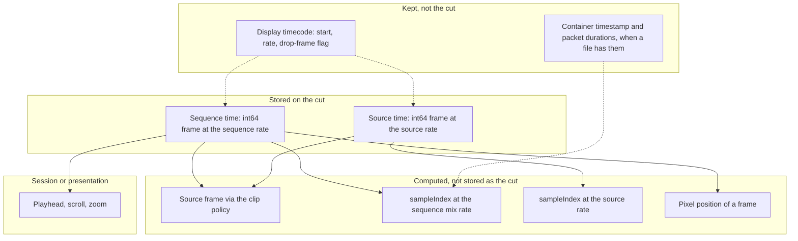

# ADR-002 time-authority decision review

## Owner decision recorded after this review

On 2026-11-21 the project owner accepted ADR-002 as **ACCEPTED — INITIAL EDITORIAL TIME AUTHORITY**. The acceptance is `architecture/decisions/ADR-002-rational-time.md`. This review did not grant it. The body below is the pre-decision paper. Its recommendations and its closing line are that paper. They are not rewritten into the acceptance.

The owner adopted the frame clock, hybrid ranges, the floor audio boundary, the measured integers 12812, 12813, and 320320000, and a frame-only initial scope. The owner did not adopt two recommendations of this paper:

- An exact picture tie selects the earlier frame. This paper had described a tie toward the greater index.
- A fractional-sample mapping is not an error. A sync warning is only when a source offset or an operation cannot be represented in the frame-only model. This paper had treated a container sample mismatch as a sync warning.

Ceiling stays rejected. The displayed out-point stays **DEFERRED**. The MXF encoder log was not rewritten. ADR-006 and ADR-007 were not part of the acceptance. No slice was started.

**SLICE 0A COMPLETE — DEVELOPMENT FROZEN PENDING NEXT AUTHORISATION.**

## Pre-decision review

**PROPOSED — PENDING PROJECT-OWNER DECISION** was the status of this paper when it was written. This review does not accept ADR-002. ADR-006 and ADR-007 stay **PROPOSED** and are not interpreted here. No playback path is designed. No slice is started.

**SLICE 0A COMPLETE — DEVELOPMENT FROZEN PENDING NEXT AUTHORISATION.**

## 1. How to read the labels

Every claim below carries one of these labels.

| Label | Meaning in this file |
| --- | --- |
| Confirmed requirement | The owning time documents agree on the sentence. Agreement is not acceptance of ADR-002. |
| Slice 0A behaviour | What the prototype timing function does, and what the Slice 0A validation recorded. |
| Engineering recommendation | A recommendation of this review. It is not an owner decision. |
| Unresolved | The inspected documents disagree, or a document marks the point open. |
| Owner approval | A question only the project owner can close. |

`docs/SOURCE_TIMECODE_AND_FRAME_ACCURACY.md` uses the phrases "architecture decision 7" and "architecture decision 8" for display-out storage and for the audio storage domain. Those phrases are unresolved questions in that file. They are not ADR-007. ADR-007 remains the relink, conform, and exchange decision, and this review does not touch it.

## 2. Documents read, and the contradictions

Read from the files: `architecture/decisions/ADR-002-rational-time.md`; `docs/05_TIMEBASE_AND_TIMING_ARCHITECTURE.md`; `docs/TIMEBASE_AND_FRAME_ACCURACY.md`; `docs/AUDIO_TIMEBASE_AND_SYNC.md`; `docs/TIMELINE_ENGINE_ARCHITECTURE.md`; `docs/EDITORIAL_OPERATIONS.md`; `docs/EDITORIAL_PHILOSOPHY.md`; `docs/SOURCE_TIMECODE_AND_FRAME_ACCURACY.md`; `docs/validation/AUDIO_FRAME_SAMPLE_BOUNDARY_VALIDATION.md`; `docs/validation/SLICE_0A_PROJECT_CORE_VALIDATION.md`; `docs/NEXT_DEVELOPMENT_SLICE_PROPOSAL.md`; `docs/ENGINEERING_INTERFACES.md`; `docs/SYSTEM_INTEGRATION_AND_CONSISTENCY.md`. The timing helper was skimmed at `include/aether/core/timing/sample_boundary.hpp` and `src/core/timing/sample_boundary.cpp`. Interchange statements were taken from `docs/INTERCHANGE_ADAPTER_ARCHITECTURE.md`, `docs/AVX_FORMAT_SPECIFICATION.md`, `docs/AAF_AUDIO_EXCHANGE_PROFILE.md`, `docs/AAF_MEDIA_REFERENCE_PROFILE.md`, and `docs/EXCHANGE_COMPATIBILITY_MATRIX.md`. `docs/PROJECT_DATABASE_SCHEMA.md` was used only as a proposed column list. Slice 0A did not create those columns.

Contradictions:

1. **Sample rounding.** [Unresolved.] `docs/TIMEBASE_AND_FRAME_ACCURACY.md`, `docs/AUDIO_TIMEBASE_AND_SYNC.md`, and timeline-engine review item 9 specify `sampleIndex` as integer floor of the exact product, one function for the whole sequence. ADR-002 proposes that derivation. `docs/SOURCE_TIMECODE_AND_FRAME_ACCURACY.md` writes `round_policy`, lists `nearest`, `floor`, and `ceil`, and says the default is `nearest`, "as in the timeline engine." The timeline engine's own review item recommends floor. Those sentences do not describe one policy.

2. **Where the picture-mapping policy is stored.** [Unresolved.] `docs/TIMEBASE_AND_FRAME_ACCURACY.md` and ADR-002 put `nearest`, `floor`, or `hold` on the clip. `docs/SOURCE_TIMECODE_AND_FRAME_ACCURACY.md` says the chosen policy is stored on the project. A clip policy and a project policy are different records.

3. **Whether a sample index is stored.** [Unresolved.] `docs/AUDIO_TIMEBASE_AND_SYNC.md` says a command stores frames and does not store the sample index it caused. `docs/SOURCE_TIMECODE_AND_FRAME_ACCURACY.md` says picture duration and audio sample count are both stored, and its unresolved "decision 8" asks whether samples live at the source rate, the sequence rate, or one project tick. `docs/PROJECT_DATABASE_SCHEMA.md` proposes `duration_samples` and a keyframe domain that includes `sample`. That schema is a proposal. Slice 0A did not build it.

4. **The words "stored policy".** [Unresolved until the owner separates them.] ADR-002's clip policy is the picture conform policy (`nearest`, `floor`, `hold`). Timeline-engine item 9 warns that the same words must not become a per-clip audio rounding, because two clips would then disagree about the sample at which frame `F` starts. The documents name the danger. They do not yet put the two policies in separate owner-facing questions.

5. **A timing test that one document says does not exist.** [Confirmed requirement of the later record, against a stale sentence.] `docs/05_TIMEBASE_AND_TIMING_ARCHITECTURE.md` section 5 says no such test exists and that `tests/` is empty. Slice 0A later added the timing tests recorded in `docs/validation/SLICE_0A_PROJECT_CORE_VALIDATION.md`. The older sentence was not rewritten. The validation report is the later fact.

6. **Whether a named 29.97 file failed.** [Slice 0A behaviour and the boundary validation.] `docs/SOURCE_TIMECODE_AND_FRAME_ACCURACY.md` says the earlier FFmpeg note is a reconcile case, not a pass or a fail of a file that document opened. `docs/validation/AUDIO_FRAME_SAMPLE_BOUNDARY_VALIDATION.md` later measured named files. At 30000/1001, eight frames, the MXF audio `duration_ts` was 12813 against the editorial 12812. That encoder test stays **failed**. The older sentence limits what that source-timecode document itself measured. It does not clear the later failure.

7. **Half-open storage and an inclusive displayed out.** [Unresolved.] `docs/TIMEBASE_AND_FRAME_ACCURACY.md` and `docs/EDITORIAL_OPERATIONS.md` store `[start, end)`. `docs/SOURCE_TIMECODE_AND_FRAME_ACCURACY.md` also stores half-open ranges and says the displayed out is the last included frame. It still lists that display rule as unresolved.

8. **Two uses of `nearest`.** [Confirmed requirement that they are different operations, if the floor rule stands.] `docs/AUDIO_TIMEBASE_AND_SYNC.md` converts a typed millisecond duration to a frame count with the timebase `nearest` rule, then stores frames. The sample boundary of a frame index is floor. Merging those into one rounding name would change `sampleIndex`.

No inspected document accepts float seconds as the stored position. [Confirmed requirement of the proposed texts.] ADR-002's status line is still **PROPOSED**, and its confirmation line is "None."

## 3. Rational rates and int64 frame positions

[Confirmed requirement.] A `Ratio` is a reduced pair of integers. The denominator is greater than zero. A `FrameRate` is a ratio in frames per second. Ordinary values named in `docs/TIMEBASE_AND_FRAME_ACCURACY.md` are 24/1, 25/1, 24000/1001, 30000/1001, 48/1, and 60000/1001. `docs/SOURCE_TIMECODE_AND_FRAME_ACCURACY.md` also names 30/1, 50/1, and 60/1, and allows any positive integer pair. Reduction uses exact integer arithmetic.

[Confirmed requirement.] A position at a rate is an `int64` frame index. Frame 0 is the origin of that count. A stored position is greater than or equal to zero. A `Range` is half-open `[start, end)` at one rate. `end < start` is rejected. Sequence frames and source frames are not added together. A legal delta is an `int64` count of frames at one named rate. Checked addition fails on overflow, on a negative stored position, on a source range outside a known duration, and on an overlap that is not a transition. The document stays as it was.

[Confirmed requirement.] Each sequence has one rate. A project may hold sequences at different rates. No project-wide rate overrides a sequence. The editorial quantum in `docs/EDITORIAL_PHILOSOPHY.md` is the sequence frame.

[Slice 0A behaviour.] The prototype `FrameRate` is two `int64` fields. The helper does not reduce a ratio, does not store a frame index, and does not create a sequence. Its header says ADR-002 is not accepted.

[Owner approval.] Whether those stored forms become the accepted authority is the ADR-002 question. This section does not answer it.

## 4. Time domains

[Confirmed requirement.] The cut uses two stored clocks. The session adds a third, and that third is not a timebase of the film.



| Domain | Class in the owning time documents | What it is allowed to decide |
| --- | --- | --- |
| Sequence time | Authoritative for the cut. [Confirmed requirement.] | Record ranges, sequence marks, the frame a command names |
| Source media time | Authoritative for which source frame an instance uses. [Confirmed requirement.] | The source range at the source rate |
| Timeline position | Session view of sequence time. [Confirmed requirement.] | Playhead, scroll, zoom. Interchange may ignore a saved playhead. Zoom and scroll are not timeline-document fields |
| Video frames | The same integer frames, at the rate of the side being named. [Confirmed requirement.] | Not a third index beside source time and sequence time |
| Audio samples | Derived by `sampleIndex`. [Confirmed requirement of the timebase and audio documents.] Storage of a sample count is [Unresolved] in the source-timecode document |
| Container timestamps | Source-preserving measurements. [Engineering recommendation drawn from the boundary validation.] | A disagreement sets `sync_warning`. It does not replace the frame index |
| Display timecode | A label. [Confirmed requirement.] | Identification and display. Not the stored position |

[Confirmed requirement.] A still uses `hold`: every record frame maps to one source frame. A nested sequence uses the inner sequence's rate as the source rate of the outer clip. A device clock is not the playhead. `docs/SYSTEM_INTEGRATION_AND_CONSISTENCY.md` gives time to the timebase and audio documents, and says a decoder timestamp is not the place to specify it.

## 5. Integer range, overflow, and float

[Confirmed requirement.] The mapping product is computed in a width that can hold it, or the conversion fails. It does not pass through binary floating point. It does not saturate silently. A zero or negative denominator is rejected at the ratio. Floating-point seconds may be formatted for a person. They are not written into the document, the undo record, the resolver, a render request, or an AVX rational.

[Slice 0A behaviour.] `sampleBoundary` rejects `n < 0` with `NegativePosition`. It rejects a non-positive sample rate or rate component with `InvalidRate`. It multiplies with a 128-bit unsigned integer and returns `Overflow` when the product does not fit that width or the quotient does not fit in `int64`. The quotient is the floor of the exact product because the division is of non-negative integers. `sampleCount` is the difference of the two boundaries when `end >= start` and both boundaries succeed. The prototype requires a compiler `__int128`. That type is not a portable acceptance of a C++ standard, and C++17 remains prototype-only.

[Engineering recommendation.] Fail closed stays the rule for any later authorised timing code. The 128-bit compiler type is a prototype mechanism, not an owner decision about the language standard.

[Owner approval.] Rejecting float as the authority is already the proposed text. Accepting that rejection is still the owner's ADR-002 answer.

The published walk fits. [Slice 0A behaviour.] `sampleIndex(200000)` at 30000/1001 and 48000 Hz is 320320000. The product `200000 * 48000 * 1001` fits in the width the prototype uses. A larger triple that does not fit is an error, not a wrapped index.

## 6. Mixed-rate policies and nine scenarios

The picture question is which identity survives. [Engineering recommendation.] Three policies are compared here. They are not the clip's `nearest`, `floor`, and `hold` rules. Those three remain the mapping used inside policy C.

| Policy | What is stored as the cut | What is recomputed |
| --- | --- | --- |
| A. Sequence-authoritative | The record range at the sequence rate | The source frame, whenever a session needs it |
| B. Source-preserving | The source range at the source rate | The sequence span, from the source |
| C. Hybrid | Both ranges, plus one sequence rate, plus the clip's mapping policy | Nothing on reopen. The same integers are read back |

[Engineering recommendation.] A feature cut has to reopen on the same sequence frame and on the same source frame. Policy A keeps the sequence frame and can change the source frame if the mapping is later applied differently. Policy B keeps the source frame and gives up "one sequence, one rate," because each clip would drag its own rate onto the timeline. Policy C stores both integers, so reopen is a read, and a policy change is a document edit. C is recommended because both identities are part of the cut. It is not recommended because it has fewer fields. A and B have fewer fields and lose one identity.

[Confirmed requirement of the formula, still proposed.] For sequence frame `S` inside a record range, `k = S - recordStart`. At matching rates, when the policy is not `hold`, `sourceFrame = sourceStart + k`. When the rates differ, `sourceOffset = divide(k * Nr * Ds, Dr * Ns, policy)` and `sourceFrame = sourceStart + sourceOffset`. `floor` is the quotient. `nearest` adds one when `2 * remainder >= denominator`, so a tie moves toward the greater frame index. `hold` keeps `sourceStart`.

### Worked conversion

[Confirmed requirement.] Sequence 24000/1001, source 24/1, record start 0, source start 0, `k = 500`. The division is 500500 / 1000, quotient 500, remainder 500, an exact half.

| Clip policy | Source frame |
| --- | --- |
| `floor` | 500 |
| `nearest` | 501 |
| `hold` | 0 |

[Engineering recommendation, illustration of the same formula, not a fixture in the tree.] Sequence 25/1, source 24/1, `k = 25` is one sequence second: 600 / 25 = 24 exactly, so `floor` and `nearest` both yield source offset 24. At `k = 1` the quotient is 0 and the remainder is 24. `floor` yields 0. `nearest` yields 1, because `2 * 24 >= 25`. The first sequence frame is already a policy decision. A fixture for that pair is not in the repository.

### The nine scenarios

[Engineering recommendation.] The documents do not number nine scenarios. This table collects the nine cases they do name, and says what A, B, and C would keep. Expected integers are quoted only where a document already publishes them.

| # | Case | A keeps | B keeps | C keeps |
| --- | --- | --- | --- | --- |
| 1 | Matching rates, policy not `hold`. [Confirmed requirement.] `sourceFrame = sourceStart + k` | Record range. Source is implied and can be rewritten by a bad remap | Source range. Sequence length is a copy of the source length | Both ranges. The identity is exact |
| 2 | 24000/1001 sequence, 24/1 source, `k = 500`. [Confirmed requirement.] Floor 500, nearest 501 | One of those frames, only if the policy is reapplied the same way | The original source range, and no single sequence rate unless the sequence becomes 24/1 | Both ranges and the stored policy, so 500 or 501 stays the stored source frame |
| 3 | 24/1 sequence, 24000/1001 source. [Unresolved as a fixture.] The formula is specified. The inverse integers are not a published fixture | A recomputed source frame | The 24000/1001 source range | Both, once a fixture names the integers |
| 4 | 25/1 against 24/1. [Unresolved as a fixture.] Both rates are ordinary values. One sequence second maps to 24 source frames exactly under the formula | The sequence second | 24 source frames, with the sequence rate pulled toward 24 | Both, with the first-frame floor/nearest split stored by the policy |
| 5 | 30000/1001 sequence and a 24/1 or 24000/1001 source. [Unresolved.] No published source-frame fixture for this pair | A recomputed film frame inside a 29.97 record | The film source, and the sequence stops being only 30000/1001 | Both, after a fixture is written. The audio boundary in section 7 is a different measurement |
| 6 | Still, generator, or freeze. [Confirmed requirement.] `hold`: every `k` maps to `sourceStart`. A freeze has zero source advance and a positive record duration | A record duration and one frame, if `hold` is reapplied | One source frame, and no honest record duration | The record range, `sourceStart`, and `hold` |
| 7 | Nested sequence. [Confirmed requirement.] The inner rate is the source rate of the outer clip | The outer record range | The inner sequence's own frames | The outer record range and the inner source range, mapped by the clip policy |
| 8 | Non-zero timecode start, and a non-zero sequence start frame. [Confirmed requirement of the boundary note.] `sampleIndex` uses the stored frame index. It does not subtract a start label. A start label of `00:00:00:00` is not invented | The sequence index, and the label only if someone also stored it | The source index named by the label | The indexes and the label as separate fields. Phase is not reset at the label |
| 9 | Same picture mapping, audio rate not an even divisor. [Slice 0A behaviour.] 30000/1001 at 48000 Hz. This is not a picture conform policy | n/a. Policy A does not answer the sample grid | n/a. Policy B does not answer it either | The sequence frame stays stored. The sample index stays derived. See section 7 |

[Owner approval.] Choosing A, B, or C is independent of accepting the floor function. Choosing C does not by itself accept `ceil`, and it does not authorise sequence tables.

## 7. Are derived samples enough?

[Confirmed requirement of the audio document.] `sampleIndex(F) = floor(F * R * D / N)` for `F >= 0`. It is a property of the sequence rate and the mix rate. Every clip, every track, and the master share it. The samples that belong to frame `F` are `[sampleIndex(F), sampleIndex(F + 1))`. A span `[start, end)` contains `sampleIndex(end) - sampleIndex(start)` samples. The clip's video policy is not a second audio policy. Source samples use the same function at the source rate and the asset sample rate. A command stores frames. Fades inside a frame may be evaluated per sample. The stored fade duration is still a frame count. At 24/1 and 48000 Hz, one frame is 2000 samples, so a one-frame fade is sample-accurate across those 2000 samples without storing a sample index.

[Engineering recommendation.] That derivation is enough for a cut that falls on a sequence frame, and for naming every output sample under that frame. It is not enough for a stored cut that sits between frames. A separate stored sample domain would be required for that slip. It is also not a substitute for checking a file: a container sample count is compared with the derived span, and a disagreement is `sync_warning`. The comparison does not become the cut.

[Unresolved.] The source-timecode document leaves the stored audio domain open: source-rate samples, sequence-rate samples, or one project tick. It still requires the map to be rational and integer in every one of those choices.

### Adjacent boundaries

[Slice 0A behaviour.] At 30000/1001 and 48000 Hz, `sampleIndex(F) = floor(F * 8008 / 5)`.

| Span | Samples | Boundary at the start |
| --- | --- | --- |
| `[0, 8)` | 12812 | 0 |
| `[8, 16)` | 12813 | 12812 |

[Confirmed requirement.] The published samples in frames 0 through 7 are 1601, 1602, 1601, 1602, 1602, 1601, 1602, 1601. They sum to 12812. The alternation is the remainder. It is the same on every reopen. Forcing every eight-frame span to 12812 was not adopted.

[Engineering recommendation.] Shared absolute boundaries are why the adjacent spans may differ and still meet. `sampleIndex(16) - sampleIndex(8)` uses one function. Two clips on either side of frame 8 name the same sample. A per-segment rule that restarts at each cut would give each side its own origin and a one-sample gap or overlap at the join.

## 8. Floor, ceil, nearest, ties-to-even, and drift

[Confirmed requirement of the boundary validation, which refused to change the contract.] For the origin product 12812.8 at eight frames:

| Rule | Value at frame 8 | What the validation did |
| --- | --- | --- |
| Floor of the absolute product | 12812 | Kept |
| Ceil of the same product | 12813 | Rejected. It would hide the encoder failure |
| Nearest, half up | 12813 | Rejected for the same reason |
| Constant 1602 samples per frame | 12816 over eight frames | Rejected. Over 1000 frames the error is +400 against the floor total |

[Engineering recommendation.] Ties-to-even is a fourth rule, and it is not the timebase `nearest`. On the published picture tie, `k = 500`, quotient 500 is even and the remainder is exactly half. Ties-to-even stays on 500. The document's `nearest` moves to 501. Substituting ties-to-even would change a specified picture result. It does not apply to 12812.8, which is not a half.

[Confirmed requirement.] Per-segment rounding drifts. Treating every eight-frame span as another origin span of 12812 misses `sample_boundary(16)` by one sample and `sample_boundary(40)` by four. The error grows with the number of segments. Absolute `sampleIndex(F)` does not accumulate a new rounding decision at each cut. The error of floor against the exact rational stays in `[0, 1)` at each boundary. The long walk to frame 200000 matched 320320000.

[Slice 0A behaviour.] The prototype implements floor of the absolute index. It does not implement ceil, nearest, or ties-to-even. Negative positions are errors because floor and toward-zero disagree: the boundary note's illustration for frame `-1` is Python floor `-1602` and toward-zero `-1601`. Those are not a contract result. The formula was not extended below zero.

[Owner approval.] Keeping floor for `sampleIndex` is the recommended boundary rule. It can be confirmed without accepting a sequence schema.

## 9. The Slice 0A floor rule, and the MXF failure

[Slice 0A behaviour.] The rule in source is `sample_boundary(n) = floor(n * sample_rate * fps_denominator / fps_numerator)` and `sample_count = sample_boundary(end) - sample_boundary(start)`, in integer arithmetic. Negative positions and overflow fail closed.

| Check | Result | Label |
| --- | --- | --- |
| `[0, 8)` at 30000/1001 and 48000 Hz | 12812 | Slice 0A behaviour |
| `[8, 16)` | 12813 | Slice 0A behaviour |
| Walk to frame 200000 | 320320000 | Slice 0A behaviour |
| Negative position, overflow, invalid rate, inverted span | Fail closed | Slice 0A behaviour |

[Slice 0A behaviour.] This function stores nothing. The header states that ADR-002 is not accepted. The 200000-frame figure is the sample boundary, not a count of CTest tests. CTest for Slice 0A remains 1 discovered, 1 passed, with TimingTests 7 and ProjectTests 11 inside it.

[Confirmed requirement of the encoder record.] The MXF test at 30000/1001, eight frames from frame 0, produced audio `duration_ts` 12813 against the contract 12812. The packet durations were 1602, 1601, 1602, 1601, 1602, 1602, 1601, 1602. The source PCM had 12812 samples. Supplying 12813 samples made the file match the muxer and still fail the contract. On 40-frame and 600-frame files the total matched the floor function and the packet phase stayed within one sample. A bounded phase error is not a pass. The origin span stays a **failed** encoder test. `[8, 16) = 12813` does not reclassify it. OP-Atom stereo remains unsupported on the tested build. This review does not touch FFmpeg.

## 10. Four storage alternatives

[Engineering recommendation.] These are the four ways the cut's position could be stored. The recommendation is not "the smallest record."

| Alternative | What reopen compares | What it cannot keep | Recommendation |
| --- | --- | --- | --- |
| 1. IEEE float or double seconds | A binary approximation of a duration | 30000/1001 exactly, across a feature-length sequence. Display text would be written back as the position | Reject. Every inspected time document already rejects it. Simplicity of one column is the reason it is tempting, and it is the wrong reason |
| 2. One rational count of seconds, `n/d`, and no frame index | An exact instant on a second line | The editorial quantum. A frame exists only after someone divides by a rate. Two readers can choose different frames for one rational if the rate is not in the same record | Not the first authority. Exactness is real. The cut the philosophy names is a frame, so a rational second still needs a rate and a rounding rule, which returns to alternative 3 or silently invents one |
| 3. `int64` frame index at a reduced frame-rate ratio. Samples derived. Timecode stored beside it as a label | The same frame numbers | A cut that is not on a frame, unless a later ADR adds that | Recommended as the first stored authority, because sequence time and source time are both frames, and `sampleIndex` already names the samples under a frame. The extra derived value is a function, so it cannot drift away from the frame |
| 4. Dual stored authority: a frame index and an independent sample index, or a rational subframe, on each edit | Whichever field a later reader treats as the winner | A single answer, unless a rule says which field wins when they disagree | Not the first scope. It is the honest record of subframe slip, and it is larger than alternative 3 for a reason. It should wait for an explicit later decision. Storing both now and calling the sample "just a cache" recreates alternative 3 with a field that will be mistaken for authority |

[Owner approval.] Alternative 3 is the engineering recommendation for the first scope. Alternatives 1 and 2 are not recommended. Alternative 4 is the later shape if the owner wants stored slip. Selecting 3 in this paragraph does not accept ADR-002.

## 11. Subframe slip

| Option | Stored cut | Professional audio that is not on a frame |
| --- | --- | --- |
| A. Frame-only | Sequence frames and source frames | Not stored. A one-frame fade is still evaluated per sample inside the frame. [Confirmed requirement of the audio document.] |
| B. Audio sample offsets | Frames, plus a sample offset on an audio edit | A dialogue slip of some samples can be stored. Picture stays on frames. This is the "later ADR" ADR-002 already calls **OPEN** |
| C. General rational subframe | A rational inside the frame for every position | Picture, audio, and effects all leave the frame quantum. Speed maps already have a separate, open specification |

[Engineering recommendation.] Keep option A for the first scope. Do not silently drop the slips option A cannot store. A command that needs a cut between frames fails and names the missing capability, or an interchange import reports the loss. It does not round the slip onto a neighbouring frame and save. Option B is the smallest later addition that would store professional audio slip without making every picture position a rational. Option C is wider than the audio problem and would replace the quantum `docs/EDITORIAL_PHILOSOPHY.md` states. Sample-accurate fades inside a stored frame are already in option A. They are not slip.

[Unresolved.] ADR-002 leaves subframe audio slip **OPEN** as later work and says it is not part of that decision. This review does not close it.

[Owner approval.] Whether the first scope is A, and whether B is deferred rather than rejected, are owner questions. A recommendation of A is not a deletion of B.

## 12. Timecode, drop-frame, and non-zero starts

[Confirmed requirement.] A timecode label is a start value, a rate, and a drop-frame flag. The frame index is the stored value. Non-drop counting numbers every frame. Drop-frame counting skips numbers in the text at the start of each minute except every tenth minute. The frame index still increases by one. A drop-frame label that reads `00:01:00;00` is not frame 1800. A skipped number is an invalid label, not a nearby frame chosen in silence. The flag is not inferred from the rate. Missing flag stays `unknown` or `absent`. `00:00:00:00` is not invented. Drop-frame true is specified only for 30000/1001 and 60000/1001 until a review adds another rate. The exact skipped-number table for 59.94 is [Unresolved] in the source-timecode document.

[Confirmed requirement.] Typed entry parses with the rate of the side being addressed and returns a frame index or an error. An unparsed string is never stored as a position. Reel, start, and file identity stay on the catalog. They are not a second playhead.

[Slice 0A behaviour.] The boundary measurement did not adopt a sequence start frame as a second sample origin. Indexes 100 and 1000 were non-zero positions of the same function. At 30000/1001, `[100, 108)` is 12812 because frame 100 has the same phase as frame 0. That is not a rule that a start label resets the phase.

### Source timecode and sequence time

[Confirmed requirement, illustrative numbers already in the timebase document, not a program result.] Sequence Reel 1 at 24/1, start frame 0. Source asset at 24/1, label start `01:00:00:00`.

| Item | Record range | Source range | Source label of the first source frame |
| --- | --- | --- | --- |
| Shot A | `[0, 48)` | `[100, 148)` | `01:00:04:04` |
| Shot B | `[48, 144)` | `[10, 106)` | `01:00:00:10` |

Sequence frame 48 is the first frame of Shot B and source frame 10. The command carries 48 and, after the mapping, 10. The label `01:00:00:10` is display. At 48000 Hz, `sampleIndex(48) = 96000`. A roll of the cut to sequence frame 52 moves the derived audio boundary to sample 104000. The roll stores frames.

[Confirmed requirement of a second illustration in the source-timecode document.] Source in `01:00:12:08` is source frame 296. A sequence label `00:02:14:00` is record frame 3216 when the sequence start label is `00:00:00:00`. An export writes the source label and the stored source range. It does not write `00:02:14:00` as the source timecode.

## 13. Interchange

[Confirmed requirement.] No AVX, AAF, OTIO, FCP XML, FCPXML, or CMX 3600 file has been written by this tree. No package was imported into Resolve, Media Composer, Premiere Pro, or Pro Tools. What follows is what the specifications say each format can keep, not a tested round trip. The native project remains the source of truth. A loss report is the specified way to avoid a silent drop. ADR-007 is not accepted by this paragraph.

| Carrier | What it can keep exactly, on the specification's own terms | What it does not keep exactly |
| --- | --- | --- |
| `project.db` | [Engineering recommendation, not a schema.] The integers of alternative 3, if the owner later authorises tables: sequence rate, record range, source rate, source range, clip policy, timecode label and flag, mix rate. [Slice 0A behaviour.] Today's file has eight tables and no sequence, no timecode, and no sample column | Nothing derived should be required for reopen. Sample indexes, pixel positions, and playhead are not the cut. The proposed schema's `duration_samples` is [Unresolved] |
| Manifest | Package metadata. [Slice 0A behaviour.] The Slice 0A manifest holds no bins, clips, or sequences | Not a second timeline. A rational rate written there would be a copy, not the authority |
| Bins | Editorial objects and membership. [Slice 0A behaviour.] Bins and master clips exist. They do not store a sequence rate or a record range | A bin is not a sequence. Putting a cut in a bin would invent a timeline beside `project.db` |
| AVX | [Confirmed requirement of the AVX specification.] Rationals as strings `"n/d"`, never as a JSON number. Time of keyframes in sequence frames or source frames, declared per curve. Rational speeds, including a negative rational. Loss report | A JSON number for a rate. Float speed. Sample-accurate slip, unless a later field is specified. No writer exists |
| AAF | [Confirmed requirement of the profiles, untested.] Source in and out at the source rate, record positions at the sequence rate, start timecode, drop-frame slot, edit rate as a rational in the manifest. Audio profile: sample positions at the sequence audio rate, picture timebase as metadata. A float edit rate for 23.976, 29.97, or 59.94 is a failure | The profile says a target may apply its own pull-up or 29.97 alignment. That shift is the receiver's, not a stored AETHER authority. Sample-accurate round-trip is a desired test and is not a result. The 29.97 MXF mismatch still constrains any MXF essence an AAF might point at |
| OTIO | [Confirmed requirement.] An adapter, not the database. Nests, ramps, and gains map only where OTIO has a public schema. Anything else is `unsupported`, with the definition in a sidecar | The library is **OPEN**. No version was named. This review does not claim OTIO's rational-time fields were checked against a schema |
| FCP XML | [Confirmed requirement.] Best effort, a different document from FCPXML. Effects beyond cuts, dissolves, and basic geometry are likely unsupported. No DTD version was chosen | Exact rational subframe, and any effect not in the map. Not a promise that Final Cut opens the file |
| FCPXML | [Confirmed requirement.] Best effort. Roles, multicam, and compound clips need explicit maps | Same limit. Unmapped items are reported, not dropped without a record |
| CMX 3600 | [Confirmed requirement.] Event numbers, reel names, edit type, and timecodes. Drop-frame is written only when the sequence timecode mode is drop-frame. 23.976 and 24 are not written as if they were 30 | A rational speed ramp. The specification refuses a silent conversion and reports `speed_not_represented`. An EDL is not the project |

[Engineering recommendation.] If alternative 3 is later accepted, AVX can carry the frame indexes and the ratios exactly, because it already forbids a JSON number for a rational. CMX 3600 can carry a timecode label of a frame-aligned cut and cannot carry the ratio itself. AAF's specified intent is both positions plus a rational edit rate; that intent is untested. OTIO, FCP XML, and FCPXML stay best-effort adapters with a sidecar. None of them is a reason to store float seconds in `project.db`.

## 14. Sequence and timeline consequences

[Engineering recommendation.] No sequence table and no timeline document should be added while ADR-002 stays **PROPOSED**. ADR-003 allows the one database to hold sequence data later. It does not choose the time representation. Writing those columns now would accept alternative 3, or invent alternative 4, without the owner question in section 15.

If the owner later accepts the recommendations and, in a separate act, authorises an implementation, the sequence model those documents already describe would store: one rate per sequence, `int64` record ranges, `int64` source ranges, a clip policy of `floor`, `nearest`, or `hold`, a timecode label that is not the index, and a mix rate used only to derive `sampleIndex`. Timeline position would stay session state. Marks would stay half-open. Editorial operations would keep carrying frames, with the source delta taken from the mapping. Playback wiring is not part of that list and is not designed in this review.

[Unresolved.] Speed-ramp resampling beyond the stored policies remains open in `docs/05_TIMEBASE_AND_TIMING_ARCHITECTURE.md`. Pull-up is not applied unless a preset stores an explicit rational. Gap storage, sync-close, and the other timeline-engine review items stay in that document. This review does not decide them.

[Owner approval.] Accepting a time authority does not authorise the Foundation Prototype, a sequence editor, or a player. `docs/NEXT_DEVELOPMENT_SLICE_PROPOSAL.md` recommended a paper decision on ADR-002 and said the recommendation was not authorisation. This file is that paper. It is still not authorisation.

## 15. Recommendations, a proposed contract, and the owner questions

### Recommendations

These five are engineering recommendations. None is accepted.

| Decision | Recommendation |
| --- | --- |
| Time authority | Alternative 3. Reduced integer rates and `int64` frame indexes for sequence time and source time. Timecode is a label. Float seconds are display. Not because a frame index is a smaller implementation, but because the cut's two stored identities are frames, and a derived sample function cannot drift from them |
| Mixed-rate policy | Policy C, hybrid. Store both ranges and the clip policy. Policy A drops the source identity. Policy B drops the single sequence rate. `floor`, `nearest` with ties toward the greater index, and `hold` stay the clip policies. `ceil` is not added |
| Audio sample policy | `sampleIndex` stays derived, sequence-wide, and identical for every clip. A container count is a check and a `sync_warning`, not a second cut. A stored sample domain is not required until a cut between frames is in scope |
| Subframe | Option A for the first scope. Sub-frame slip is refused or reported, not rounded away. Option B stays open for a later ADR. Option C is not the first scope |
| Boundary rule | Absolute floor, the Slice 0A behaviour. `[0, 8)` is 12812, `[8, 16)` is 12813, the walk to frame 200000 is 320320000. Negative and overflow fail closed. Per-segment rounding is rejected because it drifts. The MXF 12813-against-12812 result stays a failed encoder test |

### Proposed data contract

[Engineering recommendation.] Not a schema. Not a migration. Not present in the Slice 0A database.

```text
Rate           reduced int64 N/D, D > 0
FrameIndex     int64 >= 0, at one named Rate
Range          half-open [start, end) at one Rate
ClipPolicy     floor | nearest | hold
               nearest: tie (2 * remainder >= denominator) moves to the greater index
TimecodeLabel  start components, Rate, drop-frame flag, availability
               absent is stored as absent
MixRate        positive integer samples per second, default 48000 for a new sequence
SampleIndex    not a stored field
               sampleIndex(F) = floor(F * MixRate * D / N), or the conversion fails
SyncWarning    a comparison result when a container span disagrees
               it does not rewrite FrameIndex
```

A sequence owns one `Rate`, one `MixRate`, and record `Range` values. An instance owns a source `Rate`, a source `Range`, and a `ClipPolicy`. A label may sit on the source and on the sequence. Reopen reads the integers. It does not re-parse a timecode string to discover the cut.

### Owner questions

Each question is independent. Answering one does not answer another. This file answers none of them.

1. Does the owner accept alternative 3 as the stored time authority, and reject float seconds as that authority?
2. Does the owner accept mixed-rate policy C, with both ranges stored?
3. Is the clip policy limited to `floor`, `nearest` (ties toward the greater index), and `hold`, with `ceil` excluded?
4. Does `sampleIndex` stay a derived sequence-wide function, with a container mismatch stored as `sync_warning` rather than as a new position?
5. Does subframe slip stay out of the first scope, with an unsupported sub-frame edit refused or reported rather than rounded onto a frame?
6. Does the boundary rule stay absolute floor, including 12812, 12813, and 320320000, with the MXF origin span left a failed encoder test?
7. Does a non-zero sequence start, or a non-zero timecode label, leave sample phase on the stored frame index?
8. Does any answer above authorise sequence tables, timeline code, or playback? The engineering recommendation on this question is no.

PROPOSED — PENDING PROJECT-OWNER DECISION.
