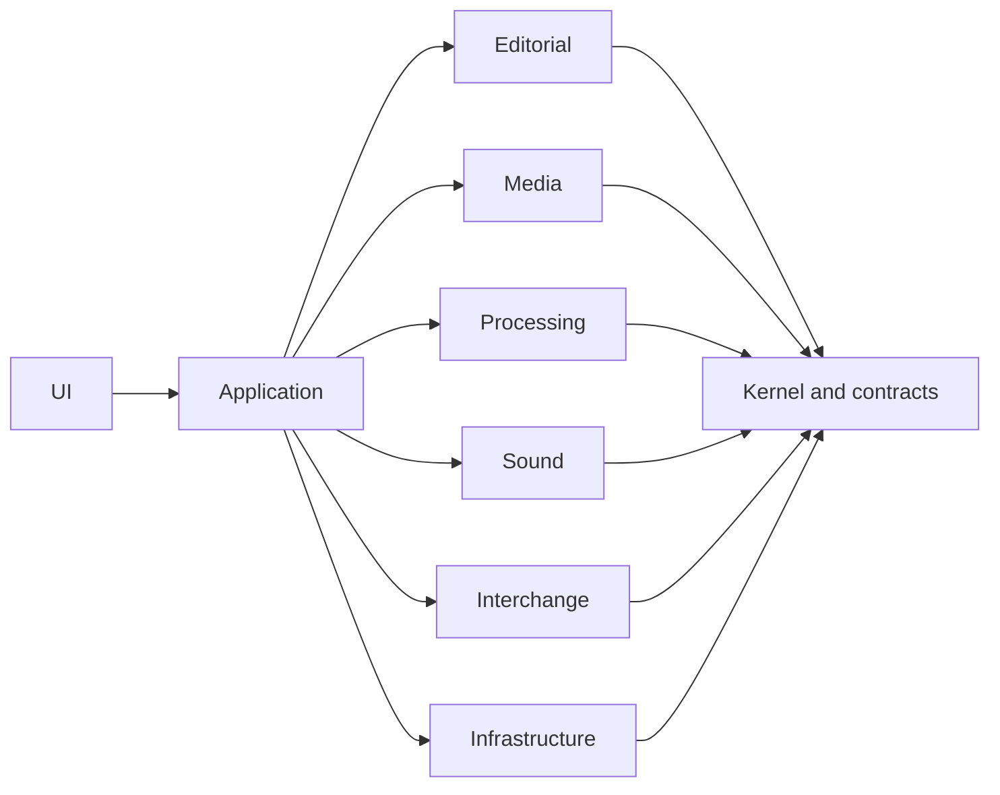
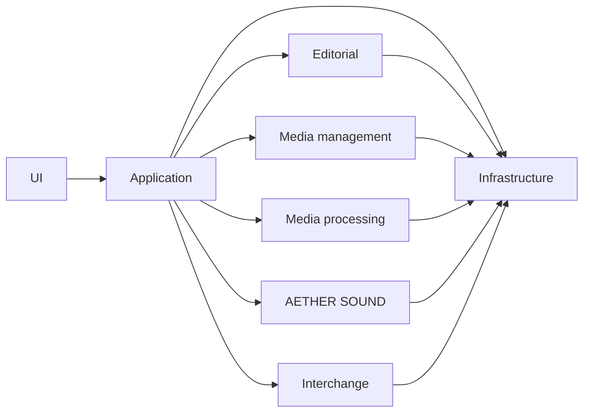
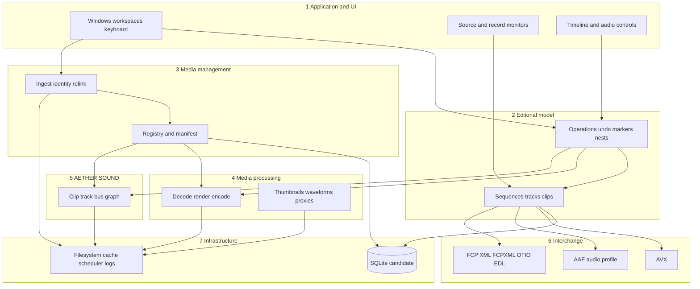
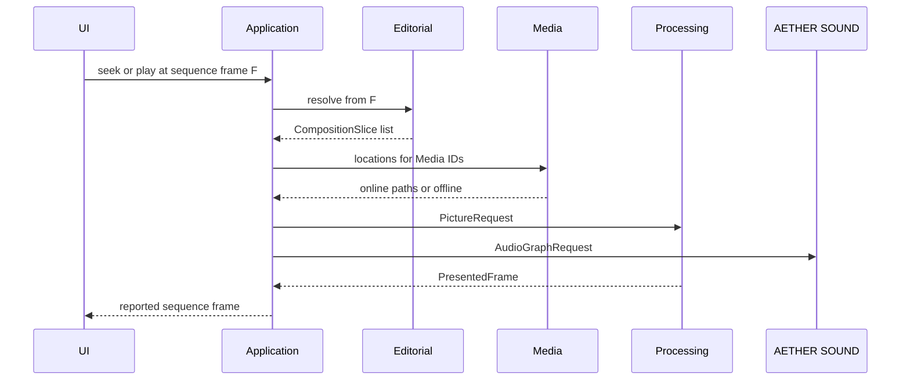
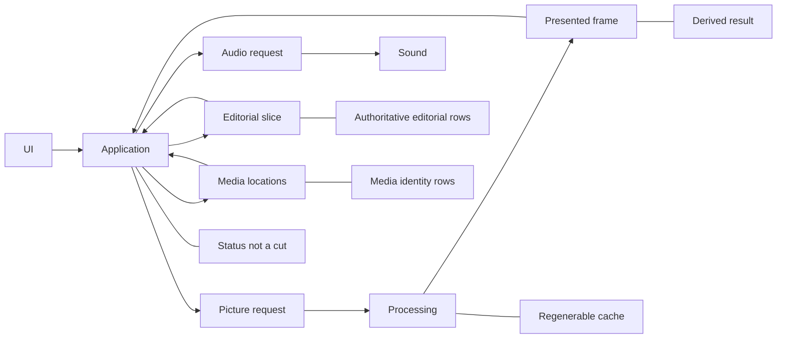
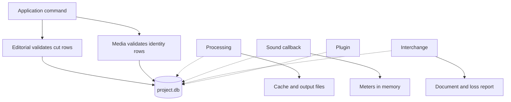

# ADR-006 application and media boundary — decision review

ADR-006 stays **PROPOSED**. This review does not accept it. A recommendation is not approval. No slice is started.

**SLICE 0A COMPLETE — DEVELOPMENT FROZEN PENDING NEXT AUTHORISATION.**

## 1. How to read the labels

| Label | Use in this file |
| --- | --- |
| CONFIRMED | Measured, or a document's own confirmed sentence, including a sentence that is now stale |
| ACCEPTED | An owner decision already recorded. ADR-002 and ADR-005 are in this class. ADR-009 is accepted for the Foundation Prototype |
| PROPOSED | Written and still awaiting the owner. ADR-006 is in this class |
| OPEN | The documents disagree, or a document marks the point open |
| DEFERRED | Named and postponed. Not decided here |

Disagreements are recorded. They are not edited into agreement.

## 2. Documents read, and what Slice 0A owns

Read in full: `architecture/decisions/ADR-006-application-joiner.md`. Also read: ADR-002, ADR-005, ADR-009, and ADR-007 (not modified); `docs/decisions/ADR-002_IMPLEMENTATION_CONSEQUENCES.md`; `docs/ENGINEERING_INTERFACES.md`; `docs/SYSTEM_INTEGRATION_AND_CONSISTENCY.md`; `docs/SYSTEM_ARCHITECTURE.md`; `docs/PROJECT_ARCHITECTURE.md`; `docs/PROJECT_STORAGE_AND_DATABASE.md`; `docs/10_PLAYBACK_AND_RENDERING.md`; `docs/TIMELINE_ENGINE_ARCHITECTURE.md`; `docs/CONFORM_ENGINE_SPECIFICATION.md`; `docs/MEDIA_IDENTITY_SPECIFICATION.md`; `docs/SLICE_0A_TECHNICAL_DEBT.md`; `docs/NEXT_DEVELOPMENT_SLICE_PROPOSAL.md`; `docs/validation/SLICE_0A_PROJECT_CORE_VALIDATION.md`.

`src/` was skimmed. Slice 0A owns a floor timing function, id and record types, SQLite persistence for eight tables (`schema_info`, `project_meta`, `bins`, `editorial_objects`, `bin_membership`, `media_assets`, `media_representations`, `master_clips`), a manifest, a log, a Qt window, and `ProjectSession`. The session header says ADR-006 is **PROPOSED** and that the type does not join decoders, playback, or exchange. Undo entries in the session cover bin rename, membership, and metadata. Autosave does not touch that stack. There is no sequence table, no FFmpeg include, and no picture or audio request type.

**CONFIRMED.** CTest for that slice was 1 discovered and 1 passed, with 18 Qt Test cases inside it. That is not 18 CTest tests. **ACCEPTED** on the tested Fedora machine only.

## 3. What ADR-006 actually proposes

**PROPOSED.** Status line in the file: **PROPOSED**. Date 2026-11-20. Confirmation: none.

The context names three failures: a timeline that calls a decoder, so a codec change changes trim code; media management that calls the editorial command API, so a relink can move a cut; a plugin that receives the database path.

The proposed split:

- Editorial emits a composition slice: sequence frame, layers, source positions, weights, effect parameters, Media IDs. No paths.
- Media management emits locations: Media ID, role, path or offline. No permission to delete, and no sequence structure.
- The application builds a picture request and an audio graph request from those documents.
- Processing and AETHER SOUND do not call editorial commands and do not write the project database.
- Interchange returns documents and a loss report. It does not update live rows in place.
- Whether sound is a separate link target (`aether_sound`) or a backend inside Processing is **OPEN** as a build shape. The data split is the proposal either way.

The early architecture keeps interactive playback, including device audio, inside Processing. The later layering splits AETHER SOUND out. **PROPOSED** that this split is part of the ADR and is not accepted. GStreamer as the authority for the current frame is not proposed. The presented frame is the frame index the request carried.

## 4. Accepted limits this review respects

**ACCEPTED.** ADR-002, initial editorial time authority. `int64` frames, reduced rates, one sequence rate, the source range kept, picture selection by nearest source timestamp with an exact tie on the earlier frame, absolute floor samples, phase at sequence frame 0, half-open ranges, timecode as a label, frame-only scope. A subframe position is refused or reported, not silently rounded. No sequence schema was authorised with that acceptance.

**ACCEPTED.** ADR-005. One Media ID. Separate Representation IDs. Roles include original, proxy, transcode, and consolidated. A path is not the Media ID and is not the Representation ID. Playback selection of a representation does not retarget the cut. Relink must not replace a Media ID. That last sentence is the identity rule. It is not acceptance of ADR-007's relink procedure.

**ACCEPTED FOR FOUNDATION PROTOTYPE.** ADR-009. Undo and redo are session-only. Autosave, crash recovery, snapshots, and journals are different mechanisms. Closing the process may drop the undo stack. It must not drop the last committed edit.

**PROPOSED.** ADR-007 stays proposed. This review does not change it. Relink, conform, and exchange remain different results on that page. No conform report has been generated here.

## 5. Contradictions recorded, not reconciled

1. **Two diagrams in one architecture document.** **OPEN.** `docs/SYSTEM_ARCHITECTURE.md` says domain layers do not call each other and that the application joins a decision to a location and then to a request. Its module diagram matches that. Its system diagram draws `OPS --> DEC`, `REG --> DEC`, `OPS --> MIX`, `REG --> MIX`, and sequence boxes directly into AVX, AAF, and the other adapters, plus windows directly into operations and ingest. Those edges are the calls ADR-006 forbids. Both drawings are in the same file. This review does not delete either.

2. **Who receives an edit command.** **OPEN.** `docs/ENGINEERING_INTERFACES.md` sends `EditCommand` from the UI to the application, then to editorial. `docs/SYSTEM_ARCHITECTURE.md` sends `EditCommand` from the UI to editorial. The playback sequence diagram goes UI to application.

3. **Who writes the database.** **OPEN.** Editorial is said to own persistence of the cut. Infrastructure is said to own the database, cache, and migrations. The interface table says the owning domain hands documents to storage, and infrastructure writes rows the domain validates. Slice 0A does none of that split: `ProjectSession` in the application façade writes the eight tables. **CONFIRMED** by the source skim. That façade is not a processing engine. It is also not the proposed joiner.

4. **`src/` is empty.** **CONFIRMED** as the sentence in `docs/ENGINEERING_INTERFACES.md` section 6, which says no public header exists and `src/` has no files. **CONFIRMED** by the tree that the sentence is stale. Slice 0A added sources under `src/` and headers under `include/aether/`. The interface document was not edited by this review.

5. **Sequences in `project.db`.** **ACCEPTED** in `docs/PROJECT_STORAGE_AND_DATABASE.md` that the open database is the authority for sequences, among other records. **ACCEPTED** in ADR-002's consequences that no sequence schema was authorised. Slice 0A created no sequence table. The storage sentence describes a later authority. It is not a schema.

6. **Project filename.** **OPEN.** `docs/PROJECT_ARCHITECTURE.md` still names a root file `project.aether` and says SQLite is not a linked library. `docs/PROJECT_STORAGE_AND_DATABASE.md` says the canonical file is `project.db` and that the `project.sqlite` name is closed. Slice 0A linked SQLite and used `project.db`. The architecture page's verified-facts block was not rewritten.

7. **Undo location.** **ACCEPTED FOR FOUNDATION PROTOTYPE** that undo is session-only. **OPEN** in the storage table, which still lists the undo session stack as **OPEN**. Slice 0A keeps the stack in memory and does not create an undo table.

8. **Debt list versus later acceptance.** **CONFIRMED** that `docs/SLICE_0A_TECHNICAL_DEBT.md` says ADR-002, ADR-006, and ADR-007 stay **PROPOSED**. ADR-002 was accepted on 2026-11-21. ADR-006 and ADR-007 were not. The debt file was not edited here. The same file says `LICENSE` stays empty. A later licence file exists. That licence fact is outside this boundary.

9. **A running sample clock.** **OPEN.** `docs/SYSTEM_ARCHITECTURE.md` says AETHER SOUND returns a running sample clock related to the picture frame by a rational mapping. **ACCEPTED** that ADR-002 does not store a sample-time domain and anchors phase at sequence frame 0. A device clock can be derived. The sentence does not say it is written into `project.db`. It can be read as a second clock if a later design stores it.

10. **Next-slice proposal.** **PROPOSED** as a pre-decision paper. Its body still discusses ADR-002 as proposed. A dated note at the top records the later acceptance. It does not accept ADR-006.

## 6. Five kinds of data

| Kind | Examples | Who may treat it as the cut |
| --- | --- | --- |
| Authoritative editorial data | Record ranges, source ranges, bins, master clips, Media IDs cited by the cut, half-open frame indexes, rates | Editorial document. **ACCEPTED** for time and identity. **PROPOSED** for the joiner |
| Media identity | Media ID, Representation ID, role, location id, checksum evidence | Media registry. A path is evidence. **ACCEPTED** |
| Derived results | `sample_boundary`, the selected source frame, a presented frame, meters | Nobody writes these back as the stored position. **ACCEPTED** for the floor function. **PROPOSED** for the presented frame |
| Regenerable cache | `CACHE/`, thumbnails, waveforms, proxies once generated | Not the cut. **PROPOSED** in the storage document. A proxy file is a representation under ADR-005, which is stronger than cache: regeneration does not change the Media ID |
| Status | Offline, job progress, slate flag, sync warning, lock held | Status does not change a record range or a Media ID. **PROPOSED** |

**ACCEPTED.** A fractional-sample mapping is not an error. A sync warning is only when a source offset or an operation cannot be represented in the frame-only model.

## 7. Option A — application-owned orchestration

**PROPOSED** in ADR-006 and in the engineering-interface diagram.

The UI talks to the application. The application asks editorial for a slice and media management for locations. It builds the picture request and the audio graph request. Processing and sound return results. They do not call back into editorial commands. Interchange returns a document and a loss report to the application.

The sound library may still be `aether_sound` or a backend inside Processing. **OPEN.** Option A does not require that choice. The request is still built by the application either way.

## 8. Option B — distributed queries

Editorial would ask media management for a path while resolving a trim. Processing would ask editorial which frame is current. Media management would call an editorial command during relink.

**PROPOSED** that ADR-006 rejects this. It is the context's failure case: a codec change changes trim code, and a relink moves a cut. No document reviewed here adopts option B. The system diagram's direct arrows are the drawing of something like it, not a decision for it.

## 9. Option C — dedicated coordinator

A module that is neither the application nor a domain would own the join. Candidates already named, and not chosen, are the job scheduler and the plugin host. `docs/SOFTWARE_MODULES.md` lists `aether_app` as the application and `aether_jobs` under infrastructure. **PROPOSED** catalogues only. **OPEN** whether a job runner is a second joiner.

A coordinator would duplicate the application or become the application under another name. Jobs are a place for proxy generation and export work. They are not the owner of the current frame. ADR-009 keeps undo in the session, not in a job record.

## 10. Option D — hybrid

The application would join playback, and some direct queries would remain: the timeline reading locations, or processing reading the registry, for latency or convenience.

**OPEN** because that hybrid is already visible. The prose forbids the edges and one diagram draws them. A hybrid rule needs a list of allowed edges. No such list is accepted. An allowed edge that carries a path into editorial, or a database handle into a plugin, is the failure ADR-006 names. An allowed edge that is "only a read" still lets a decoder timestamp become the playhead if processing reports a clock instead of the request's frame index.

## 11. Comparison and recommendation

| Option | Keeps the cut free of paths and codecs | New module | Risk recorded in the documents |
| --- | --- | --- | --- |
| A. Application-owned | Yes, if the forbidden edges stay forbidden | No | Sound build shape still **OPEN** |
| B. Distributed queries | No | No | Relink can move a cut. A codec change reaches trim code |
| C. Dedicated coordinator | Only if it is the sole joiner | Yes | A second joiner beside `aether_app`, or a job runner that writes the cut |
| D. Hybrid | Only on the edges that were listed | No | The unlisted edge is how the two architecture diagrams diverged |

**PROPOSED** recommendation, not approval: option A.

The reason is the failure the ADR already names, not the number of boxes. Distributed queries give media management a way to edit the cut and give processing a way to choose the frame. A dedicated coordinator adds a module the catalogues did not accept and collides with session undo if jobs become the history of the cut. A hybrid without an accepted edge list is the contradiction in section 5. Option A leaves the sound link shape **OPEN**, which is what ADR-006 already says.

This recommendation does not accept ADR-006. It does not authorise playback, a timeline, or a codec link.

## 12. Database write boundary

**PROPOSED** as the boundary option A requires. Not implemented. Not a schema.

| Rows | May commit them | Must not commit them |
| --- | --- | --- |
| Editorial project rows: bins, membership, editorial objects, master clips, and any future sequence rows | The editorial document, through infrastructure, as part of an application command that already entered editorial | Processing, AETHER SOUND, interchange, plugins, a cache writer |
| Media identity rows: Media ID, Representation ID, location, checksum evidence | Media management, through infrastructure | A picture request, an audio callback, a plugin holding a path |
| Manifest | The project commit that ADR-003 already describes | A decoder, an export mux |
| Cache files and job status | Infrastructure | They are not editorial rows |

**ACCEPTED.** ADR-003 is one `project.db` plus a manifest. The manifest is not a second editorial document. **CONFIRMED** Slice 0A uses that package and no sequence tables.

**PROPOSED.** Engines do not write editorial project rows. A second writer is refused by the lock the storage document already specifies. The audio callback does not take the database lock. **PROPOSED** and unmeasured.

**CONFIRMED.** Today's only writer is `ProjectSession` through `ProjectStore`. Treating that as permission for processing to write the same tables would erase the boundary. The prototype has not split the modules.

A path string copied onto a request is not a location-row update. **PROPOSED** here, and **PROPOSED** in ADR-007 that a location-row update is still not a relink until classification and validation have run. This review does not perform that classification.

## 13. Picture request minimum

**PROPOSED.** The minimum that respects ADR-002, ADR-005, and the playback contract. Not an FFmpeg design. Not a struct in the tree.

The editorial slice, before locations exist, carries:

- sequence frame as `int64`, and the sequence rate as a reduced ratio
- half-open ranges where a span is named
- per layer: Media ID, source rate, source frame chosen by the accepted picture-selection rule, weights and effect parameters already on the slice
- no path, no database handle, no undo stack, no FFmpeg type

The application then adds, without writing those additions back as the cut:

- Representation ID and role, chosen as playback selection
- path or an explicit offline mark
- a slate flag when offline, the slice kept

Processing returns a presented frame: the sequence frame from the request, the Media ID, the source frame, and the slate flag if offline. **PROPOSED.** It does not invent the playhead from a device clock. It does not change the source range. Switching representation does not mint a Media ID. **ACCEPTED** under ADR-005.

Export destination sits on an export request only. **PROPOSED** that the export report is not a conform verdict.

## 14. Audio request minimum

**PROPOSED.** Same limits. Not a graph implementation.

- sequence frame and sequence rate
- sample span derived by `sample_boundary`, phase anchored at sequence frame 0, not reset at the clip, the edit, the timecode label, or an export in-point
- Media IDs resolved by the application to a readable path or to explicit silence
- gains, automation, and routing already stored as editorial or mix values, not as widget state
- no database lock, no editorial command, no stored sample-time domain

**ACCEPTED.** `[0, 8)` at 30000/1001 and 48000 Hz is 12812 samples. `[8, 16)` is 12813. The walk to frame 200000 is 320320000. A request that starts at frame 8 starts at sample 12812. It does not start a new origin. The MXF file that held 12813 samples for frames 0–8 remains a failed encoder test. This request minimum does not redesign that muxer.

**OPEN.** Device buffer size. The playback document refuses to invent a millisecond sync tolerance. This review also refuses.

A frame-only model cannot store a slip between frames. **ACCEPTED** that the operation is refused or reported unsupported. It is not rounded into the request and saved.

## 15. ADR-007 dependency

**PROPOSED.** ADR-007 is a dependency for implementing relink, conform, and exchange. It is not a dependency for choosing the joiner, provided the joiner text does not invent those results.

| Event | What it is | What it is not |
| --- | --- | --- |
| A path substituted on a picture or audio request | Playback selection for one request | A relink. **PROPOSED** |
| A location row written after classification | The relink result ADR-007 describes | A conform state. **PROPOSED** |
| A presented frame or an export file | A derived or generated product | A conform. **PROPOSED** that export does not set `verified` |
| An interchange document and a loss report | A translation | An in-place update of live rows. **PROPOSED** |

**CONFIRMED.** No conform report exists in this repository. No vendor test is recorded. Accepting a joiner would not create those results and would not accept ADR-007.

If an owner answer required the application to relink, conform, or exchange as part of the same decision, ADR-007 would have to be decided first. **PROPOSED** recommendation: do not couple them.

## 16. Undo, jobs, cache, and status

**ACCEPTED FOR FOUNDATION PROTOTYPE.** Session undo restores editorial commands inside the process. A processing job is not an undo step. Undo does not have to delete a rendered file, and a failed job does not revert a committed cut. Autosave flushes a commit. It is not the undo stack. **CONFIRMED** that Slice 0A autosave logs that it did not touch the undo stack.

**PROPOSED.** Cache and status stay out of the authoritative editorial rows. A superseded representation stays a historical representation of the same Media ID. **ACCEPTED** under ADR-005. It is not a second cut.

## 17. Sequence schema and the FFmpeg boundary

**ACCEPTED** that ADR-002 did not add sequence tables. **PROPOSED** that ADR-006 does not add them either. A composition slice can be described without a new table. Building the slice in code would be an implementation this review does not authorise.

**ACCEPTED WITH CONDITIONS.** ADR-001 names FFmpeg as the later media framework, inside a media engine, not in domain types. The library link is blocked. Development headers were missing at the Slice 0A measurement. `libavfilter` is not approved. GStreamer is not a dependency. This review states the boundary: editorial and the application request carry frames and Media IDs; codec types stay behind processing. It does not choose a pin, a decode call, or a filter graph.

## 18. Diagrams

### 18.1 Existing — engineering interfaces

**PROPOSED.** Copied from `docs/ENGINEERING_INTERFACES.md`. Domain boxes do not connect. The absence is the interface.

### 18.2 Existing — module dependencies

**PROPOSED.** Copied from `docs/SYSTEM_ARCHITECTURE.md`. Same shape as 18.1. Infrastructure is the downward edge. Sideways calls are absent.

### 18.3 Existing — system diagram that disagrees

**OPEN.** Copied from the same architecture document. Arrows from operations and the registry into decode and the mix, and from sequences into the adapters, are the contradiction in section 5. This review does not redraw it as option A.

### 18.4 Existing — seek and play

**PROPOSED.** Copied from `docs/10_PLAYBACK_AND_RENDERING.md`. This is the application-owned sequence. It is not a statement that playback exists.

### 18.5 Conceptual — option A with the five data kinds

**PROPOSED** recommendation drawing. It is not in the specifications. It does not replace 18.3.

### 18.6 Conceptual — write boundary

**PROPOSED** recommendation drawing. Not a schema.

The dotted arrows are the forbidden writes. A path on a request does not travel along them.

## 19. What this review does not do

**PROPOSED.** It does not accept ADR-006. It does not edit ADR-007. It does not add a sequence schema, a playback graph, or an FFmpeg design past the fields in sections 13 and 14. It does not start a slice. It does not treat Slice 0A's session writer as the target module split. The freeze stands.

## 20. Owner questions

Each question is independent. This file answers none of them.

1. Does the owner accept option A, application-owned orchestration, as the joiner?
2. Does the sound build shape stay **OPEN** even if question 1 is yes?
3. Do processing, sound, interchange, and plugins remain forbidden to write editorial project rows?
4. Is the picture-request minimum in section 13 the minimum, with no path on the editorial slice and no device clock as the playhead?
5. Is the audio-request minimum in section 14 the minimum, with phase at sequence frame 0 and explicit silence for offline media?
6. While ADR-007 stays **PROPOSED**, is a path on a request not a relink, and a playback or export request not a conform?
7. Does session undo stay separate from processing jobs, as ADR-009 already separates undo from autosave and journals?
8. Does any yes above authorise implementation, a sequence schema, or an FFmpeg link? The recommendation on this question is no.

PROPOSED — PENDING PROJECT-OWNER DECISION.
