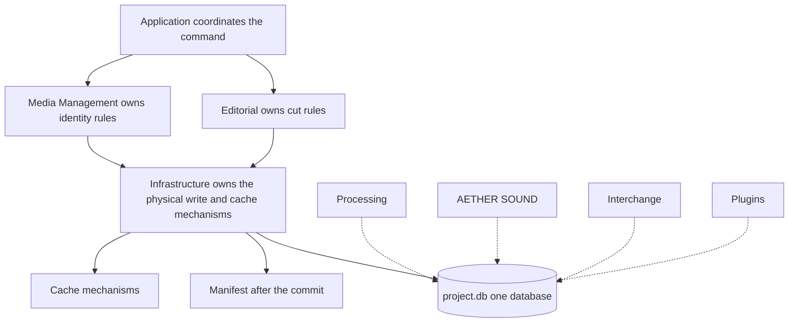
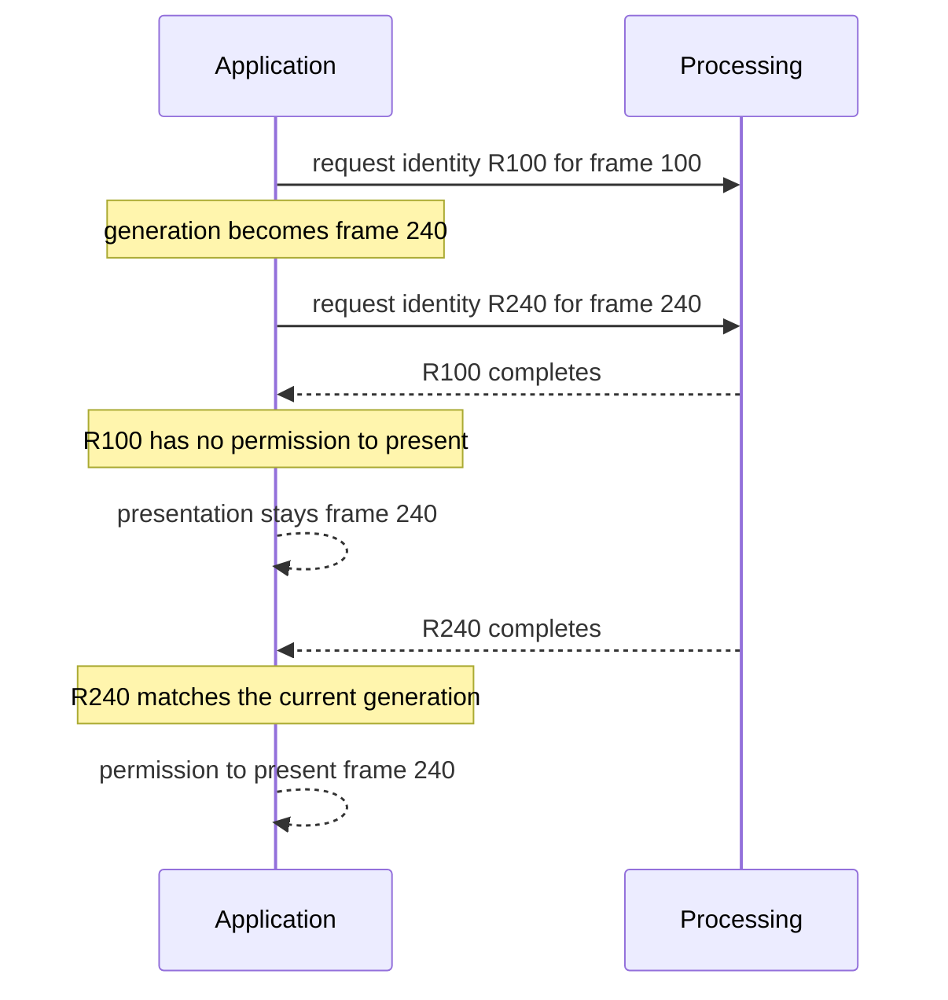
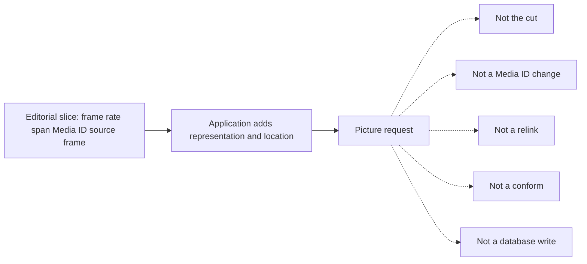
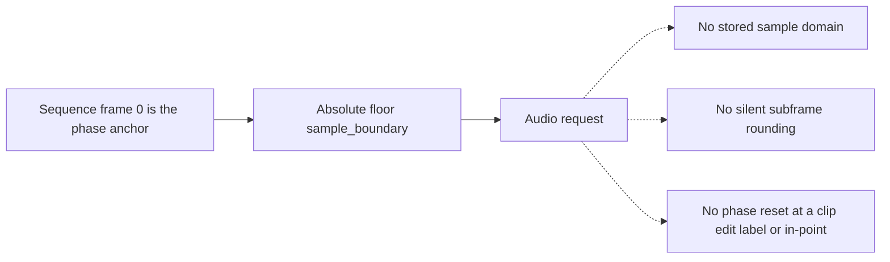

# ADR-006 boundary clarifications and interface readiness

Supplementary architecture review. It does not accept ADR-006. It does not answer the eight questions in section 20 of `docs/decisions/ADR-006_APPLICATION_MEDIA_BOUNDARY_DECISION_REVIEW.md`. A recommendation is not an acceptance. No slice is started.

## 1. Labels and statuses

| Label | Use here |
| --- | --- |
| CONFIRMED | A measurement, or a sentence that is in a file, including a sentence that later work has left stale |
| ACCEPTED | An owner decision already on an ADR. This paper grants none |
| PROPOSED | A clarification offered to the owner. Not accepted by being written here |
| OPEN | Documents disagree, or a document marks the point open |
| DEFERRED | Named and postponed. Not decided here |

Statuses, unchanged by this file:

| Item | Status |
| --- | --- |
| Slice 0A | **CONFIRMED** complete and accepted on the tested Fedora machine |
| Development | **SLICE 0A COMPLETE — DEVELOPMENT FROZEN PENDING NEXT AUTHORISATION.** |
| ADR-001 | **ACCEPTED WITH CONDITIONS** |
| ADR-002 | **ACCEPTED — INITIAL EDITORIAL TIME AUTHORITY** |
| ADR-003 | **ACCEPTED** |
| ADR-005 | **ACCEPTED** |
| ADR-006 | **PROPOSED** |
| ADR-007 | **PROPOSED** |
| ADR-009 | **ACCEPTED FOR FOUNDATION PROTOTYPE** |

## 2. Files read

No named file was missing.

Read: `architecture/decisions/ADR-006-application-joiner.md`; ADR-001, ADR-002, ADR-003, ADR-005, ADR-007, and ADR-009; `docs/decisions/ADR-006_APPLICATION_MEDIA_BOUNDARY_DECISION_REVIEW.md`; `docs/SYSTEM_ARCHITECTURE.md`; `docs/ENGINEERING_INTERFACES.md`; `docs/SYSTEM_INTEGRATION_AND_CONSISTENCY.md`; `docs/10_PLAYBACK_AND_RENDERING.md`. Channel-layout and buffer sentences were checked in `docs/SYSTEM_ARCHITECTURE.md`, `docs/10_PLAYBACK_AND_RENDERING.md`, and `docs/AUDIO_ENGINE_ARCHITECTURE.md` so this paper would not invent a decision those files do not contain.

## 3. What this paper does not answer

Section 20 of the existing ADR-006 review asks eight questions: whether option A is the joiner, whether the sound build shape stays open, who may write editorial rows, whether the picture and audio minima hold, whether a path is not a relink and playback is not a conform, whether undo stays separate from jobs, and whether a yes authorises implementation. Those questions stay unanswered. The eight questions in section 16 of this file are a different list.

## 4. Clarification A — rules, writes, and commands

**PROPOSED** clarification, not an acceptance.

The domain owns the rules. Editorial owns cut invariants. Media management owns identity and location rules. Infrastructure owns the physical write and the cache mechanisms. The application coordinates commands: it asks the domain to validate, and it asks infrastructure to commit. Editorial and Media Management do not expose unrestricted SQL. Processing, AETHER SOUND, interchange, and plugins do not write editorial project rows.

**ACCEPTED.** ADR-003 is one `project.db` and one manifest. The manifest is not a second editorial authority. Domain modules do not link SQLite. Infrastructure does. One editorial command is one database transaction. A compound command is still one transaction. The transaction commits only when the command’s invariants hold. A failure rolls back to the previous commit. One writer holds the project lock. A second open is refused. The manifest is replaced by a temporary file, an fsync, and a rename after the database commit it describes. Those sentences are ADR-003. This clarification does not add isolation levels, retry counts, a WAL requirement, or any other transaction guarantee. `docs/PROJECT_STORAGE_AND_DATABASE.md` calls WAL recommended and unmeasured. **CONFIRMED** that it was not measured. It is not promoted here.

**PROPOSED** reading of compatibility. The split above fits that one database: the domain states the invariants, infrastructure performs the write ADR-003 already assigns to infrastructure, and the application is the coordinator of the command. Where a document still offers a second package shape, that point stays **OPEN** in section 13. It is not closed by this sentence.

Cache mechanisms sit with infrastructure. **PROPOSED** in the storage document that `CACHE/` is regenerable and is not the cut. A proxy representation under ADR-005 is identity-bearing media, not a licence for processing to write editorial rows.

## 5. Conceptual persistence diagram

**PROPOSED.** This drawing is not in the specifications. Dotted arrows are not writes.

## 6. Clarification B — identity, generation, and permission to present

**PROPOSED** clarification, not an acceptance. No threading library and no C++ type is specified.

Three facts are different:

| Fact | What it means | What it is not |
| --- | --- | --- |
| Request identity | Which request this work belongs to | A generation, and not permission to present |
| Generation | Which request is current for presentation | Proof that older work has finished, and not the playhead by itself |
| Permission to present | The application allows this completion to become the presented frame | The order in which work happens to finish |

The device clock is not the playhead. **PROPOSED** in ADR-006 and in `docs/10_PLAYBACK_AND_RENDERING.md` that the presented frame is the sequence frame the request carried. Completion order is not presentation order.

Worked case, conceptual only. Frame 100 starts. Frame 240 then becomes the current generation. Frame 100 later completes. That completion has a request identity and a finished result. It does not have permission to present. It must not overwrite the presentation of frame 240, and it must not move the playhead to 100.

Cancellation is not a new generation and not a database write. **PROPOSED** in the playback document that a cancelled export leaves the composition hash unchanged. This clarification uses that idea for a superseded picture request. It does not add a new durability rule.

Stale rejection is the refusal to present. It is not deletion of the editorial frame, not a relink, and not a conform.

## 7. Sequence diagram for a stale completion

**PROPOSED.** Conceptual. Not a claim that playback exists.

## 8. Clarification C — picture request

**ACCEPTED** rules kept exactly. ADR-002: `int64` frames, reduced rates, one sequence rate, source range kept, nearest valid source-frame presentation timestamp, exact tie selects the earlier frame, half-open ranges, timecode as a label, frame-only scope. ADR-005: one Media ID, separate Representation IDs, a path is not identity. Playback selection does not retarget the cut.

**PROPOSED** picture request, not a new authority.

The editorial slice carries an `int64` sequence frame, the reduced sequence rate, half-open spans, the Media ID, source-native time, and the source frame from the accepted selection rule. No path sits on that slice.

The application adds the representation and the location for that request. The resulting request is not editorial authority, not media identity, not a relink, not a conform, and not a database write.

## 9. Clarification D — audio request

**ACCEPTED** and kept exactly. Audio for a frame-boundary edit uses the absolute floor. Phase is anchored at sequence frame 0. There is no stored sample-time domain. A subframe position is not silently rounded. Phase is not reset at a clip, an edit, a timecode origin, or an export in-point.

**CONFIRMED** at 30000/1001 and 48000 Hz, and **ACCEPTED** as the boundary rule:

| Span | Samples |
| --- | --- |
| `[0, 8)` | 12812 |
| `[8, 16)` | 12813 |
| `[0, 200000)` | 320320000 |

A request whose current frame is 8 names sample 12812 as the boundary of that frame. It does not start a new grid. Different 8-frame counts are expected.

**CONFIRMED.** The FFmpeg MXF result of 12813 samples against 12812 for eight frames from frame 0 remains a failed encoder test. This paper does not rewrite that log and does not treat the failure as a new rounding rule.

**OPEN.** No millisecond sync tolerance is invented. `docs/10_PLAYBACK_AND_RENDERING.md` already refuses to invent one. Channel layout is **OPEN**: `docs/SYSTEM_ARCHITECTURE.md` lists persistence of channel layout as an unresolved re-test, not a decision. Resampling policy is not decided in the files read for this paper. Device buffer bounds of 64 to 4096 samples are a recommendation in the audio documents, and `docs/10_PLAYBACK_AND_RENDERING.md` says the default inside that range is unchosen. Those bounds are not adopted here.

## 10. Conceptual picture and audio diagrams

**PROPOSED.** Neither drawing is in the specifications.

## 11. The four conceptual diagrams

Sections 5, 7, and 10 are the four conceptual diagrams: persistence, stale completion, the picture request, and the audio request. They are not redraws of the existing diagrams in `docs/SYSTEM_ARCHITECTURE.md`, `docs/ENGINEERING_INTERFACES.md`, or `docs/10_PLAYBACK_AND_RENDERING.md`. Those existing drawings stay in their files, including the system diagram that disagrees with the module diagram.

## 12. Interface readiness

**PROPOSED** documents describe passive records: a composition slice, a media location, a picture request, an audio graph request, and a presented frame. **CONFIRMED** that Slice 0A did not implement those records. The session façade writes eight tables and keeps undo in memory. Its header says ADR-006 is not accepted and that the type does not join decoders, playback, or exchange.

Readiness is therefore paper-only. The field lists in sections 8 and 9 can be reviewed. They are not headers, not a schema, and not a player. **CONFIRMED** that `docs/ENGINEERING_INTERFACES.md` says no public header exists to review and that `src/` has no files. That sentence is stale: Slice 0A added sources and headers. This paper does not edit it, and those headers are not the joiner interface.

## 13. Contradictions left in place

Recorded only. The four files were not edited.

`docs/SYSTEM_ARCHITECTURE.md`. The module diagram and the prose say the application is the only sideways joiner. The system diagram draws operations and the registry into decode and the mix, and draws sequences directly into AVX, AAF, and the other adapters. The same file says AETHER SOUND returns a running sample clock related to the picture by a rational mapping. ADR-002 does not store a sample-time domain. A derived clock and a stored clock are not distinguished there. Unresolved item 11 leaves channel layout open. **OPEN.**

`docs/ENGINEERING_INTERFACES.md`. `EditCommand` goes from the UI to the application, then editorial. `docs/SYSTEM_ARCHITECTURE.md` sends that command from the UI to editorial. The interface document still marks opaque blobs versus normalised tables **OPEN** and cites ADR-003. **ACCEPTED** ADR-003 rejected the opaque `project.sqlite` package and chose `project.db`. The interface document also says `src/` has no files. **CONFIRMED** that the tree now has Slice 0A sources. **OPEN** as a stale sentence, not as a second architecture.

`docs/SYSTEM_INTEGRATION_AND_CONSISTENCY.md`. Section 4 still labels the blob package versus `project.db` **OPEN** and points at ADR-003, after ADR-003 closed that choice. It still labels asset id versus Media ID **OPEN** and points at ADR-005, after ADR-005 closed that choice. It still labels undo durability **OPEN** and points at ADR-009, after ADR-009 was accepted for the Foundation Prototype. It still says a README must not call the stack approved while ADR-001 is proposed. ADR-001 is **ACCEPTED WITH CONDITIONS**, which is not an unconditional approval and is not still proposed. Invariant 3, rational time, does match the later ADR-002 acceptance. A playback change that stores a path on the instance is rejected there. That rejection agrees with ADR-005 and is not a relink procedure.

`docs/10_PLAYBACK_AND_RENDERING.md`. The contract says the application is the only module that joins a slice to locations, and that an export report is not a conform verdict. It does not define request identity, generation, or permission to present, so it does not say whether a late completion may overwrite a newer frame. Section 3 says that if a GStreamer clock and the frame index disagree, the reported frame stays the index in the request. ADR-001 says GStreamer is not a dependency. The failure row is a comparison rule, not an adoption of GStreamer. The document leaves the Phase 11 sync tolerance uninvented and the device-buffer default unchosen. **OPEN.**

## 14. Playback, export, relink, and conform

**PROPOSED.** A playback request is not a relink and is not a conform. An export is not a conform verdict. **PROPOSED** in ADR-007, which stays proposed: relink may change location rows for a known Media ID and does not change instance ids, record ranges, or Media IDs; conform writes a report; export does not set `verified`. **CONFIRMED** that no conform report has been generated in this repository. This paper does not generate one and does not accept ADR-007.

**ACCEPTED** under ADR-005 that choosing a representation for playback does not change the Media ID or the cut. Putting that choice on a request, as section 8 describes, stays inside that rule only if the request is not written back as identity.

## 15. FFmpeg and the media boundary

**ACCEPTED WITH CONDITIONS.** ADR-001 names FFmpeg as the later media framework, dynamically linked inside a media engine. The approved set named there is `libavutil`, `libavcodec`, `libavformat`, `libswscale`, and `libswresample`. `libavfilter` is not approved. GStreamer is not a dependency. Domain code does not include FFmpeg headers.

**CONFIRMED** that the library link was blocked when headers were missing, and that this paper does not select a version, a pin, or a decoder API. Decode stays behind the boundary in section 8 and section 9. No filter graph is designed.

ADR-001’s decision text still says the root `CMakeLists.txt` is empty. **CONFIRMED** that Slice 0A later added a product `CMakeLists.txt`. That sentence is the 2026-11-20 decision text. This paper does not edit the ADR.

## 16. Owner questions

These eight questions are independent of each other and independent of section 20 of the existing ADR-006 review. This file answers none of them. None is marked accepted.

1. Does the owner adopt clarification A: the domain owns the rules, infrastructure owns physical writes and cache mechanisms, and the application coordinates commands? It matters because ADR-003 already assigns the SQLite link to infrastructure, while Slice 0A’s session both validates and writes. Leaving the split unstated lets the prototype façade be read as the permanent writer.

2. Do Editorial and Media Management stay without an unrestricted SQL interface, on the one `project.db`? It matters because a domain that can issue arbitrary SQL can break the invariants it is supposed to own, even if infrastructure is the library that links SQLite.

3. Are request identity, generation, and permission to present three different facts? It matters because `docs/10_PLAYBACK_AND_RENDERING.md` names a presented frame and does not separate these three. Finishing work would otherwise be treated as permission to show it.

4. In the case where frame 100 has started, frame 240 has become current, and frame 100 then completes, is presentation of that completion refused? It matters because completion order is not presentation order, and a late result must not move the playhead. The device clock is not that playhead.

5. Is cancellation separate from starting a new generation, and does cancellation leave the committed cut unchanged? It matters because the playback document already says a cancelled export leaves the composition hash unchanged. A superseded playback request needs the same kind of limit, or cancel becomes an editorial edit.

6. After the application adds a representation and a location, is that picture request still not editorial authority, not a Media ID change, not a relink, not a conform, and not a database write? It matters because ADR-005 allows playback selection without retargeting the cut. The joined request is the place that rule is easiest to lose.

7. Do the audio rules stay the absolute floor, phase at sequence frame 0, no stored sample domain, no silent subframe rounding, and no phase reset, including 12812, 12813, and 320320000, with the MXF 12813-against-12812 result left a failed encoder test? It matters because a playback request could be mistaken for a new audio policy. ADR-002 already fixed those facts.

8. Do channel layout, resampling, and the device-buffer default stay **OPEN**, with no millisecond sync tolerance added, and do these clarifications leave ADR-006 **PROPOSED**? It matters because a recommended buffer range is not a chosen default, and answering a clarification must not accept the joiner or invent a latency.

## 17. Freeze

This supplement is complete as a review. It does not authorise implementation, a sequence schema, a playback graph, or a codec link. ADR-006 stays **PROPOSED**. ADR-007 stays **PROPOSED**. Development stays frozen.

SUPPLEMENTARY ARCHITECTURE REVIEW COMPLETE — PENDING PROJECT-OWNER DECISION — DEVELOPMENT FROZEN
