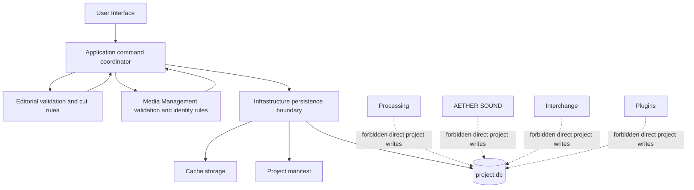
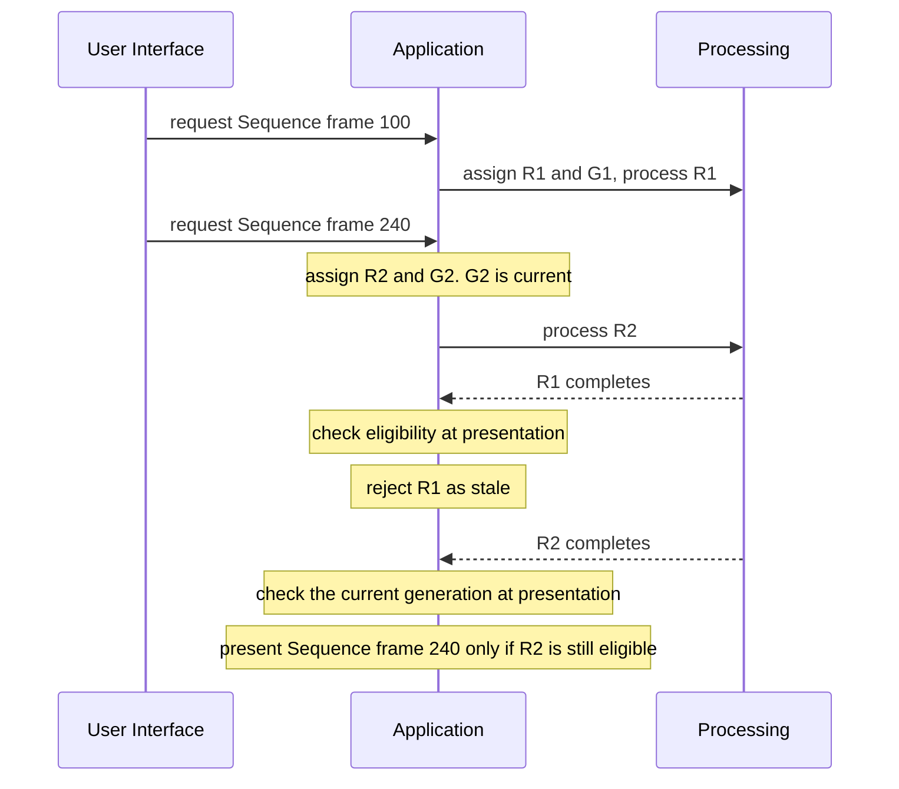

# ADR-006 owner decision record

**ADR-006 stays PROPOSED.** Original Questions 1, 3, 4, 5, 6, and 7 are **ACCEPT**. Original Question 2 is **ACCEPT — KEEP OPEN**. Original Question 8 is **NO**. Supplementary Questions 1 through 8 are **ACCEPT**. None of these decisions accepts ADR-006. Audio-engine details stay **OPEN**.

The freeze does not depend on those decisions. **SLICE 0A COMPLETE — DEVELOPMENT FROZEN PENDING NEXT AUTHORISATION.** The YES answers do not authorise implementation. Original Question 8 records that limit. The freeze stays independently enforceable even after ADR-006 is eventually accepted. These decisions do not authorise code, interfaces, playback, audio, sequence schema, FFmpeg, relink, conform, interchange, a new slice, or diagram changes.

This record does not edit ADR-006. It does not accept ADR-006. No date is attached to the sixteen owner questions. This record’s convention does not require one. No signatory is named.

## 1. How the four classes stay distinct

| Class | Meaning in this record |
| --- | --- |
| Already-accepted ADR text | Wording already decided in ADR-001, ADR-002, ADR-003, ADR-004, ADR-005, or ADR-009. Not reopened |
| Review recommendation | A YES or NO from the reviews. Not an owner answer |
| Pending owner question | An owner field the owner has not decided. It stays **PENDING PROJECT-OWNER DECISION**. The sixteen owner questions are decided and are not in this class. Refinements A, B, and C remain in it |
| Later task | Work that needs a separate authorisation even if the owner later accepts a direction |

Labels used on claims: **CONFIRMED**, **ACCEPTED**, **PROPOSED**, **OPEN**, **DEFERRED**, **OWNER DECISION REQUIRED**.

## 2. Statuses, unchanged

| Item | Status |
| --- | --- |
| Slice 0A | **COMPLETE** and accepted on the tested Fedora machine. **CONFIRMED** |
| Development | **FROZEN.** **SLICE 0A COMPLETE — DEVELOPMENT FROZEN PENDING NEXT AUTHORISATION.** |
| ADR-001 | **ACCEPTED WITH CONDITIONS** |
| ADR-002 | **ACCEPTED — INITIAL EDITORIAL TIME AUTHORITY** |
| ADR-003 | **ACCEPTED** |
| ADR-004 | **ACCEPTED** as interchange, not as a database |
| ADR-005 | **ACCEPTED** |
| ADR-006 | **PROPOSED** |
| ADR-007 | **PROPOSED** |
| ADR-009 | **ACCEPTED FOR FOUNDATION PROTOTYPE** |

## 3. Files read

No named file was missing.

Read: `architecture/decisions/ADR-006-application-joiner.md`; ADR-001, ADR-002, ADR-003, ADR-004, ADR-005, ADR-007, and ADR-009; `docs/decisions/ADR-006_APPLICATION_MEDIA_BOUNDARY_DECISION_REVIEW.md`, including section 20; `docs/decisions/ADR-006_BOUNDARY_CLARIFICATIONS_AND_INTERFACE_READINESS.md`, including section 16.

## 4. Executive summary

**Already-accepted ADR text.** Time is `int64` frames at reduced rates, with the source range kept and audio samples derived by the absolute floor from sequence frame 0 (ADR-002). One `project.db` and a manifest are the package (ADR-003). `.abin` is interchange (ADR-004). One Media ID and separate Representation IDs; a path is not identity (ADR-005). Undo for the Foundation Prototype is session-only (ADR-009). FFmpeg is the later media framework under ADR-001, with conditions still open. `libavfilter` is not approved. GStreamer is not a dependency.

**Review recommendation.** Adopt application-owned orchestration as the architectural direction, with the qualifications in this record. Recommended answers stay labelled separately from owner decisions.

**Owner decision on Original Question 1.** Owner decision: **ACCEPT**. Owner answer: **YES**. The owner accepts Option A — Application-owned orchestration — as the architectural direction. Rationale: the Application is the orchestration boundary that combines editorial composition with validated media locations and constructs requests for processing subsystems. Editorial rules, media identity, application orchestration, processing and sound execution, and infrastructure persistence stay distinct. This YES is not acceptance of ADR-006. It does not authorise code, interfaces, playback, audio, sequence schema, FFmpeg, relink, conform, interchange, a new slice, or diagram changes.

**Owner decision on Original Question 2.** Owner decision: **ACCEPT — KEEP OPEN**. Owner answer: **YES**. The AETHER SOUND build shape stays **OPEN**. This does not decide whether `aether_sound` is a separate link target or Sound is a backend inside Media Processing. The Application-owned request-construction boundary stays independent of that build decision. Editorial composition data stays separate from the audio graph request. Rationale: the data and architectural boundary can be established without prematurely deciding the final build and linkage structure of AETHER SOUND. This is not approval of either build arrangement. It does not authorise implementation. It does not accept ADR-006.

**Owner decision on Original Question 3.** Owner decision: **ACCEPT**. Owner answer: **YES**. The project owner accepts that Processing, AETHER SOUND, Interchange and plugins must not write authoritative editorial project rows. Owner rationale: the authoritative editorial project data must remain protected from direct mutation by media-processing operations, audio processing, interchange operations and plugins. These subsystems must not bypass the editorial command and validation boundaries to modify the editorial cut. Editorial rules, media identity and location rules, application-owned orchestration, infrastructure-owned physical persistence, and processing/sound execution without editorial write authority stay distinct. This decision does not independently approve Supplementary Question 1, Supplementary Question 2, Refinement A, any database interface or implementation, or any new transaction or concurrency guarantees. Supplementary Questions 1 and 2 are recorded separately in section 7. Refinement A, any database interface or implementation, and any new transaction or concurrency guarantees stay **PENDING PROJECT-OWNER DECISION**. This acceptance is not acceptance of ADR-006. It does not authorise implementation.

**Owner decision on Original Question 4.** Owner decision: **ACCEPT**. Owner answer: **YES**. The conceptual picture-request minimum from section 13 only. It is not a C++ structure, a public header, an implementation API, playback, an FFmpeg link, a decoder, relink, conform, the supplementary generation and stale-result refinements, a sequence schema, or a development slice.

**Owner decision on Original Question 5.** Owner decision: **ACCEPT**. Owner answer: **YES**. The conceptual audio-request minimum from section 14 only, including 12,812, 12,813, and 320,320,000, with the MXF 12,813-against-12,812 result left a failed encoder test. It is not an audio graph, an audio engine, playback, an FFmpeg link, a sequence schema, a development slice, or an answer to the supplementary questions.

**Owner decision on Original Question 6.** Owner decision: **ACCEPT**. Owner answer: **YES**. Playback path substitution is not relink. Playback or export is not conform. ADR-007 stays **PROPOSED**. This decision does not accept ADR-007.

**Owner decision on Original Question 7.** Owner decision: **ACCEPT**. Owner answer: **YES**. Session undo and redo remain separate from processing jobs, consistent with ADR-009 **ACCEPTED FOR FOUNDATION PROTOTYPE**. This does not extend ADR-009 into a persistent-undo design.

**Owner decision on Original Question 8.** Owner decision: **NO**. Owner answer: **NO**. Architectural YES answers do not automatically authorise implementation. **SLICE 0A COMPLETE — DEVELOPMENT FROZEN PENDING NEXT AUTHORISATION.**

**Owner decisions on Supplementary Questions 1 through 8.** Each is Owner decision **ACCEPT** and Owner answer **YES**, recorded in section 7. S-8 keeps channel layout, resampling, the device-buffer default, and synchronisation tolerance **OPEN**. These eight do not accept ADR-006, do not accept refinements A, B, and C, and do not select the consolidated outcome.

**Pending owner question.** Refinements A, B, and C are presented in section 8. Each recommended answer is YES — ACCEPT. Each owner decision stays **PENDING PROJECT-OWNER DECISION**. **OWNER DECISION REQUIRED** on those three. The consolidated outcome stays unselected.

**Later task.** Sequence tables, playback, an audio engine, relink, conform, exchange, documentation edits, and any FFmpeg link each need a separate authorisation. **IMPLEMENTATION AUTHORISATION: NOT GRANTED BY THIS RECORD.**

## 5. Proposed statement

Original Question 1 records the architectural direction. The qualifications named in the other questions are not decided here.

Owner decision: **ACCEPT**.
Owner answer: **YES**.

The owner accepts Option A — Application-owned orchestration — as the architectural direction for AETHER, subject to the boundaries and qualifications that remain pending in this Owner Decision Record.

Review recommendation, separate from the owner answer: YES.

This YES is not acceptance of ADR-006. ADR-006 stays **PROPOSED**. It does not authorise code, interfaces, playback, audio, sequence schema, FFmpeg, relink, conform, interchange, a new slice, or diagram changes. Original Questions 2 through 8 and Supplementary Questions 1 through 8 are decided separately. Refinements A, B, and C stay **PENDING PROJECT-OWNER DECISION**.

## 6. Original eight questions

Faithful to section 20 of `docs/decisions/ADR-006_APPLICATION_MEDIA_BOUNDARY_DECISION_REVIEW.md`. Not merged with section 7. The review answered none of them. This record answers Original Questions 1 through 8. Supplementary Questions 1 through 8 are answered in section 7.

Template for each: the question, the class, the recommended answer, and the owner field. A recommended answer is not written into an owner field.

### O-1

Does the owner accept option A, application-owned orchestration, as the joiner?

| Class | Text |
| --- | --- |
| Owner decision | **ACCEPT** |
| Owner answer | **YES** |
| Review recommendation | YES |

The owner accepts Option A — Application-owned orchestration — as the architectural direction.

Rationale: the Application is the orchestration boundary that combines editorial composition with validated media locations and constructs requests for processing subsystems.

Editorial rules, media identity, application orchestration, processing and sound execution, and infrastructure persistence stay distinct.

This YES is not acceptance of ADR-006. ADR-006 stays **PROPOSED**. ADR-007 stays **PROPOSED**. Slice 0A stays **COMPLETE**. Development stays frozen. It does not authorise code, interfaces, playback, audio, sequence schema, FFmpeg, relink, conform, interchange, a new slice, or diagram changes. Supplementary Questions 1 through 8 are decided in section 7. Refinements A, B, and C stay **PENDING PROJECT-OWNER DECISION**. No signatory is named.

### O-2

Does the sound build shape stay **OPEN** even if question 1 is yes?

| Class | Text |
| --- | --- |
| Owner decision | **ACCEPT — KEEP OPEN** |
| Owner answer | **YES** |
| Recommended answer | YES — KEEP OPEN |

Meaning: do not yet decide whether `aether_sound` is a separate link target or Sound is a backend inside Media Processing. Preserve the Application-owned request-construction boundary independently of that build decision. Preserve the separation between editorial composition data and the audio graph request.

Rationale: the data and architectural boundary can be established without prematurely deciding the final build and linkage structure of AETHER SOUND.

This is not approval of either build arrangement. It does not authorise implementation. It does not select a Sound build. ADR-006 stays **PROPOSED**. ADR-007 stays **PROPOSED**.

The recommended answer is labelled separately from the owner decision. ADR-006 already marks `aether_sound` versus a backend inside Processing **OPEN**. The data split is the proposal either way. **Already-accepted ADR text** does not choose the link shape.

### O-3

Do processing, sound, interchange, and plugins remain forbidden to write editorial project rows?

| Class | Text |
| --- | --- |
| Owner decision | **ACCEPT** |
| Owner answer | **YES** |
| Recommended answer | YES — Processing, AETHER SOUND, Interchange and plugins remain forbidden from writing editorial project rows |

Decision statement: the project owner accepts that Processing, AETHER SOUND, Interchange and plugins must not write authoritative editorial project rows.

Owner rationale: the authoritative editorial project data must remain protected from direct mutation by media-processing operations, audio processing, interchange operations and plugins. These subsystems must not bypass the editorial command and validation boundaries to modify the editorial cut.

Editorial rules, media identity and location rules, application-owned orchestration, infrastructure-owned physical persistence, and processing/sound execution without editorial write authority stay distinct.

This decision does not independently approve Supplementary Question 1, Supplementary Question 2, Refinement A, any database interface or implementation, or any new transaction or concurrency guarantees. Supplementary Questions 1 and 2 are recorded separately in section 7. Refinement A, any database interface or implementation, and any new transaction or concurrency guarantees stay **PENDING PROJECT-OWNER DECISION**.

This acceptance is not acceptance of ADR-006. ADR-006 stays **PROPOSED**. ADR-007 stays **PROPOSED**. Slice 0A stays **COMPLETE**. Development stays frozen. It does not authorise implementation.

**Recommended answer (advisory only):** YES. Processing, AETHER SOUND, Interchange, and plugins remain forbidden from writing editorial project rows.

Architectural rationale: those subsystems execute or exchange work. They do not own the cut. A write from them would bypass the editorial command. The recommended answer stays separate from the owner decision.

### O-4

Is the picture-request minimum in section 13 the minimum, with no path on the editorial slice and no device clock as the playhead?

| Class | Text |
| --- | --- |
| Owner decision | **ACCEPT** |
| Owner answer | **YES** |
| Recommended answer | YES — picture-request minimum: no path on the editorial slice; device clock is not the playhead |

Decision statement: the owner accepts the conceptual picture-request minimum from section 13 of the review only. The editorial slice carries a Sequence frame as a signed `int64`, a reduced rational Sequence frame rate, half-open ranges where spans are named, Media IDs, source-native timing, the source frame selected under the accepted ADR-002 picture-selection rule, and editorial weights and effect parameters already belonging to the composition slice. It does not carry physical media paths, database handles, FFmpeg or decoder-specific types, or processing implementation details. The Application adds the selected Representation ID, the representation role, a resolved physical location or an explicit offline state, and an appropriate slate indication where the source is offline. Those additions do not modify the authoritative editorial slice or change Media identity. Processing returns a result associated with the Sequence frame on the request. The device clock must not independently determine the editorial playhead. The presented Sequence frame stays tied to the frame the Application requested.

Scope: conceptual minimum only. This decision does not create or approve a C++ structure, a public header, or an implementation API. It does not authorise playback, an FFmpeg link, a decoder, relink, conform, the supplementary generation and stale-result refinements, a sequence schema, or a development slice. No field is added beyond that minimum.

This acceptance is not acceptance of ADR-006. ADR-006 stays **PROPOSED**. ADR-007 stays **PROPOSED**.

**Recommended answer (advisory only):** YES. The picture-request minimum keeps no path on the editorial slice, and the device clock is not the playhead.

Architectural rationale: the slice is composition data. A path or a device clock on it would let playback selection or device time decide the current frame. The recommended answer stays separate from the owner decision.

### O-5

Is the audio-request minimum in section 14 the minimum, with phase at sequence frame 0 and explicit silence for offline media?

| Class | Text |
| --- | --- |
| Owner decision | **ACCEPT** |
| Owner answer | **YES** |
| Recommended answer | YES — audio-request minimum, including phase at Sequence frame 0 and explicit silence for offline media |

Decision statement: the owner accepts the conceptual audio-request minimum from section 14 of the review only. The request carries the Sequence frame and the reduced Sequence frame rate, the sample span from the accepted ADR-002 `sample_boundary` rule, and sample phase anchored at Sequence frame 0. Media IDs are resolved by the Application to a readable source location or to explicit silence for offline media. Gains, automation, and routing values belong to editorial or mix data, not to transient widget state. The audio engine must not receive unrestricted project database access, issue editorial commands, create a stored sample-time editorial domain, reset sample phase at a clip, an edit, a displayed timecode origin, or an export in-point, or silently round an unsupported subframe editorial position.

Preserved: at 30000/1001 fps and 48000 Hz, `[0, 8)` = 12,812 samples; `[8, 16)` = 12,813 samples; `[0, 200000)` = 320,320,000 samples. A request beginning at frame 8 starts at sample boundary 12,812. The FFmpeg MXF result of 12,813 against 12,812 expected for the tested `[0, 8)` interval remains a failed encoder test. This decision does not force every eight-frame span to the same sample count.

Scope: conceptual minimum only. It does not approve an audio graph, a C++ interface, channel layout, resampling, a device-buffer default, a synchronisation tolerance, an audio engine, playback, an FFmpeg link, a sequence schema, a development slice, or the supplementary questions.

This acceptance is not acceptance of ADR-006. ADR-006 stays **PROPOSED**.

**Recommended answer (advisory only):** YES. The audio-request minimum includes phase at Sequence frame 0 and explicit silence for offline media.

Architectural rationale: the sample grid stays anchored at Sequence frame 0. Offline media is silence the request names, not a new identity and not a new grid. The recommended answer stays separate from the owner decision.

### O-6

While ADR-007 stays **PROPOSED**, is a path on a request not a relink, and a playback or export request not a conform?

| Class | Text |
| --- | --- |
| Owner decision | **ACCEPT** |
| Owner answer | **YES** |
| Recommended answer | YES — a path on a playback request is not a relink; playback and export are not conform |

Decision statement: playback path substitution is not relink, and playback or export is not conform. A path or resolved location on a picture or audio playback request is request-specific media selection, not a relink. A presented frame is a playback result, not a conform result. An exported file is a generated output, not a conform verdict. Playback and export must not set or imply a verified conform status. Relink and conform remain separate operations governed by ADR-007. ADR-007 remains **PROPOSED**. This decision does not accept its procedures. Selecting a playback representation does not change the Media ID or retarget the editorial cut. That limit is ADR-005.

Scope: this decision does not accept ADR-007, relink, conform, a conform report schema, external NLE relink compatibility, interchange, playback, export, a sequence schema, an FFmpeg link, or a development slice.

This acceptance is not acceptance of ADR-006. ADR-006 stays **PROPOSED**. ADR-007 stays **PROPOSED**.

**Recommended answer (advisory only):** YES. A path on a playback request is not a relink. Playback and export are not conform.

Architectural rationale: ADR-007 stays **PROPOSED**. Copying a path onto a request does not classify a relink or issue a conform verdict. This question does not accept ADR-007. The recommended answer stays separate from the owner decision.

### O-7

Does session undo stay separate from processing jobs, as ADR-009 already separates undo from autosave and journals?

| Class | Text |
| --- | --- |
| Owner decision | **ACCEPT** |
| Owner answer | **YES** |
| Recommended answer | YES — session undo remains separate from processing jobs |

Decision statement: session undo and redo remain separate from processing jobs. Undo and redo apply to editorial commands within the application session. A processing job is not an editorial undo step. A failed or cancelled processing job does not automatically reverse a committed editorial change. Undoing an editorial change does not automatically delete a generated file. Autosave is separate from the undo stack. Crash recovery, snapshots, and journals are separate from session undo. Closing the process may discard the session undo stack but must not discard the last committed edit. This is consistent with ADR-009 **ACCEPTED FOR FOUNDATION PROTOTYPE**. It does not extend ADR-009 into a persistent-undo design.

Scope: this decision does not approve processing-job implementation, a job-history or persistent-undo schema, job cancellation, retry, or recovery implementation, changes to the existing undo implementation, or a development slice.

This acceptance is not acceptance of ADR-006. ADR-006 stays **PROPOSED**.

**Recommended answer (advisory only):** YES. Session undo remains separate from processing jobs.

Architectural rationale: ADR-009 already separates undo from autosave and journals. A processing job is not an undo step and does not commit the cut. The recommended answer stays separate from the owner decision.

**Already-accepted ADR text.** ADR-009. Undo is not autosave, crash recovery, a snapshot, or a journal. Closing the application may drop the undo stack. It must not drop the last committed edit. Persistent undo is not required for the Foundation Prototype.

### O-8

Does any yes above authorise implementation, a sequence schema, or an FFmpeg link? The recommendation on this question is no.

| Class | Text |
| --- | --- |
| Owner decision | **NO** |
| Owner answer | **NO** |
| Recommended answer | NO — no YES answer authorises implementation, sequence schema creation, or FFmpeg linking |

Decision statement: architectural YES answers do not automatically authorise implementation. Application or domain implementation, playback or audio-engine implementation, creation or modification of a sequence database schema, FFmpeg development-library integration or linking, relink, conform, or interchange implementation, and any subsequent development slice each require separate explicit authorisation.

Owner rationale: architectural acceptance establishes boundaries, responsibilities, and constraints. It is not permission to begin implementation. Development remains frozen until a separate authorisation names the permitted scope.

**SLICE 0A COMPLETE — DEVELOPMENT FROZEN PENDING NEXT AUTHORISATION.** The freeze stays independently enforceable even after ADR-006 is eventually accepted. This is not whole-ADR acceptance. ADR-006 stays **PROPOSED**. ADR-007 stays **PROPOSED**.

**Recommended answer (advisory only):** NO. No YES answer authorises implementation, sequence schema creation, or FFmpeg linking.

Architectural rationale: a boundary answer is not a slice. Implementation, a sequence schema, and an FFmpeg link each need a separate authorisation. The recommended answer stays separate from the owner decision.

## 7. Supplementary eight questions

Faithful to section 16 of `docs/decisions/ADR-006_BOUNDARY_CLARIFICATIONS_AND_INTERFACE_READINESS.md`. A separate set. Not merged into section 6. That paper answered none of them. This record now records owner decisions for S-1 through S-8.

### S-1

Does the owner adopt clarification A: the domain owns the rules, infrastructure owns physical writes and cache mechanisms, and the application coordinates commands?

It matters because ADR-003 already assigns the SQLite link to infrastructure, while Slice 0A’s session both validates and writes. Leaving the split unstated lets the prototype façade be read as the permanent writer.

| Class | Text |
| --- | --- |
| Owner decision | **ACCEPT** |
| Owner answer | **YES** |
| Recommended answer | YES — domain-owned rules, Infrastructure-owned physical writes and cache mechanisms, Application-coordinated commands |

Decision statement: the owner accepts the responsibility allocation only. Editorial owns editorial rules and cut invariants and validates editorial changes. Media Management owns media identity and location rules and validates those changes. The Application receives and coordinates user commands, coordinates required domain validation, and coordinates the persistence workflow through Infrastructure. Infrastructure owns physical database persistence, connections, migrations, and physical writes. It owns manifest persistence and cache mechanisms. It performs physical writes under the already accepted ADR-003 rules. Processing, AETHER SOUND, Interchange, and plugins do not gain authority to change editorial data and must not bypass those boundaries.

This adopts the responsibility allocation only. It does not create a new database architecture or extra transaction guarantees. ADR-003 is preserved: one `project.db` and one manifest; the existing transaction and project-lock rules are unchanged; no new isolation, retry, WAL, or concurrency guarantee is added. This decision does not mark Supplementary Question 2 accepted. Refinement A stays a separate pending documentation action. No diagram is redrawn.

This acceptance is not acceptance of ADR-006. ADR-006 stays **PROPOSED**. It does not authorise implementation.

**Recommended answer (advisory only):** YES. The domain owns the rules. Infrastructure owns physical writes and cache mechanisms. The Application coordinates commands.

Architectural rationale: ADR-003 already assigns the SQLite link to infrastructure. Slice 0A’s session both validates and writes. That façade is not the permanent split. This recommendation adds no transaction guarantee. The recommended answer stays separate from the owner decision.

### S-2

Do Editorial and Media Management stay without an unrestricted SQL interface, on the one `project.db`?

It matters because a domain that can issue arbitrary SQL can break the invariants it is supposed to own, even if infrastructure is the library that links SQLite.

| Class | Text |
| --- | --- |
| Owner decision | **ACCEPT** |
| Owner answer | **YES** |
| Recommended answer | YES — Editorial and Media Management must not expose unrestricted SQL access to the one authoritative project.db |

Decision statement: Editorial and Media Management must not expose or receive an unrestricted SQL interface to the single authoritative `project.db`. They access and validate through defined domain contracts and authorised operations. Neither gets unrestricted SQL over project tables. Infrastructure keeps physical persistence under ADR-003. The Application coordinates commands and the persistence workflow. No module may use unrestricted database access to bypass ownership.

This does not prohibit every possible read or query interface. Precise repository and query contracts remain a future interface-design matter unless already decided. This decision does not define repository interfaces, query APIs, or C++ types. It does not implement access control. It does not add transaction guarantees. It does not change ADR-003. It does not approve Refinement A. It does not authorise implementation.

This acceptance is not acceptance of ADR-006. ADR-006 stays **PROPOSED**.

**Recommended answer (advisory only):** YES. Editorial and Media Management must not expose unrestricted SQL access to the one authoritative `project.db`.

Architectural rationale: a domain that can issue arbitrary SQL can break the invariants it owns, even when infrastructure is the library that links SQLite. The recommended answer stays separate from the owner decision.

**Already-accepted ADR text.** ADR-003: one database; domain modules do not link SQLite; infrastructure does. This question does not add a transaction guarantee.

### S-3

Are request identity, generation, and permission to present three different facts?

It matters because `docs/10_PLAYBACK_AND_RENDERING.md` names a presented frame and does not separate these three. Finishing work would otherwise be treated as permission to show it.

| Class | Text |
| --- | --- |
| Owner decision | **ACCEPT** |
| Owner answer | **YES** |
| Recommended answer | YES — request identity, presentation generation, and permission to present are three distinct facts |

Decision statement: request identity, presentation generation, and permission to present are three distinct facts. Request identity identifies the individual processing request and which request a completion belongs to. It is not a generation identifier and it is not permission to present. Presentation generation identifies the current generation of playback or presentation requests. It is independent of the Sequence frame number. It does not prove that earlier work completed or was cancelled. Permission to present is an Application-controlled determination of whether a completed result may become the presented frame. It is distinct from completion order. It must not be inferred merely because a decoder finished. The Application remains responsible for presentation eligibility.

This decision does not decide the frame-100 and frame-240 scenario, cancellation, threading, scheduling, queues, decoder implementation, C++ structures, playback, or a presentation API. A Sequence frame number is not used as a generation identifier. The device clock is not the editorial playhead.

This acceptance is not acceptance of ADR-006. ADR-006 stays **PROPOSED**. It does not authorise implementation.

**Recommended answer (advisory only):** YES. Request identity, presentation generation, and permission to present are three distinct facts.

Architectural rationale: finishing work is not permission to show it. A Sequence frame number is not a generation identifier. The playback document names a presented frame and does not yet separate these three. The recommended answer stays separate from the owner decision.

### S-4

In the case where frame 100 has started, frame 240 has become current, and frame 100 then completes, is presentation of that completion refused?

It matters because completion order is not presentation order, and a late result must not move the playhead. The device clock is not that playhead.

| Class | Text |
| --- | --- |
| Owner decision | **ACCEPT** |
| Owner answer | **YES** |
| Recommended answer | YES — reject a late frame-100 result after frame 240 becomes the current presentation generation |

Decision statement: a completed playback result must be refused presentation when it belongs to a superseded presentation generation. R1 asks for Sequence frame 100 in G1. R2 asks for frame 240 in G2. G2 becomes current. R1 completes late and must not replace the current presentation or move the playhead back to frame 100. R2 completes. The Application checks R2 against the current generation at the point of presentation. R2 may be presented only if it is still eligible then. Request identity, generation, and permission to present stay distinct. Completion order does not determine presentation order. The device clock is not the playhead. Stale-result rejection remains necessary even if cancellation was requested.

This decision does not approve Supplementary Question 5, threading, a queue or decoder API, C++ structures, playback, or a presentation interface. It does not imply that cancellation must immediately stop already-running work.

This acceptance is not acceptance of ADR-006. ADR-006 stays **PROPOSED**. It does not authorise implementation.

**Recommended answer (advisory only):** YES. Reject a late frame-100 result after frame 240 becomes the current presentation generation.

Architectural rationale: completion order is not presentation order. A late result must not move the playhead. The device clock is not that playhead. Correction B remains a recommendation, not this decision. The recommended answer stays separate from the owner decision.

### S-5

Is cancellation separate from starting a new generation, and does cancellation leave the committed cut unchanged?

It matters because the playback document already says a cancelled export leaves the composition hash unchanged. A superseded playback request needs the same kind of limit, or cancel becomes an editorial edit.

| Class | Text |
| --- | --- |
| Owner decision | **ACCEPT** |
| Owner answer | **YES** |
| Recommended answer | YES — cancellation is separate from starting a new generation and must not alter the committed cut |

Decision statement: cancellation is distinct from starting a new presentation generation and must leave the committed editorial cut unchanged. Starting a new generation identifies which requests are current. Cancellation is a request to stop or abandon processing work. It does not itself create a new generation, modify or roll back the committed cut, or create an editorial undo. A cancellation request does not guarantee that an already-running operation stops immediately. The Application must still reject stale results. Cancellation, stale-result rejection, and permission to present stay separate. Supplementary Questions 3 and 4 stay as already recorded.

This is architectural only. It does not approve a cancellation API, threading, scheduling, a queue, decoder interruption, job persistence, C++ types, playback, or new undo or recovery. It does not assume synchronous termination. ADR-009 stays **ACCEPTED FOR FOUNDATION PROTOTYPE**.

This acceptance is not acceptance of ADR-006. ADR-006 stays **PROPOSED**. It does not authorise implementation.

**Recommended answer (advisory only):** YES. Cancellation is separate from starting a new generation and must not alter the committed cut.

Architectural rationale: cancel is not an editorial edit. The playback document already says a cancelled export leaves the composition hash unchanged. Cancellation does not guarantee immediate termination, so a stale result still has to be refused. The recommended answer stays separate from the owner decision.

### S-6

After the application adds a representation and a location, is that picture request still not editorial authority, not a Media ID change, not a relink, not a conform, and not a database write?

It matters because ADR-005 allows playback selection without retargeting the cut. The joined request is the place that rule is easiest to lose.

| Class | Text |
| --- | --- |
| Owner decision | **ACCEPT** |
| Owner answer | **YES** |
| Recommended answer | YES — adding a representation and location to a picture request does not make it editorial authority, a Media ID change, relink, conform, or a database write |

Decision statement: adding a selected Representation ID and a resolved physical location to a picture request does not grant editorial authority, media-identity authority, relink or conform authority, or database-write authority. The editorial composition slice remains the authoritative editorial meaning. The Application may add a Representation ID and role, and a resolved location or an explicit offline state, for that request. Those additions do not modify the composition slice, change or replace the Media ID, change the Representation identity or role in the Media Registry, constitute a relink or a conform result, or authorise a project database write. The request remains a derived execution input. Selecting a representation for playback does not retarget the cut or change the Media ID. That limit is ADR-005. A resolved path must not be written back to authoritative media identity rows.

This decision does not approve C++ structures, playback, a location lookup API, ADR-007 relink, conform, database interfaces, a sequence schema, or a development slice. ADR-007 stays **PROPOSED**.

This acceptance is not acceptance of ADR-006. ADR-006 stays **PROPOSED**. It does not authorise implementation.

**Recommended answer (advisory only):** YES. Adding a representation and a location to a picture request does not make it editorial authority, a Media ID change, a relink, a conform, or a database write.

Architectural rationale: ADR-005 allows playback selection without retargeting the cut. The joined request is the place that rule is easiest to lose. The recommended answer stays separate from the owner decision.

**Already-accepted ADR text.** ADR-005. A path is not a Media ID. Playback selection does not retarget the cut.

### S-7

Do the audio rules stay the absolute floor, phase at sequence frame 0, no stored sample domain, no silent subframe rounding, and no phase reset, including 12812, 12813, and 320320000, with the MXF 12813-against-12812 result left a failed encoder test?

It matters because a playback request could be mistaken for a new audio policy. ADR-002 already fixed those facts.

| Class | Text |
| --- | --- |
| Owner decision | **ACCEPT** |
| Owner answer | **YES** |
| Recommended answer | YES — preserve ADR-002 timing rules and all established sample counts and encoder test results |

Decision statement: the accepted ADR-002 editorial time authority and the established sample-mapping facts stay as they are. Positions are integer frames. Rates are reduced rational ratios. `sample_boundary` is the absolute floor. Phase is anchored at Sequence frame 0. There is no stored sample-time editorial domain. An unsupported subframe position is refused or reported. It is never silently rounded. Phase is not reset at a clip, an edit, a displayed timecode origin, or an export in-point. Ranges are half-open. At 30000/1001 and 48000 Hz, `[0, 8)` = 12,812 samples, `[8, 16)` = 12,813 samples, and `[0, 200000)` = 320,320,000 samples. A request at frame 8 starts at sample boundary 12,812. Different eight-frame intervals may differ. The tested MXF result of 12,813 against the expected 12,812 for `[0, 8)` remains a failed encoder test. This decision does not reclassify that result, change the test history, force every eight-frame span to 12,812, or add a rounding rule. ADR-002 and its consequences file are not modified.

This decision does not approve an audio engine, a sample-time domain, channel layout, resampling, a device buffer, a synchronisation tolerance, C++ structures, FFmpeg linking, or MXF encoder changes.

This acceptance is not acceptance of ADR-006. ADR-006 stays **PROPOSED**. It does not authorise implementation.

**Recommended answer (advisory only):** YES. Preserve the ADR-002 timing rules and all established sample counts and encoder test results.

Architectural rationale: a playback request is not a new audio policy. `[0, 8)` stays 12,812 samples, `[8, 16)` stays 12,813 samples, and `[0, 200000)` stays 320,320,000 samples. The MXF result of 12,813 against 12,812 remains a failed encoder test. This recommendation does not force every eight-frame interval to the same sample count. The recommended answer stays separate from the owner decision.

**Already-accepted ADR text.** ADR-002. The integers are not a new measurement. `sample_boundary(n)` is the absolute floor from Sequence frame 0. The MXF log is not rewritten.

### S-8

Do channel layout, resampling, and the device-buffer default stay **OPEN**, with no millisecond sync tolerance added, and do these clarifications leave ADR-006 **PROPOSED**?

It matters because a recommended buffer range is not a chosen default, and answering a clarification must not accept the joiner or invent a latency.

| Class | Text |
| --- | --- |
| Owner decision | **ACCEPT** |
| Owner answer | **YES** |
| Recommended answer | YES — keep channel layout, resampling, device-buffer default, and synchronisation tolerance OPEN. ADR-006 remains PROPOSED pending a separate owner decision |

Decision statement: unresolved audio-engine matters stay **OPEN**, and these clarifications do not change ADR-006 from **PROPOSED**. Channel-layout policy, resampling policy, the device-buffer default and bounds, audio and video synchronisation tolerance, and any millisecond tolerance not already supported by an accepted decision stay **OPEN**. A recommended device-buffer range is not an approved default. No synchronisation tolerance is invented. The sixteen questions being individually decided does not accept refinements A, B, and C, and does not select the consolidated ADR-006 outcome. ADR-007 stays **PROPOSED**. ADR-006 stays **PROPOSED**.

This acceptance is not whole-ADR acceptance. It does not authorise implementation.

**Recommended answer (advisory only):** YES. Keep channel layout, resampling, the device-buffer default, and synchronisation tolerance **OPEN**. ADR-006 remains **PROPOSED**.

Architectural rationale: a recommended buffer range is not a chosen default. Answering this clarification must not accept the joiner or invent a latency. This YES is not an acceptance of ADR-006. The recommended answer stays separate from the owner decision.

## 8. Refinements A, B, and C

These are technical recommendations. They match Supplementary Questions 1 and 2, 3 through 5, and 7, and the accepted text of ADR-002, ADR-003, and ADR-005. Each recommended answer is **YES — ACCEPT**. Each owner decision stays **PENDING PROJECT-OWNER DECISION**. None of A, B, or C is accepted. Later acceptance of A, B, or C does not accept ADR-006. No diagram outside this record is edited. No signatory or date is attached.

### Refinement A — persistence diagram and command flow

| Class | Text |
| --- | --- |
| Recommended answer | YES — ACCEPT |
| Owner decision | **PENDING PROJECT-OWNER DECISION** |
| Owner rationale | To be completed by the project owner |

**Recommended answer (advisory only):** YES — ACCEPT. Correct the conceptual diagram so it matches Supplementary Questions 1 and 2. The Application coordinates commands. Editorial and Media Management validate their rules. They do not own physical persistence or unrestricted SQL. Infrastructure owns `project.db`, the manifest, and cache persistence.

Recommended flow: the user interface submits a command to the Application. The Application coordinates Editorial and/or Media Management validation. The domain returns a validated result or a rejection. The Application coordinates persistence through Infrastructure. Infrastructure performs the physical transaction under accepted ADR-003. Infrastructure handles the associated manifest and cache persistence where applicable. The Application reports the outcome.

Conceptual flowchart only. Not an API and not a transaction algorithm.

Qualifications. Preserve ADR-003: one `project.db` and one manifest, and the existing transaction and project-lock rules. This recommendation invents no isolation, retry, WAL, or concurrency guarantee. Domains get no direct SQL and no physical write authority. Not all cache writes are editorial project transactions. `docs/PROJECT_STORAGE_AND_DATABASE.md` already treats `CACHE/` as regenerable and not the cut, and it leaves WAL recommended and unmeasured. This recommendation does not modify ADR-003.

Documentation consequence. If the owner later accepts this refinement, existing architecture diagrams would be corrected in a separate documentation-authorisation step. Those diagrams are not edited now. `docs/ENGINEERING_INTERFACES.md` still sends `EditCommand` from the UI to the Application, while `docs/SYSTEM_ARCHITECTURE.md` sends it from the UI to Editorial. That disagreement stays an open documentation item.

### Refinement B — playback generation and presentation eligibility

| Class | Text |
| --- | --- |
| Recommended answer | YES — ACCEPT |
| Owner decision | **PENDING PROJECT-OWNER DECISION** |
| Owner rationale | To be completed by the project owner |

**Recommended answer (advisory only):** YES — ACCEPT. Request identity, presentation generation, and permission to present stay distinct. A Sequence frame number is not a generation identifier. Decoder completion does not grant permission to present.

Example: R1 is Sequence frame 100 in G1. R2 is frame 240 in G2. G2 becomes current. Late R1 is rejected and cannot replace frame 240. R2 is checked against the current generation at the point of presentation and may be presented only if it is still eligible. The eligibility check occurs when the result is submitted for presentation, not only at decode completion, because the generation can change before the presentation surface. This recommendation does not prescribe threading or synchronisation.

Supplementary Question 5 stays as recorded. Cancellation is not a new generation. It does not change the committed cut. It may not stop running work immediately. Stale-result rejection remains necessary. The device clock is not the editorial playhead. `docs/10_PLAYBACK_AND_RENDERING.md` still does not separate these three facts. This recommendation does not create C++ types, threading, a scheduler, a decoder API, a presentation surface, a playback graph, or a device timing policy.

### Refinement C — explicit offline audio

| Class | Text |
| --- | --- |
| Recommended answer | YES — ACCEPT |
| Owner decision | **PENDING PROJECT-OWNER DECISION** |
| Owner rationale | To be completed by the project owner |

**Recommended answer (advisory only):** YES — ACCEPT. The Application resolves Media IDs and representations before the audio request. The sound engine must not search for, substitute, or invent media identity. When the media is online, the Application supplies the readable source location. When the media is offline, the Application identifies that state and the request explicitly represents silence. Offline stays distinguishable from an intentional editorial mute. The engine does not substitute another file or another Media ID.

Preserve ADR-005. Preserve ADR-002: absolute floor `sample_boundary`, phase at Sequence frame 0, no stored sample-time domain, no silent subframe rounding, and no phase reset at a clip, an edit, a displayed timecode origin, or an export in-point. At 30000/1001 and 48000 Hz, `[0, 8)` = 12,812 samples, `[8, 16)` = 12,813 samples, and `[0, 200000)` = 320,320,000 samples. The MXF result of 12,813 against 12,812 remains a failed encoder test. Channel layout, resampling, device buffer, and synchronisation tolerance stay **OPEN**. `docs/AUDIO_ENGINE_ARCHITECTURE.md` recommends a device-buffer range of 64 to 4096 and does not choose the default or a millisecond tolerance. This recommendation does not adopt that range.

This recommendation does not invent fallback media, automatic relink, proxy substitution beyond ADR-005, a channel layout, a resampling policy, a device-buffer default, or a sample-time domain.

### Refinement summary

Recommendations stay separate from owner decisions.

| Refinement | Recommended answer | Owner decision |
| --- | --- | --- |
| A | YES — ACCEPT | **PENDING PROJECT-OWNER DECISION** |
| B | YES — ACCEPT | **PENDING PROJECT-OWNER DECISION** |
| C | YES — ACCEPT | **PENDING PROJECT-OWNER DECISION** |

## 9. Recommended consolidated architectural position

**Review recommendation** for every part of this position that is not one of the sixteen owner questions recorded in sections 6 and 7. Those sixteen do not accept ADR-006, ADR-007, refinements A, B, and C, or this consolidated position. Audio-engine details named by Supplementary Question 8 stay **OPEN**. The consolidated outcome stays unselected. None of these alternatives is chosen: ACCEPT ADR-006 WITH RECORDED BOUNDARIES; REJECT ADR-006; DEFER ADR-006 FOR FURTHER REVIEW; ACCEPT ADR-006 WITH SPECIFIC OWNER-RECORDED CONDITIONS. Later acceptance of refinements A, B, or C does not automatically accept ADR-006. The consolidated outcome is not **ACCEPT**. ADR-006 stays **PROPOSED**.

The application coordinates commands. It asks Editorial and Media Management to validate. It asks Infrastructure to commit to the one `project.db` after validation. Editorial emits a composition slice with Media IDs and no paths. Media management emits locations. The application builds the picture request and the audio request. Processing, AETHER SOUND, interchange, and plugins do not write editorial project rows and do not call editorial commands. Sound’s link shape stays **OPEN**. Request identity, generation, and permission to present stay three facts. A stale completion is not presented. Offline audio is explicit silence and invents no identity. Time and identity stay the accepted ADR-002 and ADR-005 text, including 12812, 12813, and 320320000. A path on a request is not a relink. Playback and export are not conform. ADR-007 stays **PROPOSED**. ADR-006 stays **PROPOSED**. Original Questions 1 through 8 do not accept ADR-006 or ADR-007. Question 2 does not select a Sound build arrangement. The freeze stays in force. Channel layout, resampling, and the device-buffer default stay **OPEN**. No millisecond sync tolerance is added.

**Later task.** None of that position authorises a sequence schema, a player, a codec link, or an edit to the other documents.

## 10. Documentation correction table

Approval to edit each row is an owner field: **PENDING PROJECT-OWNER DECISION**. This record does not edit the files.

| File | Verified issue | Label now | Approval to edit |
| --- | --- | --- | --- |
| `docs/SYSTEM_ARCHITECTURE.md` | Module diagram forbids sideways calls. System diagram draws operations and the registry into decode, the mix, and the adapters | **OPEN** | **PENDING PROJECT-OWNER DECISION** |
| `docs/SYSTEM_ARCHITECTURE.md` | “Running sample clock” is not distinguished from ADR-002’s rule that samples are not a stored domain | **OPEN** | **PENDING PROJECT-OWNER DECISION** |
| `docs/SYSTEM_ARCHITECTURE.md` | Channel-layout persistence is an unresolved re-test | **OPEN** | **PENDING PROJECT-OWNER DECISION** |
| `docs/ENGINEERING_INTERFACES.md` | `EditCommand` goes UI to application. The architecture document sends it UI to editorial | **OPEN** | **PENDING PROJECT-OWNER DECISION** |
| `docs/ENGINEERING_INTERFACES.md` | Opaque blobs versus tables still marked **OPEN**, citing ADR-003, after ADR-003 accepted `project.db` | **OPEN** | **PENDING PROJECT-OWNER DECISION** |
| `docs/ENGINEERING_INTERFACES.md` | Says `src/` has no files. Slice 0A added sources and headers | **CONFIRMED** stale | **PENDING PROJECT-OWNER DECISION** |
| `docs/SYSTEM_INTEGRATION_AND_CONSISTENCY.md` | Blob package versus `project.db` still **OPEN** after ADR-003 | **OPEN** | **PENDING PROJECT-OWNER DECISION** |
| `docs/SYSTEM_INTEGRATION_AND_CONSISTENCY.md` | Asset id versus Media ID still **OPEN** after ADR-005 | **OPEN** | **PENDING PROJECT-OWNER DECISION** |
| `docs/SYSTEM_INTEGRATION_AND_CONSISTENCY.md` | Undo durability still **OPEN** after ADR-009’s prototype acceptance | **OPEN** | **PENDING PROJECT-OWNER DECISION** |
| `docs/SYSTEM_INTEGRATION_AND_CONSISTENCY.md` | Failure row still speaks of ADR-001 as proposed. ADR-001 is **ACCEPTED WITH CONDITIONS** | **CONFIRMED** stale | **PENDING PROJECT-OWNER DECISION** |
| `docs/10_PLAYBACK_AND_RENDERING.md` | Does not separate request identity, generation, and permission to present | **OPEN** | **PENDING PROJECT-OWNER DECISION** |
| `docs/10_PLAYBACK_AND_RENDERING.md` | GStreamer-clock failure row remains, while ADR-001 says GStreamer is not a dependency. The row does not adopt GStreamer | **OPEN** | **PENDING PROJECT-OWNER DECISION** |
| `docs/decisions/ADR-006_BOUNDARY_CLARIFICATIONS_AND_INTERFACE_READINESS.md` | Persistence diagram can be read as domains writing. Generation is drawn as “becomes frame 240” | **PROPOSED** drawing, corrected only in this record | **PENDING PROJECT-OWNER DECISION** |
| `docs/SLICE_0A_TECHNICAL_DEBT.md` | Still says ADR-002 stays **PROPOSED**, and that `LICENSE` stays empty | **CONFIRMED** stale relative to later owner acts | **PENDING PROJECT-OWNER DECISION** |
| `architecture/decisions/ADR-001-technology-stack.md` | Decision text still says the root `CMakeLists.txt` is empty. Slice 0A later added one | **CONFIRMED** as the 2026-11-20 text | **PENDING PROJECT-OWNER DECISION** |

No row above is approved. Sound inside Processing versus `aether_sound` remains **OPEN** in the integration document and in ADR-006. That one is not a stale label.

## 11. Final fields

The sixteen owner questions are recorded in sections 6 and 7. Original Question 8 is Owner decision **NO**, Owner answer **NO**. Supplementary Questions 1 through 8 are Owner decision **ACCEPT**, Owner answer **YES**. Outcome alternatives stay unselected: ACCEPT ADR-006 WITH RECORDED BOUNDARIES; REJECT ADR-006; DEFER ADR-006 FOR FURTHER REVIEW; ACCEPT ADR-006 WITH SPECIFIC OWNER-RECORDED CONDITIONS. None is chosen. Refinements A, B, and C each have recommended answer YES — ACCEPT and owner decision **PENDING PROJECT-OWNER DECISION**. Later acceptance of those refinements does not automatically accept ADR-006. No date is attached. No signatory is named.

| Field | Subject | Owner field |
| --- | --- | --- |
| A | The architectural direction in section 5, decided by Original Question 1. The other qualifications stay undecided | Owner decision: **ACCEPT**. Owner answer: **YES** |
| B | Original Questions 2 through 8 are decided in section 6. They stay in the original set and are not pending | O-2: Owner decision **ACCEPT — KEEP OPEN**. Owner answer **YES**. O-3 through O-7: Owner decision **ACCEPT**. Owner answer **YES**. O-8: Owner decision **NO**. Owner answer **NO** |
| C | Supplementary Questions S-1 through S-8, each still separate from the original set, recorded in section 7 | S-1 through S-8: Owner decision **ACCEPT**. Owner answer **YES** |
| D | Approval to edit the documents in section 10, including refinements A, B, and C | **PENDING PROJECT-OWNER DECISION** |
| E | Any implementation, schema, playback, or FFmpeg work | **PENDING PROJECT-OWNER DECISION** |

**IMPLEMENTATION AUTHORISATION: NOT GRANTED BY THIS RECORD.**

Field E staying pending does not grant the work. No acceptance authorises source changes, interfaces, playback, audio implementation, a sequence schema, FFmpeg linking, relink, conform, diagram edits, or a new slice. Original Question 8 records that architectural YES answers do not authorise implementation. The freeze stays independently enforceable even after ADR-006 is eventually accepted. **SLICE 0A COMPLETE — DEVELOPMENT FROZEN PENDING NEXT AUTHORISATION.**

SIXTEEN OWNER QUESTIONS DECIDED — THREE REFINEMENTS PRESENTED WITH RECOMMENDATIONS — REFINEMENT OWNER DECISIONS PENDING — ADR-006 PROPOSED — DEVELOPMENT FROZEN

## 12. Current-status addendum

This addendum does not change any owner answer, any refinement, or the historical freeze recorded above. Those sentences stay as written, including **SLICE 0A COMPLETE — DEVELOPMENT FROZEN PENDING NEXT AUTHORISATION.**

**Current status, recorded after Slice 1B. This is not an owner decision.** Slices 0A, 0B, 1A, and 1B are complete. Development is frozen after Slice 1B. Playback and media processing are not implemented. No later slice has been started or authorised. ADR-006 stays **PROPOSED**. Refinements A, B, and C stay **PENDING PROJECT-OWNER DECISION**. This addendum does not accept those refinements and does not accept ADR-006.
