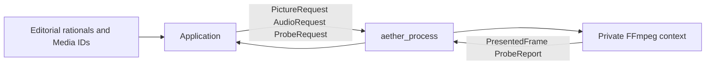

# FFmpeg integration architecture

Status: authoritative integration specification for the direction in ADR-001 (**ACCEPTED WITH CONDITIONS**). No processing code is authorised by this file. The build baseline is `docs/technology/FFMPEG_DEVELOPMENT_CONFIGURATION.md`. Library integration is **BLOCKED** (`docs/validation/FFMPEG_LIBRARY_INTEGRATION_VALIDATION.md`). This file does not choose a licence and it does not mark a codec available.

FFmpeg is the mandatory core media framework. GStreamer is not a mandatory dependency. The approved dynamic link, inside the Media Engine only, is `libavutil`, `libavcodec`, `libavformat`, `libswscale`, and `libswresample`. `libavfilter` is not approved.

Behaviour spec this integration is measured against: `docs/NATIVE_MEDIA_ARCHITECTURE.md`. That document is the FFmpeg study and the native profile proposal. Container targets live in `docs/MXF_CONTAINER_SPECIFICATION.md`. Time authority stays `docs/TIMEBASE_AND_FRAME_ACCURACY.md` and `docs/AUDIO_TIMEBASE_AND_SYNC.md`. The module boundary stays `docs/ENGINEERING_INTERFACES.md`.

## 1. What is inside the framework, and what is not

The Media Engine (`aether_process`) links these shared libraries and no others from the FFmpeg set. This list is the accepted direction, still conditional on a real link and on counsel:

| Library | Job at the boundary | Editorial use |
| --- | --- | --- |
| `libavformat` | Demux and mux. Operational pattern, packets, timecode metadata as reported | None. Patterns and packet durations are evidence |
| `libavcodec` | Decode and encode of picture and PCM | None. A profile name is not a Media ID |
| `libavutil` | Memory, pixel formats, `AVRational` | None. `AVRational` is converted at the boundary and then discarded |
| `libswscale` | Pixel format and scale for a processing request | None. Display rectangles stay in the identity record |
| `libswresample` | Sample format conversion when a request asks for it | None. `sampleIndex` is not a resampler output |

**not recommended** inside the core link:

| Piece | Reason |
| --- | --- |
| `libavfilter` | **Not approved.** Reconsider only when the Effects and Processing architecture requires it. A filter graph is not a second editorial model in the meantime (`docs/11_EFFECTS_AND_COMPOSITING.md`) |
| `libavdevice` | Device clocks and DeckLink belong to a monitoring decision that is still off by default |
| `libavfilter`’s GStreamer-shaped substitutes | GStreamer is not a core candidate. Sound does not take a framework graph as its timeline |
| The `ffmpeg` CLI | Test oracle and developer tool. The application does not shell out for the cut |

**further research:** a later monitoring or import adapter that is not the core framework. It would be a new decision. It is not implied by confirming FFmpeg.

## 2. Integration shape

**Recommended for adoption**, **subject to prototype**:



- C API, dynamic link, handles opaque in every header outside `aether_process`.
- No `AVFrame`, `AVPacket`, `AVRational`, `AVCodecContext`, or FFmpeg error code crosses the boundary. Errors become the project’s result codes (`MODULES.md` rule 5: exceptions stay inside a module).
- `AVRational` becomes two integers, reduced, in the project’s `Ratio`. A zero or negative denominator is rejected. Floating-point seconds are not stored and are not computed as the authority on the way in.
- Packet PTS and a framework clock are not the playhead. The playhead is the sequence frame index. `docs/10_PLAYBACK_AND_RENDERING.md` already forbids the playback clock from becoming the playhead. Confirming FFmpeg does not relax that.
- Editorial does not open files and does not include FFmpeg. Media management does not decode. Processing does not push undo and does not classify originals.
- The application is the only joiner. It asks Editorial for slices at frame F, asks Media for locations of those Media IDs, and builds the processing request. A path is not a field on the editorial slice.
- Originals are opened read-only. A transcode is a new file. Export aimed at an original path is refused. That is milestone capability 18, and it is still a proposal.

Decode of a file the user already has and encode of a new file are separate entry points. A successful decode does not enable the matching encoder. Counsel can forbid an encoder while leaving decode in review.

## 3. Capability query

A muxer name, an encoder name, or a library version is not a capability.

A capability row is one tuple, with a validation id:

- operational pattern (OP1a and OP-Atom are different rows)
- codec and profile
- pixel format
- frame rate as N/D
- raster and, where the codec pads, both stored and display rectangles
- audio sample format, sample rate, channel count
- whether the tuple was an encode, a decode, or both

The row is offered only when AETHER’s own suite has passed that tuple on a pinned build, and counsel has not forbidden that encoder. `ffmpeg -muxers` listing `mxf` does not fill the row. The 2026-11-20 CLI run does not fill the row either: it is a command-line measurement, and the 30000/1001 audio tuple failed the `sampleIndex` contract (`docs/validation/FFMPEG_MXF_ROUNDTRIP_TEST.md`).

Until a row exists, the writer stays hidden. Profiles in `docs/NATIVE_MEDIA_ARCHITECTURE.md` stay specified and `not_validated`.

## 4. Time and sync at the boundary

Picture duration is an integer frame count at `rate_n/rate_d`.

Audio duration for a frame span is `sampleIndex(end) - sampleIndex(start)` from `docs/TIMEBASE_AND_FRAME_ACCURACY.md`:

```
sampleIndex(F) = floor(F * sample_rate * rate_d / rate_n)
```

At 24/1 and 48000, that is 2000 samples per frame. The CLI file for 24 frames held 24 packets of 2000.

At 30000/1001 and 48000, the span `[0, 8)` is 12812 samples, in the order 1601, 1602, 1601, 1602, 1602, 1601, 1602, 1601. A span that does not start at frame 0 uses `sampleIndex(end) - sampleIndex(start)` and is not always 12812. The CLI file held 1602, 1601, 1602, 1601, 1602, 1602, 1601, 1602, summing to 12813. A backend that returns that second sequence for `[0, 8)` fails verification. The failure is a property of this FFmpeg mux, not a change to `sampleIndex` (`docs/validation/AUDIO_FRAME_SAMPLE_BOUNDARY_VALIDATION.md`).

Float durations printed by ffprobe (`0.266938`, `0.266933`, `0.266937` on the same file) are display. They are not compared as the authority.

## 5. Identity at the boundary

Probe results fill technical fields on a representation: pattern, codec, rectangles, rate, frame count, sample rate, channel count, timecode label, checksum state. Channel layout was null on every probed file in this run. A count of 2 does not become a stereo map by assumption (`docs/MXF_CONTAINER_SPECIFICATION.md`).

FFmpeg’s material-package UMID, product UID, `company_name`, and `product_name` are location fields. They do not become the Media ID.

## 6. What this shape still leaves open

- The pinned version and the flag set (`docs/technology/FFMPEG_BUILD_AND_DISTRIBUTION.md`).
- Whether `libswresample` is in the first link or is pulled in only when a request needs a format conversion. The recommendation includes it so sample-format conversion is not done with ad hoc code. He can defer the library until the first conversion test.
- Whether AETHER SOUND is a separate library that is allowed to call Processing for decode, or whether the application alone calls Processing. Conflict C6. Either way, sound does not link FFmpeg on its own unless a later ADR says so. This recommendation puts the link only on `aether_process`.
- Colour tagging on decode. Probe code must not invent Rec.709 (`docs/12_COLOUR_MANAGEMENT.md`).

## 7. Prototype boundary

The Foundation Prototype may call media only through this boundary, and only after the link harness has compiled and run. Until `docs/validation/FFMPEG_LIBRARY_INTEGRATION_VALIDATION.md` is no longer **BLOCKED**, inspection and proxy generation stay blocked. Editorial items in `docs/FIRST_IMPLEMENTATION_MILESTONE.md` do not wait on that link. A test double may stand in for probe results. Writing this shape down does not start the prototype.
